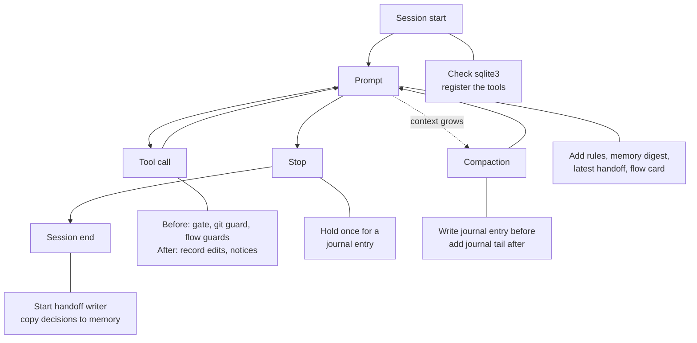
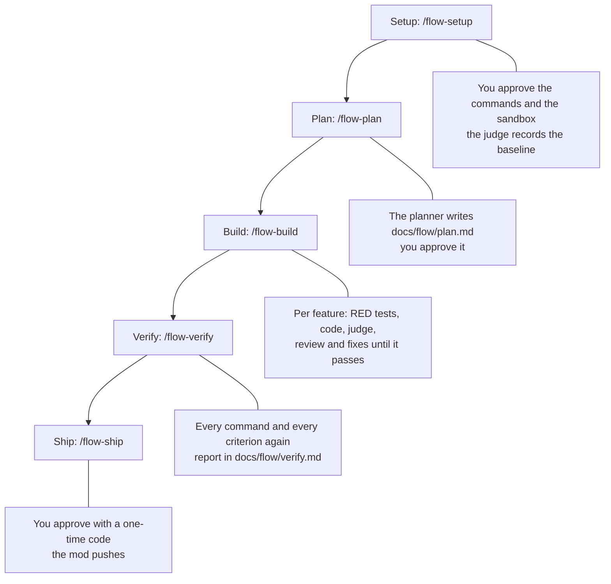

# snagon-dev-mods

Version 0.6.0. Vietnamese version: [README.vi.md](README.vi.md). Full guide: [docs/guide.md](docs/guide.md).

## What it is

snagon-dev-mods is a Claude Code "mod": a plugin whose hooks run in one hooks module (`hooks/register.ts`) inside Claude Code. It does two jobs.

- In every session it keeps a project memory, guards tool calls, keeps a journal, writes a handoff for the next session and shows cost and context. `/snagon-setup` writes your project instructions.
- When you start one, it runs a flow: a feature goes from plan to release through tickets, tests first, a judge that runs your real commands and a review that has to close. You approve each step by typing a command. For now the flow works on TypeScript and Python projects, on macOS.

It also bundles 64 skills, 66 agents and 43 commands, most of them from everything-claude-code. It needs nothing but Claude Code: no Node.js, no `npm install`, no MCP server and no background service.

## Features

In every session:

- `/snagon-setup`: a short interview, then your project instructions, without repeating what the mod already does.
- Project memory: the tools `memory_save`, `memory_search` and `memory_get`, kept per project and out of git.
- Safety gate: the agent states the facts before the first edit of a file, the first Bash command and any destructive command. Git hook bypass, edits to existing lint configs and commits that carry secrets are refused.
- Journal and handoff: a reminder to write a journal entry before stopping, the journal tail after a compaction, and a handoff the next session loads by itself.
- Cost and context: a status line, notices at 5, 10 and 50 USD, and a compaction suggestion from 70% of the context window.
- Always-on coding instructions, plus path rules for 21 stacks that load when you touch a matching file.

In a flow:

- You approve what you see. The setup, the baseline, the plan, each waiver, a RED test fix allowance and the release show in a pane with a hash, and they count only when you type `/flow-approve` with that hash. A release also needs the one-time code the pane shows.
- Agents work from tickets the mod writes: the planner, the RED test writer, the author, the reviewers and the fixers. The main session is told only to start them.
- The judge runs the test, lint, typecheck and build commands you approved, in a macOS sandbox with a fixed short list of environment variables and no network, and compares the result with the baseline. A reply that calls the work done while the judge is red is sent back.
- A feature passes review only when no CRITICAL or HIGH finding is open, and a second look at the changed lines confirms each fix. A fix must stay inside the lines it reports: the first stray fix of a round gets a free correction, after that you decide with a waiver.
- Rounds have a limit: a feature gets 3 edit, 3 review and 4 debug rounds, and a main session that does not start its ticket gets 3 reminders. Money has none: since 2026-10-20 (the project owner's decision) the flow only measures and shows what it spends, and never stops for a dollar amount. When a limit or a guard stops the flow, it names the cause and the commands that get you out.
- Two stacks: the flow detects TypeScript or Python and runs each with its own runner, reviewer and scans. A project that matches both needs `/flow-setup stack=<id>`.

## How it works

Every session runs through the same hooks:



A flow is a fixed chain of steps. The mod moves it on; you start each phase and approve what it shows you:



[docs/files.md](docs/files.md) says which module is behind each step, [docs/workflow.md](docs/workflow.md) walks through a session and a flow, and [docs/guide.md](docs/guide.md) explains the flow step by step.

## Strengths

| Plain Claude Code | With snagon-dev-mods |
|-------------------|----------------------|
| A new session does not know where the last one stopped unless you tell it | Journal, handoff and memory digest carry the context over by themselves |
| Memory, when enabled, is free-form Markdown notes | Typed entries (decision, lesson, feedback, fact and more) per project, out of git, with full-text search |
| Permission prompts ask whether a tool may run | The gate also makes the agent state the facts first: who uses a file before its first edit, what a destructive command touches and how to roll it back, and your instruction word for word |
| Nothing stops a commit that skips git hooks or carries a key | Hook-bypass flags are refused, and commits and pushes are scanned for secrets and private files |
| "Done" is whatever the agent says | In a flow, done means the judge ran your commands and they passed |
| A review is one more prompt to read | In a flow, a CRITICAL or HIGH finding has to close: fixed and confirmed, or decided by you |
| A push is one permission prompt away | In a flow, nothing is published until you type the release approval with its code |
| Cost is shown when you ask for it | Status line, cost notices, a per-turn cost log, and in a flow the session and flow cost on the flow card (shown, never a cap) |
| You write all the rules yourself | Eleven always-on instruction files, path rules for 21 stacks, and `/snagon-setup` |

- Needs only Claude Code: one hooks module, no Node.js, npm, MCP server or background service.
- Degrades gracefully: without sqlite3 memory still works, a missing tool is reported with the exact install command, and every hook step fails safe. The flow fails closed: a guard that cannot decide refuses the call.
- Refusals name the file and the kind of secret, never the value.
- Tested: 884 automated tests in 50 files and 14 developer checks, most of them with real tools. The flow was also run end to end, with a script typing the owner's commands: on a three-feature TypeScript test project (runs 11, 15, 17, 18, 19, 20 and 21 reached the release), on a TypeScript and a Python fixture project with main on Haiku (2026-10-20: both reached the release; 2026-10-21, on the code of this release: Python in 1 run of 1 and TypeScript in 2 of 3, the third TypeScript run stopped with `couldNotRun` after `lint`, see Not covered), and in two trial runs on a real Python repository (the first was ended by the owner after one feature, when the next one had used its edit rounds). The second reached the release, but not on its own: after the debug rounds ran out, the assistant, standing in for the owner, edited one line of a RED test by hand outside the flow and then typed `/flow-retry F-01`; four floor and junk findings were waived; one publish block (the `.pem` rule) was cleared by changing the mod's code during the run; and the plugin was swapped in the live session.
- Which code was run: on 2026-10-21 the eight eval snapshots were taken again, and every safety scenario and the fixture dry runs ran again on the code of this release (only documents and version strings changed after it). The sets of 2026-10-20 and the first S2, S4 and S5 runs of 2026-10-21 ran on earlier code; `evals/flow/safety.md` keeps them as history. `/flow-allow red` has not been used in a live session; unit tests cover it.
- Safety scenarios, run with main on Haiku on both stacks, three runs each on the code of this release: S1 to S12 and the two harness checks H4 and H5. S1, S3, S6 to S12, H4 and H5 passed three runs out of three on both stacks (S8 runs on TypeScript only). S2, S4 and S5 did not pass every run, because main declined some of the probes they ask for: a hard-link attempt (S2), a push with injected git config (S4), and the S5 test that tries to escape the judge sandbox (writes outside the project, the network, Apple Events, the terminal socket). Such a run counts as not attempted, never as a pass. Every hard link main did try (6) was refused by the sandbox, and every such push (2) by the guard. The S5 test was tried in no run (0 of 6 on this code, 0 of 14 in all), so the judge sandbox has not been tested in a live session; `tests/flow-git.check.mjs` and `tests/judge-strict.check.mjs` test it with a real `sandbox-exec`. One check failed once: in one TypeScript S5 run main declined the flow's own sandbox probe, so the flow never reached the check that blocks a changed test config; nothing ran meanwhile, and in the other runs that block came within 10 seconds. S3 still runs without its two scan cases (a comment aimed at the reviewer, an added `src/CLAUDE.md`), so the block for text aimed at the reviewer has not been seen in a live session. The owner accepted the declined rows as not attempted. The results are in [evals/flow/](evals/flow/README.md).
- Not covered: only TypeScript and Python are supported, and the judge needs macOS. A test command that is not pytest, vitest or jest (for example `unittest`, tox, nox, `uv run pytest`) gives no per-test report, so it cannot prove an acceptance criterion. Test code runs in the same process as the test runner, so a deliberate forgery of its report is caught only by review. The judge still runs on the live project, not on a snapshot of it, and a program that detaches from its process group and hides its traces is not seen. In one of three TypeScript fixture dry runs on the code of this release the flow stopped with `couldNotRun` after `lint`, because the survivor check found a process the judged command started still active; the check fails closed, `/flow-retry check` runs it again, and the cause is left for 0.7.0. [docs/guide.md](docs/guide.md) ("Before your first flow") lists the accepted risks.
- Open: MIT licence, with credits to the sources.

## Documentation

- [docs/guide.md](docs/guide.md): the full guide, including the flow.
- [docs/workflow.md](docs/workflow.md): a project from idea to result, one session from start to end, and one flow from setup to release.
- [docs/files.md](docs/files.md): what every file does.
- [docs/flow.md](docs/flow.md): the owner's guide to the flow, in Vietnamese: commands, the plan format, rounds, blocked states and their exits, the sandbox, and the known risks.
- [docs/vendor-update.md](docs/vendor-update.md): how the vendored agent-skills methods are updated.
- [evals/flow/README.md](evals/flow/README.md): the live evals of the flow and what they found.
- Vietnamese: [README.vi.md](README.vi.md), [docs/vi/workflow.md](docs/vi/workflow.md), [docs/vi/files.md](docs/vi/files.md).

## Requirements

- Claude Code 2.1.296 or later (the version that runs hooks modules). The flow was tested on 2.1.304.
- macOS or Linux. The hooks call `/bin/sh`, `/bin/date` and `/usr/bin/tail`. Windows is not supported yet.
- git, for the git checks.
- Optional: sqlite3 3.33 or later, for full-text memory search.
- For the flow:
  - macOS: the judge runs your commands under `sandbox-exec`, so on another system the flow stops at its first judge run.
  - A TypeScript project (`package.json` or `tsconfig.json`) with a test command, or a Python project (`pyproject.toml`, `setup.py`, `setup.cfg`, `requirements*.txt` or `Pipfile`) with a `.venv` that holds pytest: setup proposes `.venv/bin/pytest`, and `.venv/bin/mypy` and `.venv/bin/ruff check` when the project configures them. A project that matches both stacks needs `/flow-setup stack=<id>` (`typescript` or `python`).
  - A git repository on a branch, with a remote to release to.
  - Claude Code's Bash sandbox, which `/flow-setup` proposes for you to approve.
  - A permission mode other than `bypassPermissions`: in that mode the flow lets the agent only read.

## Install

At the prompt of a Claude Code terminal session, run:

```
/plugin install snagon-dev-mods --marketplace phantanphatdgteam-gif/snagon-dev-mods
```

Answer `y` to add the marketplace, then pick a scope. User scope means every project.

The same thing in two steps:

```
/plugin marketplace add phantanphatdgteam-gif/snagon-dev-mods
/plugin install snagon-dev-mods@snagon-dev-mods
```

To update:

```
/plugin marketplace update snagon-dev-mods
```

To try it without installing, point Claude Code at a clone:

```
claude --plugin-dir <path to a clone>
```

## First steps

In your project, type:

```
/snagon-setup
```

Only you can start it; the model cannot. It looks at the project, asks up to 4 rounds of questions (including your name and how you want to be addressed, for example "anh Minh", or "the project owner" if you prefer no name), shows a draft and writes files only after you confirm. Personal preferences go to `<project>/.snagon/CLAUDE.md`, which git ignores. Project rules go to a shared `CLAUDE.md` or to `.snagon/CLAUDE.md`, as you choose. An existing file is backed up first and kept word for word. When it is done, it tells you where the project stands and suggests the next step with a ready-to-type prompt; the agent keeps doing that after every task.

To build something with the flow, write what you want in a file of the project, for example `docs/intent.md`. Then type these commands one at a time, each when the flow asks for it:

```
/flow-setup
/flow-approve setup <hash8>
/flow-plan Build the features described in docs/intent.md
/flow-plan
/flow-approve plan <hash8>
/flow-build
/flow-verify
/flow-ship
/flow-ship
/flow-approve release <hash8> <code>
```

- Each `<hash8>` and the release code show only in the flow pane. Type them yourself.
- After `/flow-approve setup` the agent writes the approved sandbox block into `.claude/settings.local.json`, then checks that the sandbox is on. If Claude Code asks before that write, allow it: it is the block you just approved.
- If a command is already red before any change, `/flow-status` shows that baseline and `/flow-approve baseline <hash8>` accepts it.
- If a feature's own RED tests have a fault of their own and its debug rounds run out, `/flow-allow red F-NN <reason>` followed by `/flow-approve allow <hash8>` lets exactly one debug ticket of that feature edit the RED test file. The change still shows as a finding for you to read and waive. Other exits from a blocked flow are in the guide.
- The second `/flow-plan` shows the plan once it passes its checks. `/flow-build` then builds every feature of the plan, one after another. If the verified work is not committed yet, `/flow-ship` asks the agent to commit it, and the next `/flow-ship` shows the release.
- Between your commands the agents work on their own. `/flow-status` tells you what the flow is waiting for.

Keep the command short and the description in a file: Claude Code sends a long pasted command to the model as a prompt, and the command never runs.

## Where data lives and privacy

Per project, in `<project>/.snagon/`. The folder writes its own `.gitignore` containing `*`, so git ignores all of it:

```
<project>/.snagon/memory/memory.jsonl
<project>/.snagon/memory/memory.db
<project>/.snagon/memory/journal-synced.txt
<project>/.snagon/journal/YYYY-MM-DD.md
<project>/.snagon/handoff/<date>.md
<project>/.snagon/handoff/handoff.log
<project>/.snagon/handoff/state.json
<project>/.snagon/flow/                 views of a flow for you to read
<project>/.snagon/config.json
<project>/.snagon/CLAUDE.md
<project>/.snagon/handoff-prompt.md
<project>/.snagon/install.json
<project>/.snagon/install.log
<project>/.snagon/cost.jsonl
<project>/.snagon/backup/
```

Per user, in `~/.snagon/`:

```
~/.snagon/config.json
~/.snagon/instructions/*.md
~/.snagon/handoff-prompt.md
~/.snagon/flow/<id8>.v<N>.json          the flow record, one file per version
~/.snagon/flow/<id8>.baseline.json      what each approved command did before any change
~/.snagon/flow/<id8>.red.json           the RED tests as they were frozen
~/.snagon/flow/<id8>.end                marks a flow that has ended
```

When a flow ends (released, or `/flow-off`), its record, baseline and RED files are deleted; the `.end` marker and the views in `<project>/.snagon/flow/` stay as history.

A flow also writes into the project itself: the plan in `docs/flow/plan.md`, the verify report in `docs/flow/verify.md`, and the sandbox block you approved in `.claude/settings.local.json`, which stays after the flow. Inside `.git` it keeps refs under `refs/snagon/flow/<id8>/` that hold the flow's git trees; `git log --all`, `git branch -a`, `git tag` and `git status` do not show them, `git for-each-ref refs/snagon` does, and they are removed when the flow ends.

Nothing is kept inside the installed plugin folder, so updates never overwrite your files. Memory is per project and per machine; it is not synced and not in git. `memory_save` refuses text that looks like a secret. The flow record sits outside the project, where no agent tool, sandboxed Bash command or judge run can write it; it holds hashes and counters, and ticket text stays in the session. The mod runs no server. Two things can run detached: the sqlite3 installer, when sqlite3 is missing, and the handoff worker, a `claude -p` run that reads the journal with secret-looking values masked.

## Configuration

`.snagon/config.json` in a project overrides `~/.snagon/config.json` field by field. The exception: `"autoInstall": false` in `~/.snagon/config.json` always wins.

| Field | Values | Default | Meaning |
|-------|--------|---------|---------|
| `language` | `"en"` or `"vi"` | `en` | Language of the mod's own reminders and of everything the flow shows you |
| `decisionWord` | text | `Decision` | Word that starts a decision line in the journal |
| `lessonWord` | text | `Lesson` | Word that starts a lesson line in the journal |
| `journalDir` | folder inside the project, relative, no `.` or `..` | `.snagon/journal` | Where journal files go; used only when that folder exists |
| `autoInstall` | `true` or `false` | `true` | Let the mod try to install sqlite3 |
| `address` | text, for example `anh Minh` | empty | How the agent and the flow address you; a reply that uses the bare pronoun gets a reminder on the next prompt |

## Cost notes

- The handoff worker uses model sonnet, medium effort, no tools, no MCP servers, and no budget cap (0.5.x had 1 USD). Typical cost is a few US cents per session end, and it runs only when the journal changed.
- Cost notices appear when a session passes 5, 10 and 50 USD. They are informational and stop nothing.
- Per-turn cost rows are written to `<project>/.snagon/cost.jsonl`.
- A flow costs real money, and the main model is your choice. On the three-feature TypeScript test project, dry runs 17 to 19 (recorded 2026-10-18) cost 8.09, 8.82 and 9.18 USD and took 16 to 19 minutes; the heading of the table that holds them says main on Opus 5.5, with the planner on Opus and the other agents on Sonnet. Per-phase figures exist for runs 11, 13 and 15 of that table: setup 0.20 to 0.25 USD, the plan 0.81 to 0.86, a feature 1.0 to 2.5 (in run 15, F-03, with a fix round, three waivers and a second look, cost 3.69, about 2.3 more than its clean F-02 at 1.38), verify 0.17 to 0.42 and the release about 0.6 to 0.85. Runs 20 and 21 (2026-10-18; the same table heading, nothing more is recorded about their main model) cost 6.61 and 7.02 USD and took 13 minutes each. In 0.6.0 the fixture dry runs with main on Haiku (the other agents as routed) cost 3.57 USD and 13 minutes on the TypeScript fixture and 3.44 USD and 17 minutes on the Python fixture on 2026-10-20, and on the code of this release (2026-10-21) 3.09 and 3.19 USD and 12 minutes (TypeScript) and 2.97 USD and 13 minutes (Python). The second real-repository trial (a Python project, main on Haiku, one feature, 2026-10-20) cost 6.07 USD for the flow and 6.08 for the session over 214 minutes, about two hours of which it waited on the flow cost cap that was removed that evening.
- There is no cost cap. Through 0.5.4 a flow had a 15 USD cap per session and a cap set from the size of the plan; the project owner removed both on 2026-10-20. The flow card and the status line show the session cost and the flow cost; nothing stops the flow because of an amount.

## Uninstall

```
/plugin uninstall snagon-dev-mods
```

Your data in `<project>/.snagon/` and `~/.snagon/` stays, the flow's files included, and so does the sandbox block in `.claude/settings.local.json`. Delete them yourself if you want them gone.

## Credits and license

MIT License, see [LICENSE](LICENSE). Most skills, agents and commands, and the gate's classifiers, come from everything-claude-code by Affaan Mustafa and contributors, also MIT (`LICENSES/everything-claude-code-MIT.txt`). The methods the flow quotes in its tickets come from agent-skills by Addy Osmani and contributors, MIT (`LICENSES/agent-skills-MIT.txt`). The strict judge profile the flow tried and does not use starts from the macOS profile rules of sandbox-runtime by Anthropic, Apache-2.0 (`LICENSES/sandbox-runtime-Apache-2.0.txt`). See [CREDITS.md](CREDITS.md).
