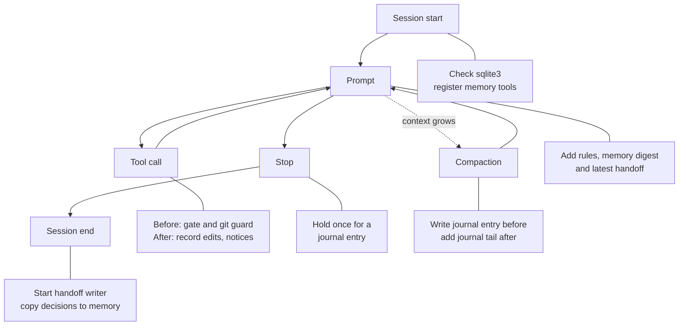

# snagon-dev-mods

Version 0.4.1. Vietnamese version: [README.vi.md](README.vi.md). Full guide: [docs/guide.md](docs/guide.md).

## What it is

snagon-dev-mods is a Claude Code "mod": a plugin whose hooks run in one hooks module (`hooks/register.ts`) inside Claude Code. It adds a per-project memory, a safety gate for tool calls, a session journal, an end-of-session handoff, cost and context notices, and a `/snagon-setup` skill that writes your project instructions. It also bundles 64 skills, 66 agents and 43 commands. It needs no Node.js, no `npm install`, no MCP server and no background service.

## Features

- `/snagon-setup`: a short interview that writes your project instructions without repeating what the mod already does.
- Project memory: the tools `memory_save`, `memory_search` and `memory_get`, kept per project and out of git.
- Safety gate: asks the agent to state facts before the first edit of a file, the first Bash command and destructive commands. Refuses git hook bypass, weakened lint configs and commits that add secrets.
- Session journal with a reminder to write an entry, and a journal tail added after a compaction.
- End-of-session handoff written by a small detached `claude -p` run, loaded by the next session.
- Cost notices, a compaction suggestion and a status line with session cost and context use.
- Always-on coding instructions, plus path rules per language that load when you touch a matching file.
- 64 skills, 66 agents and 43 commands, mostly from everything-claude-code.

## How it works



See [docs/files.md](docs/files.md) for the module behind each step and [docs/workflow.md](docs/workflow.md) for a full session.

## Strengths

| Plain Claude Code | With snagon-dev-mods |
|-------------------|----------------------|
| A new session does not know where the last one stopped unless you tell it | Journal, handoff and memory digest carry context to the next session by themselves |
| Memory, when enabled, is free-form Markdown notes | Typed entries (decision, lesson, feedback, fact and more) per project, out of git, with full-text search |
| Permission prompts ask whether a tool may run | The gate also makes the agent state the facts (files touched, rollback, your instruction) before first edits and destructive commands |
| Nothing stops a commit that skips git hooks or carries a key | Hook-bypass flags are refused, and commits and pushes are scanned for secrets and private files |
| Cost is shown when you ask for it | Status line, cost notices, compaction suggestion, per-turn cost log |
| You write all the rules yourself | Ten always-on instruction files, path rules for 21 stacks, and `/snagon-setup` |

- Needs only Claude Code: one hooks module, no Node.js, npm, MCP server or background service. Works on macOS and Linux.
- Memory is private and searchable: SQLite full-text search with accents ignored, a plain scan as fallback, and secrets refused.
- Refusals name the file and the kind of secret, never the value.
- `/snagon-setup` removes anything the harness or your files already say, and keeps personal preferences out of git.
- Degrades gracefully: without sqlite3 it still works, missing tools are reported with the exact install command, and every hook step fails safe.
- Includes 64 skills, 66 agents and 43 commands for planning, TDD, review, docs, cost and learning.
- Tested and open: 89 automated tests plus real-tool checks, MIT licence, credits to the sources.

## Documentation

- [docs/files.md](docs/files.md): what every file does.
- [docs/workflow.md](docs/workflow.md): a project from idea to result, and one session from start to end.
- [docs/guide.md](docs/guide.md): the full guide.
- [README.vi.md](README.vi.md): Vietnamese README.
- [docs/vi/files.md](docs/vi/files.md) and [docs/vi/workflow.md](docs/vi/workflow.md): the Vietnamese versions of the two pages above.

## Requirements

- Claude Code 2.1.296 or later (the version that runs hooks modules).
- macOS or Linux. The hooks call `/bin/sh`, `/bin/date` and `/usr/bin/tail`. Windows is not supported yet.
- git, for the git checks.
- Optional: sqlite3 3.33 or later, for full-text memory search.

## Install

At the prompt of a Claude Code terminal session, run:

```
/plugin install snagon-dev-mods --marketplace phantanphatdgteam-gif/snagon-dev-mods
```

Answer `y` to add the marketplace, then pick a scope. User scope means every project.

The same thing in two steps:

```
/plugin marketplace add phantanphatdgteam-gif/snagon-dev-mods
/plugin install snagon-dev-mods@snagon-dev-mods
```

To update:

```
/plugin marketplace update snagon-dev-mods
```

To try it without installing, point Claude Code at a clone:

```
claude --plugin-dir <path to a clone>
```

## First steps

In your project, type:

```
/snagon-setup
```

Only you can start it; the model cannot. It looks at the project, asks up to 4 rounds of questions, shows a draft and writes files only after you confirm. Personal preferences go to `<project>/.snagon/CLAUDE.md`, which git ignores. Project rules go to a shared `CLAUDE.md` or to `.snagon/CLAUDE.md`, as you choose. An existing file is backed up first and kept word for word. You can run it again at any time.

## Where data lives and privacy

Per project, in `<project>/.snagon/`. The folder writes its own `.gitignore` containing `*`, so git ignores all of it:

```
<project>/.snagon/memory/memory.jsonl
<project>/.snagon/memory/memory.db
<project>/.snagon/memory/journal-synced.txt
<project>/.snagon/journal/YYYY-MM-DD.md
<project>/.snagon/handoff/<date>.md
<project>/.snagon/handoff/handoff.log
<project>/.snagon/handoff/state.json
<project>/.snagon/config.json
<project>/.snagon/CLAUDE.md
<project>/.snagon/handoff-prompt.md
<project>/.snagon/install.json
<project>/.snagon/install.log
<project>/.snagon/cost.jsonl
<project>/.snagon/backup/
```

Per user, in `~/.snagon/`:

```
~/.snagon/config.json
~/.snagon/instructions/*.md
~/.snagon/handoff-prompt.md
```

Nothing is kept inside the installed plugin folder, so updates never overwrite your files. Memory is per project and per machine; it is not synced and not in git. `memory_save` refuses text that looks like a secret. The mod runs no server. The one detached process is the handoff worker, a `claude -p` run that reads the journal with secret-looking lines removed.

## Configuration

`.snagon/config.json` in a project overrides `~/.snagon/config.json` field by field. The exception: `"autoInstall": false` in `~/.snagon/config.json` always wins.

| Field | Values | Default | Meaning |
|-------|--------|---------|---------|
| `language` | `"en"` or `"vi"` | `en` | Language of the mod's own reminders |
| `decisionWord` | text | `Decision` | Word that starts a decision line in the journal |
| `lessonWord` | text | `Lesson` | Word that starts a lesson line in the journal |
| `journalDir` | folder inside the project, relative, no `.` or `..` | `.snagon/journal` | Where journal files go |
| `autoInstall` | `true` or `false` | `true` | Let the mod try to install sqlite3 |

## Cost notes

- The handoff worker uses model sonnet, medium effort, no tools, no MCP servers, and a budget cap of 1 USD. Typical cost is a few US cents per session end, and it runs only when the journal changed.
- Cost notices appear when a session passes 5, 10 and 50 USD. They are informational.
- Per-turn cost rows are written to `<project>/.snagon/cost.jsonl`.

## Uninstall

```
/plugin uninstall snagon-dev-mods
```

Your data in `<project>/.snagon/` and `~/.snagon/` stays. Delete those folders yourself if you want it gone.

## Credits and license

MIT License, see [LICENSE](LICENSE). Parts come from everything-claude-code by Affaan Mustafa and contributors, also MIT. See [CREDITS.md](CREDITS.md) and `LICENSES/everything-claude-code-MIT.txt`.
