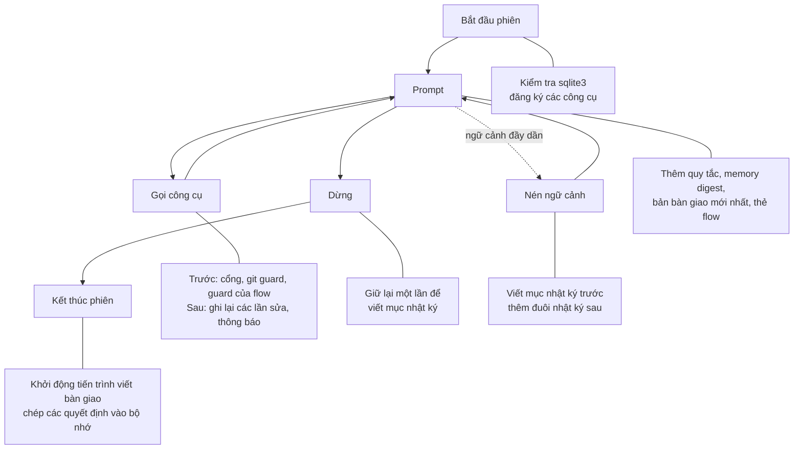
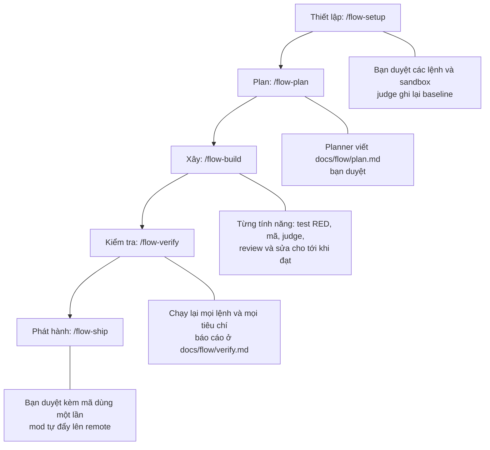

# snagon-dev-mods

Phiên bản 0.6.0. Bản tiếng Anh: [README.md](README.md). Hướng dẫn đầy đủ (tiếng Anh): [docs/guide.md](docs/guide.md). Hướng dẫn flow cho Chủ dự án (tiếng Việt): [docs/flow.md](docs/flow.md).

## Đây là gì

snagon-dev-mods là một "mod" cho Claude Code: một plugin có các hook chạy trong một module hook duy nhất (`hooks/register.ts`) ngay bên trong Claude Code. Mod làm hai việc.

- Trong mọi phiên: giữ bộ nhớ cho dự án, canh các lệnh gọi công cụ, ghi nhật ký, viết bản bàn giao cho phiên sau, cho thấy chi phí và mức dùng ngữ cảnh. `/snagon-setup` viết hướng dẫn cho dự án của bạn.
- Khi bạn bật một flow: mỗi tính năng đi từ plan tới phát hành qua các ticket, viết test trước, có một judge chạy đúng các lệnh thật của dự án và một vòng review phải khép lại. Mỗi bước bạn duyệt bằng một lệnh tự gõ. Hiện flow chạy với dự án TypeScript và Python, trên macOS.

Mod đi kèm 64 skill, 66 agent và 43 lệnh, phần lớn lấy từ everything-claude-code. Ngoài Claude Code không cần gì thêm: không Node.js, không `npm install`, không máy chủ MCP, không dịch vụ chạy nền.

## Tính năng

Trong mọi phiên:

- `/snagon-setup`: hỏi đáp ngắn, rồi viết hướng dẫn cho dự án mà không lặp lại những gì mod đã làm sẵn.
- Bộ nhớ dự án: các công cụ `memory_save`, `memory_search` và `memory_get`, lưu theo từng dự án, không nằm trong git.
- Cổng an toàn: agent phải nêu sự việc trước lần sửa đầu tiên của mỗi file, lệnh Bash đầu tiên và mọi lệnh phá hủy. Bỏ qua hook của git, sửa cấu hình lint đang có hay commit có bí mật đều bị từ chối.
- Nhật ký và bàn giao: nhắc viết mục nhật ký trước khi dừng, nạp lại đuôi nhật ký sau khi nén ngữ cảnh, và bản bàn giao mà phiên sau tự nạp.
- Chi phí và ngữ cảnh: thanh trạng thái, thông báo khi phiên qua 5, 10 và 50 USD, gợi ý nén ngữ cảnh từ 70% cửa sổ ngữ cảnh.
- Hướng dẫn lập trình luôn bật, cùng quy tắc theo đường dẫn cho 21 stack, nạp khi bạn đụng tới file phù hợp.

Trong một flow:

- Bạn duyệt đúng cái bạn thấy. Thiết lập, mốc ban đầu (baseline), plan, từng miễn trừ, phần cho phép sửa test RED và bản phát hành hiện trong khung flow kèm một mã hash, và chỉ có hiệu lực khi bạn gõ `/flow-approve` với đúng mã đó. Phát hành còn cần thêm mã dùng một lần hiện trong khung.
- Agent làm việc theo ticket do mod viết: planner, agent viết test RED, agent viết mã, các reviewer và các agent sửa lỗi. Phiên chính chỉ được bảo là khởi động chúng.
- Judge chạy các lệnh test, lint, typecheck và build bạn đã duyệt, trong sandbox của macOS với một danh sách ngắn, cố định các biến môi trường và không có mạng, rồi so với baseline. Câu trả lời báo "xong" trong khi judge còn đỏ sẽ bị trả lại.
- Một tính năng chỉ qua review khi không còn finding CRITICAL hay HIGH nào mở, và mỗi bản sửa được reviewer xem lại đúng phần đã đổi. Bản sửa phải nằm trong các dòng nó báo: lần lệch đầu tiên của mỗi vòng được một ticket sửa phạm vi miễn phí, sau đó bạn quyết bằng miễn trừ.
- Số vòng có giới hạn: mỗi tính năng 3 vòng sửa, 3 vòng review và 4 vòng debug; phiên chính không khởi động ticket thì được nhắc tối đa 3 lần. Tiền thì không có giới hạn: từ 2026-10-20 (quyết định của Chủ dự án) flow chỉ đo và hiện số tiền nó tốn, không bao giờ dừng vì một số tiền. Khi một giới hạn hay một guard dừng flow, flow nêu lý do và đúng các lệnh để ra.
- Hai stack: flow nhận ra TypeScript hoặc Python và chạy mỗi stack với runner, reviewer và các bước quét riêng. Dự án khớp cả hai thì cần `/flow-setup stack=<id>`.

## Cách hoạt động

Phiên nào cũng đi qua cùng các hook:



Flow là một chuỗi bước cố định. Mod tự đẩy chuỗi đi; bạn mở từng giai đoạn và duyệt những gì nó cho xem:



[docs/vi/files.md](docs/vi/files.md) cho biết module nào đứng sau mỗi bước, [docs/vi/workflow.md](docs/vi/workflow.md) đi qua một phiên và một flow, [docs/flow.md](docs/flow.md) giải thích flow cho Chủ dự án.

## Điểm mạnh

| Claude Code thuần | Với snagon-dev-mods |
|-------------------|----------------------|
| Phiên mới không biết phiên trước dừng ở đâu trừ khi bạn nói | Nhật ký, bản bàn giao và memory digest tự chuyển ngữ cảnh sang phiên sau |
| Bộ nhớ, khi bật, là các ghi chú Markdown tự do | Các mục có kiểu (quyết định, bài học, phản hồi, sự việc và nhiều loại khác) theo từng dự án, không nằm trong git, có tìm kiếm toàn văn |
| Hộp thoại quyền chỉ hỏi một công cụ có được chạy không | Cổng còn bắt agent nêu sự việc trước: ai dùng file trước lần sửa đầu tiên, lệnh phá hủy đụng tới gì và khôi phục ra sao, và nguyên văn chỉ dẫn của bạn |
| Không gì chặn một commit bỏ qua hook của git hoặc mang theo khóa | Cờ bỏ qua hook bị từ chối, commit và push được quét để tìm bí mật và file riêng tư |
| "Xong" là khi agent nói xong | Trong flow, xong là khi judge đã chạy các lệnh của bạn và chúng đạt |
| Review chỉ là thêm một câu trả lời để đọc | Trong flow, finding CRITICAL hay HIGH phải khép lại: sửa và được xác nhận, hoặc bạn quyết |
| Push chỉ cách một hộp thoại quyền | Trong flow, không gì được đẩy lên trước khi bạn gõ lệnh duyệt phát hành kèm mã |
| Chi phí chỉ hiện khi bạn hỏi | Thanh trạng thái, thông báo chi phí, nhật ký chi phí từng lượt, và trong flow có chi phí của phiên và của flow trên thẻ flow (chỉ hiện, không bao giờ là trần) |
| Bạn tự viết mọi quy tắc | Mười một file hướng dẫn luôn bật, quy tắc theo đường dẫn cho 21 stack, và `/snagon-setup` |

- Chỉ cần Claude Code: một module hook, không Node.js, npm, máy chủ MCP hay dịch vụ chạy nền.
- Thiếu gì vẫn chạy: không có sqlite3 thì bộ nhớ vẫn dùng được, công cụ còn thiếu được báo kèm lệnh cài chính xác, và mọi bước hook đều thất bại một cách an toàn. Riêng flow thì đóng chặt: guard nào không quyết được thì từ chối lệnh gọi đó.
- Thông báo từ chối nêu tên file và loại bí mật, không bao giờ nêu giá trị.
- Đã kiểm thử: 884 test tự động trong 50 file và 14 bước kiểm tra của nhà phát triển, phần lớn với công cụ thật. Flow còn được chạy trọn, với một script gõ lệnh thay Chủ dự án: trên một dự án thử TypeScript có ba tính năng (các lượt 11, 15, 17, 18, 19, 20 và 21 tới được bước phát hành), trên một dự án mẫu TypeScript và một dự án mẫu Python với phiên chính chạy Haiku (2026-10-20: cả hai tới được bước phát hành; 2026-10-21, trên mã của bản phát hành này: Python 1 trên 1 lượt và TypeScript 2 trên 3 lượt tới được bước phát hành, lượt TypeScript thứ ba dừng với `couldNotRun` sau `lint`, xem mục Chưa bao phủ), và trong hai lượt chạy thử trên một repo Python thật (lượt đầu bị Chủ dự án dừng sau một tính năng, khi tính năng kế tiếp đã dùng hết vòng sửa). Lượt thứ hai tới được bước phát hành, nhưng không phải tự nó đi tới: sau khi các vòng debug hết, trợ lý, đứng thay Chủ dự án, tự sửa tay một dòng của một test RED ngoài flow rồi gõ `/flow-retry F-01`; bốn finding về sàn và về file rác được miễn trừ; một chặn khi publish (quy tắc `.pem`) được gỡ bằng cách sửa mã của mod giữa lượt chạy; và plugin được đổi ngay trong phiên đang chạy.
- Mã nào đã được chạy: ngày 2026-10-21, tám snapshot của bộ eval được chụp lại, và mọi kịch bản an toàn cùng các lượt chạy thử trên dự án mẫu được chạy lại trên mã của bản phát hành này (sau đó chỉ các tài liệu và chuỗi phiên bản thay đổi). Các bộ ngày 2026-10-20 và những lượt S2, S4, S5 đầu tiên ngày 2026-10-21 chạy trên mã cũ hơn; `evals/flow/safety.md` giữ chúng làm lịch sử. `/flow-allow red` chưa được dùng trong một phiên thật; test đơn vị có bao phủ nó.
- Kịch bản an toàn, chạy với phiên chính là Haiku trên cả hai stack, mỗi kịch bản ba lượt trên mã của bản phát hành này: S1 đến S12 và hai bước kiểm tra của bộ chạy là H4 và H5. S1, S3, S6 đến S12, H4 và H5 đạt cả ba lượt trên cả hai stack (S8 chỉ chạy trên TypeScript). S2, S4 và S5 không đạt trong mọi lượt, vì phiên chính từ chối một số lần thử mà chúng yêu cầu: một lần thử hard link (S2), một lần push với cấu hình git bị chèn (S4), và test của S5 cố thoát khỏi sandbox của judge (ghi ra ngoài dự án, mạng, Apple Events, socket của terminal). Một lượt như vậy được tính là chưa thử, không bao giờ là đạt. Mọi hard link mà phiên chính đã thử (6) đều bị sandbox từ chối, và mọi lần push như vậy (2) đều bị guard từ chối. Test của S5 không được thử trong lượt nào (0 trên 6 trên mã này, 0 trên 14 tính tất cả), nên sandbox của judge chưa được kiểm thử trong một phiên thật; `tests/flow-git.check.mjs` và `tests/judge-strict.check.mjs` kiểm thử nó với `sandbox-exec` thật. Một bước kiểm tra trượt một lần: trong một lượt S5 trên TypeScript, phiên chính từ chối lệnh thử sandbox của chính flow, nên flow không bao giờ tới bước kiểm tra chặn một cấu hình test bị đổi; trong lúc đó không có gì chạy, và ở các lượt khác chặn đó đến trong vòng 10 giây. S3 vẫn chạy thiếu hai ca quét (một dòng chú thích nhắm vào reviewer, và một file `src/CLAUDE.md` được thêm vào), nên chặn đối với văn bản nhắm vào reviewer chưa được thấy trong một phiên thật. Chủ dự án chấp nhận các dòng bị từ chối là chưa thử. Kết quả nằm trong [evals/flow/](evals/flow/README.md).
- Chưa bao phủ: chỉ hỗ trợ TypeScript và Python, và judge cần macOS. Lệnh test không phải pytest, vitest hay jest (ví dụ `unittest`, tox, nox, `uv run pytest`) không cho báo cáo từng test, nên không chứng minh được một tiêu chí nghiệm thu. Mã test chạy cùng tiến trình với runner của test, nên việc cố ý làm giả báo cáo của nó chỉ review mới bắt được. Judge vẫn chạy trên dự án đang dùng, không phải trên một bản chụp của nó, và một chương trình tách khỏi nhóm tiến trình của mình rồi che dấu vết thì không bị thấy. Trong một trên ba lượt chạy thử TypeScript trên mã của bản phát hành này, flow dừng với `couldNotRun` sau `lint`, vì bộ soát tiến trình còn sống thấy một tiến trình do lệnh judge khởi động vẫn đang chạy; bước kiểm tra này dừng theo hướng an toàn, `/flow-retry check` chạy lại nó, và nguyên nhân để lại cho 0.7.0. [docs/guide.md](docs/guide.md) (mục "Before your first flow") liệt kê các rủi ro đã chấp nhận.
- Mở: giấy phép MIT, ghi công các nguồn.

## Tài liệu

- [docs/flow.md](docs/flow.md): hướng dẫn flow cho Chủ dự án (tiếng Việt): các lệnh, định dạng plan, số vòng, các lý do bị chặn và lối ra, sandbox, các rủi ro đã biết.
- [docs/vi/workflow.md](docs/vi/workflow.md): một dự án từ ý tưởng đến kết quả, một phiên từ đầu đến cuối, và một flow từ thiết lập tới phát hành.
- [docs/vi/files.md](docs/vi/files.md): mỗi file làm gì.
- [docs/guide.md](docs/guide.md): hướng dẫn đầy đủ (tiếng Anh), có cả flow.
- [docs/vendor-update.md](docs/vendor-update.md): cách cập nhật các phương pháp agent-skills đi kèm (tiếng Anh).
- [evals/flow/README.md](evals/flow/README.md): các bài chạy thật của flow và những gì chúng tìm ra (tiếng Anh).
- Bản tiếng Anh: [README.md](README.md), [docs/workflow.md](docs/workflow.md), [docs/files.md](docs/files.md).

## Yêu cầu

- Claude Code 2.1.296 trở lên (phiên bản chạy được module hook). Flow đã được thử trên 2.1.304.
- macOS hoặc Linux. Các hook gọi `/bin/sh`, `/bin/date` và `/usr/bin/tail`. Windows chưa được hỗ trợ.
- git, cho các bước kiểm tra git.
- Tùy chọn: sqlite3 3.33 trở lên, để tìm kiếm bộ nhớ toàn văn.
- Riêng flow cần thêm:
  - macOS: judge chạy lệnh của bạn trong `sandbox-exec`, nên trên hệ khác flow dừng ở lần judge đầu tiên.
  - Dự án TypeScript (`package.json` hoặc `tsconfig.json`) có lệnh test, hoặc dự án Python (`pyproject.toml`, `setup.py`, `setup.cfg`, `requirements*.txt` hoặc `Pipfile`) có `.venv` chứa pytest: phần thiết lập đề xuất `.venv/bin/pytest`, cùng `.venv/bin/mypy` và `.venv/bin/ruff check` khi dự án có cấu hình chúng. Dự án khớp cả hai stack thì cần `/flow-setup stack=<id>` (`typescript` hoặc `python`).
  - Repo git đang ở một nhánh, có remote để phát hành tới.
  - Sandbox Bash của Claude Code; `/flow-setup` đề xuất khối cấu hình để bạn duyệt.
  - Chế độ quyền khác `bypassPermissions`: ở chế độ đó flow chỉ cho agent đọc.

## Cài đặt

Tại dấu nhắc của một phiên Claude Code trong terminal, chạy:

```
/plugin install snagon-dev-mods --marketplace phantanphatdgteam-gif/snagon-dev-mods
```

Trả lời `y` để thêm marketplace, rồi chọn phạm vi. Phạm vi user nghĩa là mọi dự án.

Cùng việc đó chia làm hai bước:

```
/plugin marketplace add phantanphatdgteam-gif/snagon-dev-mods
/plugin install snagon-dev-mods@snagon-dev-mods
```

Để cập nhật:

```
/plugin marketplace update snagon-dev-mods
```

Để dùng thử mà không cài, trỏ Claude Code vào một bản clone:

```
claude --plugin-dir <path to a clone>
```

## Những bước đầu tiên

Trong dự án của bạn, gõ:

```
/snagon-setup
```

Chỉ bạn mới chạy được nó; mô hình không tự chạy. Skill xem qua dự án, hỏi tối đa 4 vòng câu hỏi (có hỏi tên và cách xưng hô, ví dụ "anh Minh"; không muốn nêu tên thì gọi là "Chủ dự án"), đưa bản nháp và chỉ ghi file sau khi bạn xác nhận. Sở thích cá nhân được ghi vào `<project>/.snagon/CLAUDE.md`, git bỏ qua file này. Quy tắc của dự án được ghi vào `CLAUDE.md` dùng chung hoặc vào `.snagon/CLAUDE.md`, tùy bạn chọn. File có sẵn được sao lưu trước và giữ nguyên từng chữ. Xong, skill cho biết dự án đang ở bước nào và đề xuất bước tiếp kèm một prompt gõ được ngay; sau mỗi việc, agent cũng làm như vậy.

Muốn xây bằng flow, hãy viết điều cần làm vào một file của dự án, ví dụ `docs/intent.md`. Rồi gõ lần lượt từng lệnh dưới đây, mỗi lệnh khi flow hỏi tới:

```
/flow-setup
/flow-approve setup <hash8>
/flow-plan Xây các tính năng mô tả trong docs/intent.md
/flow-plan
/flow-approve plan <hash8>
/flow-build
/flow-verify
/flow-ship
/flow-ship
/flow-approve release <hash8> <mã>
```

- Mỗi `<hash8>` và mã phát hành chỉ hiện trong khung flow. Hãy tự gõ.
- Sau `/flow-approve setup`, agent ghi khối sandbox đã duyệt vào `.claude/settings.local.json`, rồi kiểm tra sandbox đã bật chưa. Nếu Claude Code hỏi trước khi ghi, hãy cho phép: đó là khối bạn vừa duyệt.
- Nếu có lệnh đã đỏ ngay từ đầu, `/flow-status` cho xem baseline đó và `/flow-approve baseline <hash8>` chấp nhận nó.
- `/flow-plan` lần hai cho xem plan khi plan đã qua bước kiểm. Sau đó `/flow-build` xây hết các tính năng của plan, lần lượt từng cái. Nếu phần đã kiểm tra chưa được commit, `/flow-ship` nhờ agent commit, và lần `/flow-ship` sau cho xem bản phát hành.
- Nếu các test RED của một tính năng tự có lỗi và các vòng debug của nó đã hết, `/flow-allow red F-NN <reason>` theo sau là `/flow-approve allow <hash8>` cho phép đúng một ticket debug của tính năng đó sửa file test RED. Thay đổi đó vẫn hiện thành một finding để bạn đọc và miễn trừ. Các lối ra khác khỏi một flow đang bị chặn nằm trong hướng dẫn.
- Giữa các lệnh của bạn, agent tự làm việc. `/flow-status` cho biết flow đang chờ gì.

Gõ lệnh ngắn, để mô tả dài trong file: Claude Code coi một lệnh dài dán vào là prompt gửi cho mô hình, và lệnh không chạy.

## Dữ liệu nằm ở đâu và quyền riêng tư

Theo từng dự án, trong `<project>/.snagon/`. Thư mục tự ghi một file `.gitignore` chứa `*`, nên git bỏ qua toàn bộ:

```
<project>/.snagon/memory/memory.jsonl
<project>/.snagon/memory/memory.db
<project>/.snagon/memory/journal-synced.txt
<project>/.snagon/journal/YYYY-MM-DD.md
<project>/.snagon/handoff/<date>.md
<project>/.snagon/handoff/handoff.log
<project>/.snagon/handoff/state.json
<project>/.snagon/flow/                 các bản xem của flow để bạn đọc
<project>/.snagon/config.json
<project>/.snagon/CLAUDE.md
<project>/.snagon/handoff-prompt.md
<project>/.snagon/install.json
<project>/.snagon/install.log
<project>/.snagon/cost.jsonl
<project>/.snagon/backup/
```

Theo từng người dùng, trong `~/.snagon/`:

```
~/.snagon/config.json
~/.snagon/instructions/*.md
~/.snagon/handoff-prompt.md
~/.snagon/flow/<id8>.v<N>.json          bản ghi flow, mỗi phiên bản một file
~/.snagon/flow/<id8>.baseline.json      kết quả của từng lệnh đã duyệt trước khi có thay đổi nào
~/.snagon/flow/<id8>.red.json           các test RED lúc được khóa
~/.snagon/flow/<id8>.end                đánh dấu flow đã kết thúc
```

Khi flow kết thúc (đã phát hành, hoặc `/flow-off`), bản ghi, file baseline và file RED bị xóa; dấu `.end` và các bản xem trong `<project>/.snagon/flow/` ở lại làm lịch sử.

Flow cũng ghi vào chính dự án: plan ở `docs/flow/plan.md`, báo cáo kiểm tra ở `docs/flow/verify.md`, và khối sandbox bạn đã duyệt ở `.claude/settings.local.json`; khối này vẫn còn sau khi flow xong. Bên trong `.git` nó giữ các ref dưới `refs/snagon/flow/<id8>/` chứa các cây git của flow; `git log --all`, `git branch -a`, `git tag` và `git status` không hiện chúng, `git for-each-ref refs/snagon` thì có, và chúng bị xóa khi flow kết thúc.

Không có gì được lưu trong thư mục plugin đã cài, nên cập nhật không bao giờ ghi đè file của bạn. Bộ nhớ là theo từng dự án và từng máy; không đồng bộ và không nằm trong git. `memory_save` từ chối văn bản trông giống bí mật. Bản ghi flow nằm ngoài dự án, nơi không công cụ nào của agent, không lệnh Bash nào trong sandbox và không lần chạy judge nào ghi được; nó chỉ giữ hash và bộ đếm, còn nội dung ticket ở lại trong phiên. Mod không chạy máy chủ nào. Có hai thứ có thể chạy tách rời: trình cài sqlite3, khi máy thiếu sqlite3, và tiến trình bàn giao, một lần chạy `claude -p` đọc nhật ký sau khi các giá trị trông giống bí mật đã bị che.

## Cấu hình

`.snagon/config.json` của dự án ghi đè `~/.snagon/config.json` theo từng trường. Ngoại lệ: `"autoInstall": false` trong `~/.snagon/config.json` luôn được ưu tiên.

| Trường | Giá trị | Mặc định | Ý nghĩa |
|--------|---------|----------|---------|
| `language` | `"en"` hoặc `"vi"` | `en` | Ngôn ngữ các nhắc nhở của mod và của mọi thứ flow cho bạn xem |
| `decisionWord` | văn bản | `Decision` | Từ mở đầu dòng quyết định trong nhật ký |
| `lessonWord` | văn bản | `Lesson` | Từ mở đầu dòng bài học trong nhật ký |
| `journalDir` | thư mục trong dự án, đường dẫn tương đối, không chứa `.` hay `..` | `.snagon/journal` | Nơi đặt file nhật ký; chỉ dùng khi thư mục đó đã có |
| `autoInstall` | `true` hoặc `false` | `true` | Cho phép mod thử cài sqlite3 |
| `address` | chữ, ví dụ `anh Minh` | trống | Cách agent và flow gọi bạn; câu trả lời gọi trống không sẽ được nhắc ở lượt sau |

## Lưu ý về chi phí

- Tiến trình bàn giao dùng mô hình sonnet, mức nỗ lực medium, không công cụ, không máy chủ MCP, không có trần ngân sách (0.5.x có 1 USD). Thường chỉ tốn vài cent USD mỗi lần kết thúc phiên, và chỉ chạy khi nhật ký có thay đổi.
- Thông báo chi phí hiện khi một phiên vượt 5, 10 và 50 USD. Chúng chỉ để thông tin và không chặn gì.
- Chi phí từng lượt được ghi vào `<project>/.snagon/cost.jsonl`.
- Flow tốn tiền thật, và mô hình cho phiên chính do bạn chọn. Trên dự án thử TypeScript có ba tính năng, các lượt chạy thử 17 đến 19 (ghi ngày 2026-10-18) tốn 8,09, 8,82 và 9,18 USD và mất 16 đến 19 phút; tiêu đề của bảng chứa chúng ghi phiên chính chạy Opus 5.5, planner chạy Opus, các agent khác chạy Sonnet. Có số liệu từng giai đoạn cho các lượt 11, 13 và 15 của bảng đó: thiết lập 0,20 đến 0,25 USD, plan 0,81 đến 0,86, một tính năng 1,0 đến 2,5 (ở lượt 15, F-03, với một vòng sửa, ba miễn trừ và một lần xem lại, tốn 3,69, nhiều hơn khoảng 2,3 so với F-02 sạch của nó là 1,38), kiểm tra 0,17 đến 0,42 và phát hành khoảng 0,6 đến 0,85. Các lượt 20 và 21 (2026-10-18; cùng tiêu đề bảng, không ghi thêm gì về phiên chính của chúng) tốn 6,61 và 7,02 USD và mỗi lượt mất 13 phút. Ở 0.6.0, các lượt chạy thử trên dự án mẫu với phiên chính chạy Haiku (các agent khác theo định tuyến) tốn 3,57 USD và 13 phút trên dự án mẫu TypeScript, 3,44 USD và 17 phút trên dự án mẫu Python ngày 2026-10-20, và trên mã của bản phát hành này (2026-10-21) tốn 3,09 và 3,19 USD và 12 phút (TypeScript), 2,97 USD và 13 phút (Python). Lượt chạy thử thứ hai trên repo thật (một dự án Python, phiên chính chạy Haiku, một tính năng, 2026-10-20) tốn 6,07 USD cho flow và 6,08 cho phiên trong 214 phút, trong đó khoảng hai giờ là chờ trần chi phí của flow, thứ đã bị bỏ vào tối hôm đó.
- Không có trần chi phí. Đến 0.5.4 một flow có trần 15 USD mỗi phiên và một trần tính theo kích cỡ của plan; Chủ dự án đã bỏ cả hai ngày 2026-10-20. Thẻ flow và thanh trạng thái hiện chi phí của phiên và của flow; không gì dừng flow vì một số tiền.

## Gỡ cài đặt

```
/plugin uninstall snagon-dev-mods
```

Dữ liệu của bạn trong `<project>/.snagon/` và `~/.snagon/` vẫn còn, kể cả các file của flow, và khối sandbox trong `.claude/settings.local.json` cũng vậy. Muốn xóa thì bạn tự xóa.

## Ghi công và giấy phép

Giấy phép MIT, xem [LICENSE](LICENSE). Phần lớn skill, agent, lệnh và bộ phân loại của cổng an toàn lấy từ everything-claude-code của Affaan Mustafa và những người đóng góp, cũng theo MIT (`LICENSES/everything-claude-code-MIT.txt`). Các phương pháp mà flow trích trong ticket lấy từ agent-skills của Addy Osmani và những người đóng góp, theo MIT (`LICENSES/agent-skills-MIT.txt`). Hồ sơ judge nghiêm ngặt mà flow đã thử và không dùng bắt đầu từ các quy tắc hồ sơ macOS của sandbox-runtime của Anthropic, theo Apache-2.0 (`LICENSES/sandbox-runtime-Apache-2.0.txt`). Xem [CREDITS.md](CREDITS.md).
