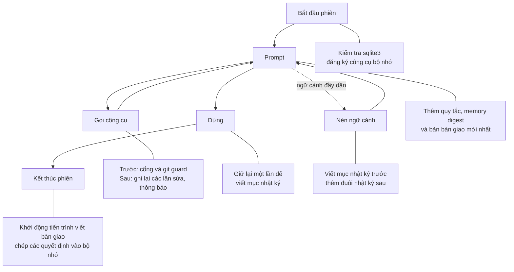

# snagon-dev-mods

Phiên bản 0.5.2. Bản tiếng Anh: [README.md](README.md). Hướng dẫn đầy đủ (tiếng Anh): [docs/guide.md](docs/guide.md).

## Đây là gì

snagon-dev-mods là một "mod" cho Claude Code: một plugin có các hook chạy trong một module hook duy nhất (`hooks/register.ts`) ngay bên trong Claude Code. Mod thêm bộ nhớ theo từng dự án, một cổng an toàn cho các lệnh gọi công cụ, nhật ký phiên làm việc, bản bàn giao cuối phiên, thông báo chi phí và ngữ cảnh, cùng skill `/snagon-setup` để viết hướng dẫn cho dự án của bạn. Mod cũng đi kèm 64 skill, 66 agent và 43 lệnh. Bạn không cần Node.js, không cần `npm install`, không có máy chủ MCP và không có dịch vụ chạy nền.

## Tính năng

- `/snagon-setup`: một buổi hỏi đáp ngắn, rồi viết hướng dẫn cho dự án mà không lặp lại những gì mod đã làm sẵn.
- Bộ nhớ dự án: các công cụ `memory_save`, `memory_search` và `memory_get`, lưu theo từng dự án và không nằm trong git.
- Cổng an toàn: yêu cầu agent nêu sự việc trước lần sửa đầu tiên của mỗi tệp, lệnh Bash đầu tiên và các lệnh phá hủy. Từ chối việc bỏ qua hook của git, việc làm yếu cấu hình lint và các commit làm lộ bí mật.
- Nhật ký phiên, có nhắc viết mục nhật ký, và phần đuôi nhật ký được thêm lại sau khi nén ngữ cảnh.
- Bản bàn giao cuối phiên do một tiến trình `claude -p` nhỏ chạy tách rời viết ra, phiên sau sẽ nạp lại.
- Thông báo chi phí, gợi ý nén ngữ cảnh và thanh trạng thái hiện chi phí phiên cùng mức dùng ngữ cảnh.
- Hướng dẫn lập trình luôn bật, cùng quy tắc theo đường dẫn cho từng ngôn ngữ, nạp khi bạn đụng đến tệp phù hợp.
- 64 skill, 66 agent và 43 lệnh, phần lớn lấy từ everything-claude-code.

## Cách hoạt động



Xem [docs/vi/files.md](docs/vi/files.md) để biết module nào đứng sau mỗi bước và [docs/vi/workflow.md](docs/vi/workflow.md) để xem một phiên đầy đủ.

## Điểm mạnh

| Claude Code thuần | Với snagon-dev-mods |
|-------------------|----------------------|
| Phiên mới không biết phiên trước dừng ở đâu trừ khi bạn nói | Nhật ký, bản bàn giao và memory digest tự chuyển ngữ cảnh sang phiên sau |
| Bộ nhớ, khi bật, là các ghi chú Markdown tự do | Các mục có kiểu (quyết định, bài học, phản hồi, sự việc và nhiều loại khác) theo từng dự án, không nằm trong git, có tìm kiếm toàn văn |
| Hộp thoại quyền hỏi xem một công cụ có được chạy không | Cổng còn bắt agent nêu sự việc (tệp bị đụng đến, cách khôi phục, chỉ dẫn của bạn) trước các lần sửa đầu tiên và các lệnh phá hủy |
| Không gì chặn một commit bỏ qua hook của git hoặc mang theo khóa | Cờ bỏ qua hook bị từ chối, còn commit và push được quét để tìm bí mật và tệp riêng tư |
| Chi phí chỉ hiện khi bạn hỏi | Thanh trạng thái, thông báo chi phí, gợi ý nén ngữ cảnh, nhật ký chi phí từng lượt |
| Bạn tự viết mọi quy tắc | Mười một tệp hướng dẫn luôn bật, quy tắc theo đường dẫn cho 21 stack, và `/snagon-setup` |

- Chỉ cần Claude Code: một module hook, không Node.js, npm, máy chủ MCP hay dịch vụ chạy nền. Chạy trên macOS và Linux.
- Bộ nhớ riêng tư và tìm kiếm được: tìm kiếm toàn văn SQLite bỏ qua dấu, quét thường làm phương án dự phòng, và từ chối bí mật.
- Thông báo từ chối nêu tên tệp và loại bí mật, không bao giờ nêu giá trị.
- `/snagon-setup` loại bỏ mọi điều harness hoặc tệp của bạn đã nói, và giữ sở thích cá nhân ngoài git.
- Suy giảm êm: thiếu sqlite3 vẫn chạy, công cụ còn thiếu được báo kèm lệnh cài chính xác, và mọi bước hook đều thất bại một cách an toàn.
- Gồm 64 skill, 66 agent và 43 lệnh cho lập kế hoạch, TDD, rà soát, tài liệu, chi phí và học hỏi.
- Đã kiểm thử và mở: 97 test tự động cùng các bước kiểm tra với công cụ thật, giấy phép MIT, ghi công các nguồn.

## Tài liệu

- [docs/files.md](docs/files.md): mỗi tệp làm gì.
- [docs/workflow.md](docs/workflow.md): một dự án từ ý tưởng đến kết quả, và một phiên từ đầu đến cuối.
- [docs/guide.md](docs/guide.md): hướng dẫn đầy đủ.
- [docs/flow.md](docs/flow.md): flow — lập plan, build, verify và ship có Chủ dự án duyệt.
- [README.vi.md](README.vi.md): README tiếng Việt.
- [docs/vi/files.md](docs/vi/files.md) và [docs/vi/workflow.md](docs/vi/workflow.md): bản tiếng Việt của hai trang trên.

## Yêu cầu

- Claude Code 2.1.296 trở lên (phiên bản chạy được module hook).
- macOS hoặc Linux. Các hook gọi `/bin/sh`, `/bin/date` và `/usr/bin/tail`. Windows chưa được hỗ trợ.
- git, cho các bước kiểm tra git.
- Tùy chọn: sqlite3 3.33 trở lên, để tìm kiếm bộ nhớ toàn văn.

## Cài đặt

Tại dấu nhắc của một phiên Claude Code trong terminal, chạy:

```
/plugin install snagon-dev-mods --marketplace phantanphatdgteam-gif/snagon-dev-mods
```

Trả lời `y` để thêm marketplace, rồi chọn phạm vi. Phạm vi user nghĩa là mọi dự án.

Cùng việc đó chia làm hai bước:

```
/plugin marketplace add phantanphatdgteam-gif/snagon-dev-mods
/plugin install snagon-dev-mods@snagon-dev-mods
```

Để cập nhật:

```
/plugin marketplace update snagon-dev-mods
```

Để dùng thử mà không cài, trỏ Claude Code vào một bản clone:

```
claude --plugin-dir <path to a clone>
```

## Những bước đầu tiên

Trong dự án của bạn, gõ:

```
/snagon-setup
```

Chỉ bạn mới chạy được nó; mô hình không tự chạy. Skill xem qua dự án, hỏi tối đa 4 vòng câu hỏi (có hỏi tên và cách xưng hô, ví dụ "anh Minh"; không muốn nêu tên thì gọi là "Chủ dự án"), đưa ra bản nháp và chỉ ghi tệp sau khi bạn xác nhận. Sở thích cá nhân được ghi vào `<project>/.snagon/CLAUDE.md`, git bỏ qua tệp này. Quy tắc của dự án được ghi vào `CLAUDE.md` dùng chung hoặc vào `.snagon/CLAUDE.md`, tùy bạn chọn. Tệp có sẵn được sao lưu trước và giữ nguyên từng chữ. Bạn có thể chạy lại bất cứ lúc nào.

## Dữ liệu nằm ở đâu và quyền riêng tư

Theo từng dự án, trong `<project>/.snagon/`. Thư mục tự ghi một tệp `.gitignore` chứa `*`, nên git bỏ qua toàn bộ:

```
<project>/.snagon/memory/memory.jsonl
<project>/.snagon/memory/memory.db
<project>/.snagon/memory/journal-synced.txt
<project>/.snagon/journal/YYYY-MM-DD.md
<project>/.snagon/handoff/<date>.md
<project>/.snagon/handoff/handoff.log
<project>/.snagon/handoff/state.json
<project>/.snagon/config.json
<project>/.snagon/CLAUDE.md
<project>/.snagon/handoff-prompt.md
<project>/.snagon/install.json
<project>/.snagon/install.log
<project>/.snagon/cost.jsonl
<project>/.snagon/backup/
```

Theo từng người dùng, trong `~/.snagon/`:

```
~/.snagon/config.json
~/.snagon/instructions/*.md
~/.snagon/handoff-prompt.md
```

Không có gì được lưu trong thư mục plugin đã cài, nên cập nhật không bao giờ ghi đè tệp của bạn. Bộ nhớ là theo từng dự án và từng máy; không đồng bộ và không nằm trong git. `memory_save` từ chối văn bản trông giống bí mật. Mod không chạy máy chủ nào. Tiến trình tách rời duy nhất là bản bàn giao, một lần chạy `claude -p` đọc nhật ký sau khi đã bỏ các dòng trông giống bí mật.

## Cấu hình

`.snagon/config.json` của dự án ghi đè `~/.snagon/config.json` theo từng trường. Ngoại lệ: `"autoInstall": false` trong `~/.snagon/config.json` luôn được ưu tiên.

| Trường | Giá trị | Mặc định | Ý nghĩa |
|--------|---------|----------|---------|
| `language` | `"en"` hoặc `"vi"` | `en` | Ngôn ngữ các nhắc nhở của chính mod |
| `decisionWord` | văn bản | `Decision` | Từ mở đầu dòng quyết định trong nhật ký |
| `lessonWord` | văn bản | `Lesson` | Từ mở đầu dòng bài học trong nhật ký |
| `journalDir` | thư mục trong dự án, đường dẫn tương đối, không chứa `.` hay `..` | `.snagon/journal` | Nơi đặt tệp nhật ký |
| `autoInstall` | `true` hoặc `false` | `true` | Cho phép mod thử cài sqlite3 |
| `address` | chữ, ví dụ `anh Minh` | trống | Cách agent gọi bạn; câu trả lời gọi trống không sẽ được nhắc ở lượt sau |

## Lưu ý về chi phí

- Tiến trình bàn giao dùng mô hình sonnet, mức nỗ lực medium, không công cụ, không máy chủ MCP, và trần ngân sách 1 USD. Chi phí thường chỉ vài cent USD mỗi lần kết thúc phiên, và chỉ chạy khi nhật ký có thay đổi.
- Thông báo chi phí hiện khi một phiên vượt 5, 10 và 50 USD. Chúng chỉ để thông tin.
- Chi phí từng lượt được ghi vào `<project>/.snagon/cost.jsonl`.

## Gỡ cài đặt

```
/plugin uninstall snagon-dev-mods
```

Dữ liệu của bạn trong `<project>/.snagon/` và `~/.snagon/` vẫn còn. Muốn xóa thì bạn tự xóa các thư mục đó.

## Ghi công và giấy phép

Giấy phép MIT, xem [LICENSE](LICENSE). Một số phần lấy từ everything-claude-code của Affaan Mustafa và những người đóng góp, cũng theo giấy phép MIT. Xem [CREDITS.md](CREDITS.md) và `LICENSES/everything-claude-code-MIT.txt`.
