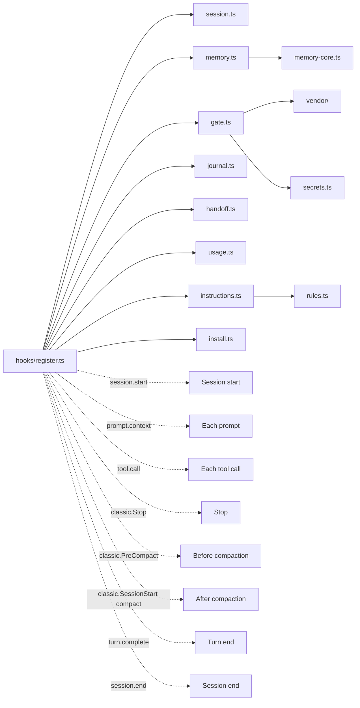

# What every file does

Back to the [README](../README.md). Day-to-day use is in [workflow.md](workflow.md), details in [guide.md](guide.md).

## Repository tree

```text
snagon-dev-mods/
├── .claude-plugin/
│   ├── plugin.json            mod manifest (name, version, links, licence, state contract)
│   ├── marketplace.json       makes the repository a marketplace with one plugin
│   └── types/                 editor types written by Claude Code on load, not in git
├── tsconfig.json              extends those types for `tsc -p .`
├── hooks/
│   ├── hooks.json             tells Claude Code to load ./register.ts
│   ├── register.ts            the only file that talks to Claude Code
│   ├── session.ts             Io adapter, config, session facts, .snagon folder
│   ├── memory-core.ts         pure memory logic
│   ├── memory.ts              memory on real files and sqlite3
│   ├── gate.ts                fact-forcing gate, git guard, lint protection
│   ├── secrets.ts             secret patterns, private paths, diff scan
│   ├── journal.ts             journal files, stop reminder, compaction entry
│   ├── handoff.ts             end-of-session handoff
│   ├── usage.ts               cost and context notices, status line
│   ├── instructions.ts        loads always-on instructions and path rules
│   ├── rules.ts               helpers for instruction files
│   ├── install.ts             sqlite3 check and installer
│   ├── address.ts             counts bare-pronoun replies for the address reminder
│   └── vendor/                shell parsing from everything-claude-code (MIT)
├── types/index.d.ts           session state contract
├── instructions/
│   ├── always/common/         eleven always-on instruction files
│   └── paths/<language>/      path rules for 21 stacks
├── skills/                    64 skills, including snagon-setup
├── agents/                    66 agents
├── commands/                  43 commands
├── tests/                     93 tests and two developer checks
├── docs/                      guide.md, files.md, workflow.md, vi/
├── README.md, README.vi.md    overview in English and Vietnamese
├── CREDITS.md                 credits
├── LICENSE                    MIT
└── LICENSES/                  licence of everything-claude-code
```

## Manifest and marketplace

| File | What it does | When it runs or is read |
|------|--------------|-------------------------|
| `.claude-plugin/plugin.json` | Manifest: name `snagon-dev-mods`, version 0.4.1, description, links, licence, state contract path | When Claude Code loads the mod |
| `.claude-plugin/marketplace.json` | Makes the repository a marketplace with one plugin, source `"./"` | On `/plugin marketplace add` and install |
| `.claude-plugin/types/` | Editor types written by Claude Code; not in git | When the mod loads |
| `tsconfig.json` | Extends those types so `tsc -p .` can check the code | When a developer type-checks |

## Hooks module files

| File | What it does | When it runs or is read |
|------|--------------|-------------------------|
| `hooks/hooks.json` | Tells Claude Code to load the hooks module `./register.ts`. The mod has no other hook and no MCP server | At mod load |
| `hooks/register.ts` | The only file that talks to Claude Code. Registers the three memory tools and hooks the events. Every step is guarded, so a failure never breaks a session; failures go to the debug log once per kind | All events |
| `hooks/session.ts` | Io adapter type (read, write, exists, list, run, now), config defaults, parsing and merging of `~/.snagon/config.json` and `<project>/.snagon/config.json`, session facts (project root, home folder, exempt or not), real local date and time from `date`, the `.snagon` folder with its own `.gitignore`, appending text, a short hash | Used by every other file |
| `hooks/memory-core.ts` | Pure memory logic: entry validation and limits, the seven kinds, control-character cleaning, SQL building with quoting, FTS5 query building, plain-scan search with accent folding, the digest text, decision and lesson lines read from a journal | Called by `memory.ts` |
| `hooks/memory.ts` | Memory on real files and sqlite3: paths under `.snagon/memory`, syncing the SQLite index from the JSONL file (incremental, rebuild when the file shrank), save, search, get, the start digest, the journal import, the three tool definitions | Session start, each prompt, memory tool calls, session end |
| `hooks/gate.ts` | Fact-forcing decisions (first edit or creation of a file, first Bash command, destructive commands; `.snagon/` exempt), git hook-bypass check, git intent (commit, commit -a, commit with paths, staging, push, other repository, wrapped git), secret and private-path scan before commit or push, push reminder, lint and formatter config protection | Before and after each tool call |
| `hooks/secrets.ts` | Secret patterns (private keys, Anthropic, OpenAI, GitHub, AWS, Slack, Google keys, quoted passwords), private paths, diff scan that names file and kind but never the value | Before commit or push, and on `memory_save` |
| `hooks/journal.ts` | Journal folder and files, which edits happened after the last journal entry, stop reminder text, compaction entry, journal tail after a compaction (last 60 lines), shortcut-phrase detector (for example "skip the tests for now") that shows a toast | Stop, compaction |
| `hooks/handoff.ts` | Handoff prompt, redaction of secret-looking lines and private-key blocks, the plan (when the journal changed), the detached worker script, finding the latest handoff for the next session | Session end, each prompt |
| `hooks/usage.ts` | Cost notices at 5, 10 and 50 USD, compaction suggestion from 70% of the context window then every 5 points, status line text, subagent model reminder | After tool calls, turn end |
| `hooks/instructions.ts` | Lists and loads always-on instruction files (the mod's, `~/.snagon/instructions/`, `<project>/.snagon/CLAUDE.md`) and the path rules; picks the rules that match a file being read or edited | Each prompt, after tool calls |
| `hooks/rules.ts` | Pure helpers: strips HTML comments and front matter before loading, reads the `paths:` globs, turns globs into patterns | Called by `instructions.ts` |
| `hooks/install.ts` | Checks for sqlite3 3.33+, background installer (Homebrew, or as root the system package manager; never sudo), exact manual command per package manager, user notice and agent notice | Session start |
| `types/index.d.ts` | Session state contract: appended path rules, edits, gate state, notices, the install notice | Read by the type checker |

## Vendor

Taken unchanged from everything-claude-code (MIT).

| File | What it does | When it runs or is read |
|------|--------------|-------------------------|
| `hooks/vendor/destructive.ts` | Destructive command detection, git subcommand finding, gate messages | Called by `gate.ts` |
| `hooks/vendor/heredoc.ts` | Shell heredoc parsing | Called by the shell scan |
| `hooks/vendor/no-verify.ts` | Detects `--no-verify` and other bypass flags | Called by `gate.ts` |
| `hooks/vendor/shell-scan.ts` | Scans shell command text | Called by `gate.ts` |
| `hooks/vendor/shell-substitution.ts` | Handles shell substitution in commands | Called by the shell scan |

## Instructions

| File | What it does | When it runs or is read |
|------|--------------|-------------------------|
| `instructions/always/common/*.md` | Eleven always-on files: agents, code-review, coding-style, development-workflow, git-workflow, guidance, hooks, patterns, performance, security, testing | Added to the context on every prompt |
| `instructions/paths/<language>/*.md` | Path rules for 21 stacks: angular, arkts, cpp, csharp, dart, fsharp, golang, java, kotlin, nuxt, perl, php, python, react, react-native, ruby, rust, swift, typescript, vue, web. Each file has `paths:` globs | Once per session, when a matching file is read or edited |

## Skills, agents, commands

| File | What it does | When it runs or is read |
|------|--------------|-------------------------|
| `skills/` (64) | Skills, mostly from everything-claude-code with upstream-only parts removed, plus `skills/snagon-setup` | The model picks one when relevant, or you type `/<skill-name>` |
| `agents/` (66) | Agents with their own prompts | Ask for one ("use the planner agent") or the model delegates; full name `snagon-dev-mods:<agent>` |
| `commands/` (43) | Slash commands | You type `/<name>` (`/snagon-dev-mods:<name>` when names clash) |

## Tests

| File | What it does | When it runs or is read |
|------|--------------|-------------------------|
| `tests/*.test.ts` | 93 tests: gate, git intent, secrets, memory core, journal, handoff, usage, config, installer, and the whole module with a simulated Claude Code | `claude plugin test .` |
| `tests/sqlite.check.mjs` | Developer check with real sqlite3 | Run by hand, needs Node.js |
| `tests/install.check.mjs` | Developer check with the real install script | Run by hand, needs Node.js |

## Docs and legal

| File | What it does | When it runs or is read |
|------|--------------|-------------------------|
| `README.md`, `README.vi.md` | Overview in English and Vietnamese | Read by people |
| `docs/guide.md` | Full guide | Read by people |
| `docs/files.md` | This file | Read by people |
| `docs/workflow.md` | Worked examples and tips | Read by people |
| `docs/vi/` | Vietnamese docs | Read by people |
| `CREDITS.md` | Credits | Read by people |
| `LICENSE` | MIT licence | Read by people |
| `LICENSES/everything-claude-code-MIT.txt` | Licence of the upstream project | Read by people |

## How `register.ts` connects the modules



`tool.call` is hooked once for each memory tool and once as a general hook.

## Data folders

Git ignores all of `<project>/.snagon/` through its own `.gitignore` containing `*`.

```text
<project>/.snagon/
├── memory/
│   ├── memory.jsonl          one entry per line, append-only
│   ├── memory.db             SQLite FTS5 index, rebuilt from the JSONL
│   └── journal-synced.txt    journal lines already copied to memory
├── journal/YYYY-MM-DD.md     one journal file per day
├── handoff/
│   ├── <date>.md             the latest handoff
│   ├── prompt-<id>.md        input of the handoff worker
│   ├── handoff.log           worker log
│   └── state.json            handoff state
├── config.json               project config
├── CLAUDE.md                 personal instructions from /snagon-setup
├── handoff-prompt.md         optional extra instructions for the handoff writer
├── install.json              sqlite3 install state
├── install.log               installer log
├── cost.jsonl                one row per turn
└── backup/                   files /snagon-setup replaced

~/.snagon/
├── config.json               defaults for every project
├── instructions/*.md         your own rules for every project
└── handoff-prompt.md         extra instructions for the handoff writer
```
