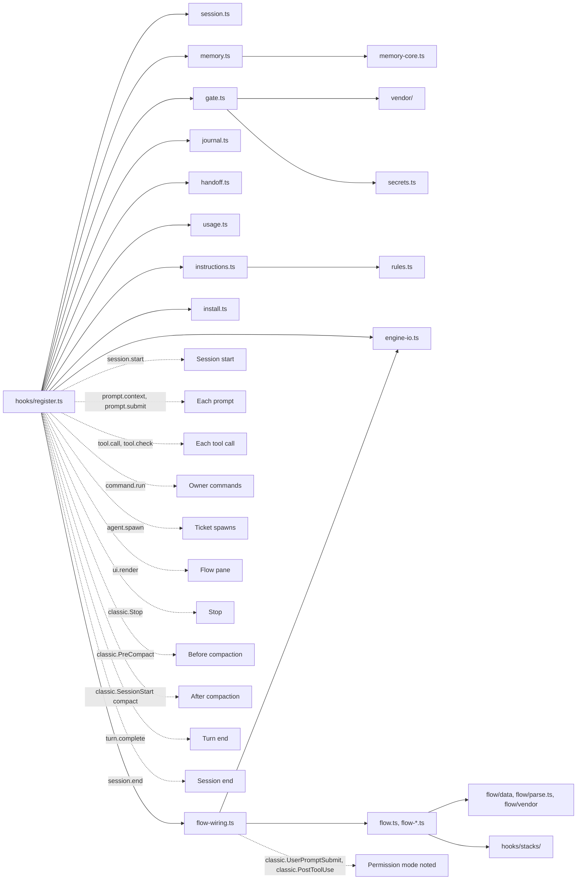

# What every file does

Back to the [README](../README.md). Day-to-day use is in [workflow.md](workflow.md), details in [guide.md](guide.md).

## Repository tree

```text
snagon-dev-mods/
├── .claude-plugin/
│   ├── plugin.json            mod manifest (name, version, links, licence, state contract)
│   ├── marketplace.json       makes the repository a marketplace with one plugin
│   └── types/                 editor types written by Claude Code on load, not in git
├── tsconfig.json              extends those types for `tsc -p .`
├── hooks/
│   ├── hooks.json             tells Claude Code to load ./register.ts
│   ├── register.ts            the only file that talks to Claude Code
│   ├── session.ts             Io adapter, config, session facts, .snagon folder
│   ├── safe-path.ts           the filtered PATH every program the mod starts gets
│   ├── engine-io.ts           helpers shared by register.ts and the flow's wiring (session facts, io, log)
│   ├── memory-core.ts         pure memory logic
│   ├── memory.ts              memory on real files and sqlite3
│   ├── gate.ts                fact-forcing gate, git guard, lint protection
│   ├── git-intent.ts          which git commands a Bash command runs (prefixes, shell syntax, aliases)
│   ├── secrets.ts             secret patterns, private paths, diff scan
│   ├── journal.ts             journal files, stop reminder, compaction entry
│   ├── handoff.ts             end-of-session handoff
│   ├── usage.ts               cost and context notices, status line
│   ├── instructions.ts        loads always-on instructions, the flow rules and path rules
│   ├── rules.ts               helpers for instruction files
│   ├── install.ts             sqlite3 check and installer
│   ├── address.ts             counts bare-pronoun replies for the address reminder
│   ├── flow.ts, flow-*.ts     the flow engine (35 files)
│   ├── stacks/                the code of the two stacks, TypeScript and Python, behind one registry (17 files)
│   └── vendor/                shell parsing from everything-claude-code (MIT)
├── flow/
│   ├── data/                  typed flow data: task chain, caps, routing, stacks, rubrics, Definition of Done, texts
│   ├── parse.ts               reads test runner output
│   ├── junit.ts, toml.ts      strict readers for pytest's JUnit report and for TOML files
│   ├── empty.npmrc            the npm config judged runs use instead of yours
│   └── vendor/                agent-skills methods quoted in tickets (MIT), their lock and the flow's overrides
├── types/index.d.ts           session state contract
├── instructions/
│   ├── always/common/         eleven always-on instruction files
│   └── paths/<language>/      path rules for 21 stacks
├── skills/                    64 skills, plus flow-loop (the flow rules)
├── agents/                    66 agents
├── commands/                  43 commands
├── tests/                     884 tests in 50 files, 14 developer checks, tsc.sh, fixtures
├── evals/flow/                live evals of the flow: runner, scenarios and results
├── docs/                      guide.md, workflow.md, files.md, flow.md, vendor-update.md, vi/
├── README.md, README.vi.md    overview in English and Vietnamese
├── CREDITS.md                 credits
├── LICENSE                    MIT
└── LICENSES/                  licences of everything-claude-code, agent-skills and sandbox-runtime
```

## Manifest and marketplace

| File | What it does | When it runs or is read |
|------|--------------|-------------------------|
| `.claude-plugin/plugin.json` | Manifest: name `snagon-dev-mods`, version 0.5.4, description, links, licence, state contract path | When Claude Code loads the mod |
| `.claude-plugin/marketplace.json` | Makes the repository a marketplace with one plugin, source `"./"` | On `/plugin marketplace add` and install |
| `.claude-plugin/types/` | Editor types written by Claude Code; not in git | When the mod loads |
| `tsconfig.json` | Extends those types so `tsc -p .` can check the code; they are refreshed only when the engine loads the mod, so `tests/tsc.sh` checks against the current ones | When a developer type-checks |

## Hooks module files

| File | What it does | When it runs or is read |
|------|--------------|-------------------------|
| `hooks/hooks.json` | Tells Claude Code to load the hooks module `./register.ts`. The mod has no other hook and no MCP server | At mod load |
| `hooks/register.ts` | The only file that talks to Claude Code. Registers the three memory tools, draws the flow pane, and hooks the events. The two flow tools and the thirteen flow commands are registered through `flow-wiring.ts` (`flowStart`, which `register.ts` calls). Every step is guarded, so a failure never breaks a session; failures go to the debug log once per kind. A flow guard that fails refuses the call instead | All events |
| `hooks/session.ts` | Io adapter type (read, write, exists, list, run, now), config defaults, parsing and merging of `~/.snagon/config.json` and `<project>/.snagon/config.json`, session facts (project root, home folder, exempt or not), real local date and time from `date`, the `.snagon` folder with its own `.gitignore`, appending text, a short hash | Used by every other file |
| `hooks/engine-io.ts` | Helpers `register.ts` and `flow-wiring.ts` share: session facts, the mod's io with the filtered PATH, the one-line-per-kind log, the tool answer shape. Every program the mod starts gets `SHELLOPTS`, `BASHOPTS`, `BASH_ENV`, `ENV` and every `BASH_FUNC_*%%` variable emptied, so the host's shell settings cannot change what a hash or check script does | Session start, every program the mod runs |
| `hooks/memory-core.ts` | Pure memory logic: entry validation and limits, the seven kinds, control-character cleaning, SQL building with quoting, FTS5 query building, plain-scan search with accent folding, the digest text, decision and lesson lines read from a journal | Called by `memory.ts` |
| `hooks/memory.ts` | Memory on real files and sqlite3: paths under `.snagon/memory`, syncing the SQLite index from the JSONL file (incremental, rebuild when the file shrank), save, search, get, the start digest, the journal import, the three tool definitions | Session start, each prompt, memory tool calls, session end |
| `hooks/gate.ts` | Fact-forcing decisions (first edit or creation of a file, first Bash command, destructive commands; `.snagon/` exempt), git hook-bypass check, git intent (commit, commit -a, commit with paths, staging, push, other repository, wrapped git), secret and private-path scan before commit or push (a `.pem` file that holds certificates only may go; one with a key block, in the change or in HEAD, is still refused, and `.key`, `.p12` and `.pfx` are refused by name), push reminder, lint and formatter config protection | Before and after each tool call |
| `hooks/git-intent.ts` | Reads which git commands a Bash command runs: environment prefixes, line breaks, shell syntax, quoted or variable command words, aliases on the command line and in git config (chains, shell aliases), `help.autocorrect`, push sources and tags | Called by `gate.ts` and `register.ts` |
| `hooks/secrets.ts` | Secret patterns (private keys, Anthropic, OpenAI, GitHub, AWS, Slack, Google keys, quoted passwords), private paths (`.pem`, `.key`, `.p12`, `.pfx`; a `.pem` is excused only by its content, see `gate.ts`), diff scan that names file and kind but never the value | Before commit or push, on `memory_save`, and wherever the flow redacts text (tickets, views, the release) |
| `hooks/journal.ts` | Journal folder and files, which edits happened after the last journal entry, stop reminder text, compaction entry, journal tail after a compaction (last 60 lines), shortcut-phrase detector (for example "skip the tests for now") that shows a toast | Stop, compaction |
| `hooks/handoff.ts` | Handoff prompt, the journal masked first (secret-looking values replaced, private-key blocks blanked), the plan (when the journal changed), the detached worker script (a `claude -p` run with no tools and no spend limit), finding the latest handoff for the next session | Session end, each prompt |
| `hooks/usage.ts` | Cost notices at 5, 10 and 50 USD, compaction suggestion from 70% of the context window then every 5 points, status line text, the model and effort reminder on each subagent spawn | After tool calls, turn end |
| `hooks/instructions.ts` | Lists and loads the always-on instruction files (the mod's, the flow rules in `skills/flow-loop/SKILL.md`, `~/.snagon/instructions/`, `<project>/.snagon/CLAUDE.md`) and the path rules; picks the rules that match a file being read or edited | Each prompt, after tool calls |
| `hooks/rules.ts` | Pure helpers: strips HTML comments and front matter before loading, reads the `paths:` globs, turns globs into patterns | Called by `instructions.ts` |
| `hooks/install.ts` | Checks for sqlite3 3.33+, background installer (Homebrew, or as root the system package manager; never sudo), exact manual command per package manager, user notice and agent notice | Session start |
| `hooks/address.ts` | Counts replies that use a bare pronoun instead of your `address`, for the reminder on the next prompt | Stop, next prompt |
| `types/index.d.ts` | Session state contract: appended path rules, edits, gate state, notices, the install notice, address slips, and the flow's state for this session (pending echoes, the settings write window, ticket texts, reviewer details, done claims, reminder counts) | Read by the type checker |

## Flow engine files

The order follows a flow: what every step uses, then setup, plan, build, verify and ship, then the guards.

| File | What it does | When it runs or is read |
|------|--------------|-------------------------|
| `hooks/flow.ts` | The task pointer, the blocked reasons and their exits, the ESCALATE block, the one ordered Stop block, the card (at most 12 lines) and the cost line | Each prompt, each stop, each `flow_check` |
| `hooks/flow-host.ts` | The flow's view of the engine: finds the repository's active flow, keeps this session's flow state, builds the guards' contexts, blocks the flow | Every flow step |
| `hooks/flow-wiring.ts` | The flow's share of the hooks, moved out of `register.ts` unchanged: `register.ts` still registers every hook and calls in here for the flow's part | At mod load, then on every flow event |
| `hooks/flow-state.ts` | The flow record, `~/.snagon/flow/<id8>.v<N>.json`: one file per version, written by compare-and-swap through a hard link; it holds, among other things, the stack frozen at setup and the one RED test fix the owner allowed (`redAllow`); ending a flow deletes it and keeps only the end marker `<id8>.end` | Every record read and write |
| `hooks/flow-turn.ts` | Where the flow stands for this session: the card, the Stop block, what `flow_status` answers, the stall count (3 pushes, then `stalled`) and its reset by your own prompt, the two tool definitions | Each prompt, each stop, `flow_status` |
| `hooks/flow-check.ts` | `flow_check`, main's one call that moves the flow on; it first checks the plugin's files, the sandbox, the command sources, the runner (its whole `.venv` or `node_modules` tree hashed; a changed runner blocks the flow as `tampered`, unless it is a dependency-only change, which re-baselines once) and the kept git trees and other refs against the setup | `flow_check` |
| `hooks/flow-cmd.ts` | The thirteen `/flow-*` commands: origin check, the flow lock for this session, the release code kept off the command line | Each owner command |
| `hooks/flow-owner.ts` | Command parsing and usage lines (`/flow-setup stack=<id>`, `/flow-allow red F-NN <reason>`), the owner origins (the prompt and Remote Control), echoes bound to a hash, approvals, the one-time release code | Owner commands, the pane |
| `hooks/flow-pane.ts` | The flow pane, the one module that reads the release code (at draw time only) | When the pane draws |
| `hooks/flow-spend.ts` | Spend per main turn and the heartbeat that writes it to the record; spend is measured and shown, never capped | Turn end, judge runs, every minute |
| `hooks/flow-setup.ts` | S1: what `/flow-setup` proposes (the stack it finds, or the one you pick with `stack=<id>`, commands, sandbox block, remote and branch), every reason the flow cannot start, the setup echo | `/flow-setup` |
| `hooks/flow-freeze.ts` | S2 and S2b: freezing the approved setup, the one-shot write of the settings file (or your paste), the sandbox probe | `/flow-approve setup`, the probe |
| `hooks/flow-sandbox.ts` | The proposed sandbox block, refusals per settings layer, the effective sandbox, the judge's `sandbox-exec` profile (it may make hard links only inside the project tree and its own run folder); also holds a stricter judge profile written for a trial, which the flow does not use | Setup, each `flow_check` |
| `hooks/flow-baseline.ts` | S3 and S4: every approved command once on the project as it is, the baseline echo, a red baseline accepted as no-new-failures | After the probe, `/flow-approve baseline` |
| `hooks/flow-git.ts` | Git for the flow, hardened (no global config, hooks or replace refs); only the release push keeps your config, after a check | Every git call of the flow |
| `hooks/flow-refs.ts` | Refs under `refs/snagon/flow/<id8>/` that point at the flow's git trees, so `git gc` cannot prune them; every ref except the flow branch, the remote-tracking refs and the flow's own refs is frozen at setup and compared at each `flow_check` and at release | When the record names a new tree, each `flow_check`, release |
| `hooks/flow-tree.ts` | Whole-tree content hashing for runner integrity, one mechanism for every stack. A link is hashed as its text, the real path of its target and the target's content; the hash fails for a link that leads out of the allowed folders (unless it is a pinned interpreter, a package manager's cache or something inside the project), a name or link text with a line break or a tab, anything that is not a file, a folder or a link, and any error of `find`, `stat` or the hash | Setup, before each judged run |
| `hooks/safe-path.ts` | The PATH every program the mod starts gets: entries the agent could write (in the project, a temp folder, a sandbox or settings write place, a package cache) are left out, so a planted `git` or `find` never runs; the setup echo shows the result | Session start, `/flow-setup`, every program the mod runs |
| `hooks/flow-plan.ts` | Parses and lints `docs/flow/plan.md`, hashes it for the approval, keys the features across re-plans | P2, P3 |
| `hooks/flow-planning.ts` | P1 the planner ticket, P2 the lint round trips, P3 the approval that freezes the plan, its files, the rubrics and the routing | `/flow-plan`, `/flow-approve plan` |
| `hooks/flow-build.ts` | B1 and B2: the RED ticket and its checks, the RED freeze, the author ticket, the round caps | `/flow-build`, `flow_check` |
| `hooks/flow-pack.ts` | Feature packs: what a RED, author or debug ticket holds about one feature, redacted and sized to the ticket | Each feature ticket |
| `hooks/flow-method.ts` | The vendored methods, quoted into tickets as text | Each ticket |
| `hooks/flow-ticket.ts` | Tickets: the held text, its hash and nonce in the record, the spawn rewritten to the routed agent and model, attestation of the answer | Agent spawns and answers |
| `hooks/flow-judge.ts` | The judge: approved commands in the judge sandbox, the runner's report, must-pass and no-new-failures, the RED rule, criteria ids in test titles, scope, plugin integrity | Each judge run |
| `hooks/flow-run.ts` | One judged run: a fresh folder, the runner's report, `sandbox-exec`, an empty environment and the frozen PATH; the command leads its own process group | Each judge run |
| `hooks/flow-reap.ts` | Reaping judged runs: after the run the mod ends the command's process group and looks for survivors of the run. Processes that were alive before the run, and the host's own children (Claude Code's `caffeinate`), are left out; a process that leaves its session and clears its environment is not detected | Each judge run |
| `hooks/flow-judging.ts` | B3: the twelve checks at the worktree, debug tickets, the fix-scope check and its correction ticket | `flow_check` at B3 |
| `hooks/flow-scan.ts` | Floor and junk scans over the diff and the untracked files | B3, V4 |
| `hooks/flow-review.ts` | The review protocol: rubrics, fenced tickets, the finding and reply parsers (`FIX`, `DISPUTE`, `REVERT`, verdicts), delta scope, the PASS gate | Review tickets and replies |
| `hooks/flow-reviewing.ts` | B4 and B5: review rounds, fix tickets, delta rounds, rounds asked again, the seal | `flow_check` at B4 |
| `hooks/flow-verify.ts` | V1 to V8: every command at the worktree, the Required criteria, the junk scan, `docs/flow/verify.md` | `/flow-verify`, `flow_check` |
| `hooks/flow-ship.ts` | H0 to H2: the commit check, the release scan, the release echo with a fresh code, the push | `/flow-ship`, `/flow-approve release` |
| `hooks/flow-decide.ts` | `/flow-decide`, `/flow-retry`, `/flow-waive` and `/flow-allow`, and what each changes | Those commands |
| `hooks/flow-guard.ts` | The allow-lists the native sandbox does not cover (agents, tools, paths, git publishing, publish verbs, background runs, screen capture), decided in `tool.check`, fail closed | Every tool call while a flow is active |
| `hooks/flow-live.ts` | The live guard around one call: the verdict before it, the rewrite, the check after it; the one-shot settings write window | Every tool call while a flow is active |
| `hooks/stacks/index.ts` | The stack registry: pairs each stack's data (`flow/data/stacks/<id>.ts`) with its code by id. The core reaches a stack only through it; a flow keeps the stack frozen at setup, and an id this mod does not know blocks the flow, never a guess | Every flow step |
| `hooks/stacks/typescript.ts`, `python.ts` | Each stack's code: thin wrappers over the modules beside them | Through the registry |
| `hooks/stacks/typescript-commands.ts`, `python-commands.ts` | What setup proposes (Python: the venv's `pytest`, `ruff`, `mypy`), the runner a command names, the flags that weaken it, how the judge runs each runner | Setup, each judge run |
| `hooks/stacks/typescript-sources.ts`, `python-sources.ts` | The command sources and the test runner's code, frozen at setup, so a change to what the commands run is caught | Setup, before each judged run |
| `hooks/stacks/python-runner.ts` | Python runner integrity: the `.venv` hashed whole, its interpreter, and what it runs at start (`.pth` files, `sitecustomize`, `pytest11` plugins); refuses venvs that see the system packages or lead outside the project | Setup, before each judged run |
| `hooks/stacks/typescript-lex.ts`, `python-lex.ts` | Light reading of the language (comments, strings, template and f-string forms) for the scans and the judge | Called by them |
| `hooks/stacks/typescript-scan.ts`, `python-scan.ts` | Floor and junk scan rules per stack (skips, early returns, suppressions, lowered coverage, debug leftovers) | B3, V4 |
| `hooks/stacks/typescript-tests.ts`, `python-tests.ts` | Reading test code: test declarations, imports, criteria ids in test names, patterns that force a security review | Each judge run |
| `hooks/stacks/typescript-red.ts`, `python-red.ts` | The RED freeze: a removed, changed or weakened RED test (Python: also a RED name bound again) becomes a finding; a patch of imported code is a mock-after-RED finding | Each judge run after RED |
| `hooks/stacks/python-report.ts` | A judged pytest run's results from its JUnit report, trusted only while pytest's last summary line agrees | Each Python judge run |

## Flow data and vendored methods

| File | What it does | When it runs or is read |
|------|--------------|-------------------------|
| `flow/data/phases.ts` | The task chain S1 to H2 with what each task writes and reads, the blocked reasons, the round caps and what `/flow-retry` adds | Imported by the flow modules |
| `flow/data/routing.ts` | The agent, model, skills and references of each role; the share of changed lines in the stack's own files (70%) from which the stack's reviewer takes a review, and the build fixer for typecheck, build and lint failures; the tools a flow allows | Imported by the flow modules |
| `flow/data/stacks.ts` | The list of stacks the flow knows, in the order setup tries them: TypeScript, then Python | Imported by the flow modules |
| `flow/data/stacks/typescript.ts`, `flow/data/stacks/python.ts` | Each stack's data: how a project is detected and its commands found, runner output forms, what RED accepts, package managers and registries, publish verbs, the patterns that force `Security: yes`, its reviewer and build fixer | Imported by the flow modules |
| `flow/data/common.ts` | Safety data every stack shares: the credential files hidden from Bash and the judge, and the publishing commands the guard denies (the union of every stack's, so a flow on one stack cannot publish with another's tools) | Imported by the flow modules |
| `flow/data/python-shadow.ts` | Module names a Python project file may not take (names the interpreter or pytest puts first on `sys.path`) | Python setup and sources check |
| `flow/data/rubrics.ts` | The severity scale and the frozen review rubrics | Review tickets |
| `flow/data/dod.ts` | The Definition of Done, each row mapped to the check that decides it, or marked as not checked in this release | The verify report |
| `flow/data/templates.ts`, `flow/data/templates-vi.ts` | Every text the flow shows you, in English and Vietnamese, with the same placeholders | Whenever the flow speaks to you |
| `flow/data/types.ts` | Types of the flow data | Read by the type checker |
| `flow/parse.ts` | Reads runner output: colours stripped, one signature per failure, test counts, the error forms RED accepts | Each judge run |
| `flow/junit.ts` | Strict reader of pytest's JUnit XML report; anything outside what pytest writes gives no result, never a pass | Each Python judge run |
| `flow/toml.ts` | Strict TOML reader for `pyproject.toml`, `uv.lock`, `poetry.lock` and tool configs; a file it cannot read counts as a change of what the commands run | Python sources check |
| `flow/empty.npmrc` | The empty npm config judged runs use instead of yours | Each judge run |
| `flow/vendor/agent-skills/` | 14 skills, 3 agents and 7 references from agent-skills (MIT), copied unchanged; tickets quote them as text, Claude Code never loads them | Each ticket |
| `flow/vendor/agent-skills.lock.json` | The pinned upstream commit, the fetch time and the sha256 of every file | `tests/vendor.check.mjs`, updates |
| `flow/vendor/overrides.md` | Where the vendored advice and a flow ticket differ, the ticket's rules win; this file says so in every ticket | Each ticket |

## Vendor

From everything-claude-code 2.2.3 (MIT): turned into ES modules with the Node-only parts removed; the logic is unchanged.

| File | What it does | When it runs or is read |
|------|--------------|-------------------------|
| `hooks/vendor/destructive.ts` | Destructive command detection, git subcommand finding, gate messages | Called by `gate.ts` |
| `hooks/vendor/heredoc.ts` | Shell heredoc parsing | Called by the shell scan |
| `hooks/vendor/no-verify.ts` | Detects `--no-verify` and other bypass flags | Called by `gate.ts` |
| `hooks/vendor/shell-scan.ts` | Scans shell command text | Called by `gate.ts` |
| `hooks/vendor/shell-substitution.ts` | Handles shell substitution in commands | Called by the shell scan |

## Instructions

| File | What it does | When it runs or is read |
|------|--------------|-------------------------|
| `instructions/always/common/*.md` | Eleven always-on files: agents, code-review, coding-style, development-workflow, git-workflow, guidance, hooks, patterns, performance, security, testing | Added to the context on every prompt |
| `instructions/paths/<language>/*.md` | Path rules for 21 stacks: angular, arkts, cpp, csharp, dart, fsharp, golang, java, kotlin, nuxt, perl, php, python, react, react-native, ruby, rust, swift, typescript, vue, web. Each file has `paths:` globs | Once per session (again after a compaction), when a matching file is read or edited |

## Skills, agents, commands

| File | What it does | When it runs or is read |
|------|--------------|-------------------------|
| `skills/` (65) | 64 skills (`snagon-setup` among them), mostly from everything-claude-code with upstream-only parts removed, plus `skills/snagon-setup`; and `skills/flow-loop`, the flow rules (they list the owner commands, `/flow-allow` included), which nobody calls | The model picks a skill when relevant, or you type `/<skill-name>`; the flow rules load with the instructions |
| `agents/` (66) | Agents with their own prompts; the flow routes its tickets to planner, tdd-guide, code-reviewer and security-reviewer, plus each stack's reviewer (typescript-reviewer or python-reviewer) and build fixer (TypeScript: build-error-resolver; Python: tdd-guide) | Ask for one ("use the planner agent") or the model delegates; full name `snagon-dev-mods:<agent>` |
| `commands/` (43) | Slash commands. The thirteen `/flow-*` commands are not here: `flow-wiring.ts` registers them, through `register.ts` | You type `/<name>` (`/snagon-dev-mods:<name>` when names clash) |

## Tests and evals

| File | What it does | When it runs or is read |
|------|--------------|-------------------------|
| `tests/*.test.ts` (50 files, 884 tests) | The harness modules (gate, git intent, secrets, memory core, journal, handoff, usage, config, installer, address), every flow module, both stacks (registry, Python data, lexer, scans, command sources, the JUnit reader), `/flow-allow`, reaping, refs, the reading of a flow record written by 0.5.3, and the whole module with a simulated Claude Code | `claude plugin test .` |
| `tests/flow-drive.ts`, `tests/flow-fakes.ts` | A fake host and a driver that play a project through the flow as the engine would | Imported by the flow tests |
| `tests/fixtures/` | Real runner output and reports (vitest, jest, tsc, eslint, pytest's JUnit XML), TOML cases read back with Python's `tomllib`, and a flow record written by 0.5.3, which the parsers and readers are tested against | Imported by the tests |
| `tests/sqlite.check.mjs`, `tests/install.check.mjs` | Developer checks with real sqlite3 and the real install script | Run by hand, needs Node.js |
| `tests/flow-data.check.mjs`, `tests/flow-code.check.mjs`, `tests/vendor.check.mjs` | Developer checks of the flow data, of who reads the release code and of the stack registry's boundaries (the core reaches a stack only through the registry, no model call where results are judged, no import cycle through the registry), and of the vendored files against their lock | Run by hand, needs Node.js |
| `tests/flow-git.check.mjs`, `tests/flow-judge.check.mjs` | Developer checks with real git and `sandbox-exec` (macOS) | Run by hand, needs Node.js |
| `tests/flow-refs.check.mjs` | Developer check with real git: the flow's trees survive `git gc --prune=now` while their refs exist, and a tree lost anyway is reported as lost | Run by hand, needs Node.js |
| `tests/flow-reap.check.mjs` | Developer check with real processes (harmless `sleep` fixtures): the judged command's process group is ended and a survivor is found | Run by hand, needs Node.js |
| `tests/flow-tree.check.mjs`, `tests/flow-setup.check.mjs` | Developer checks of whole-tree hashing on real trees (links, FIFOs, odd names, a venv with `.pth` files and `pytest11` plugins), of the registry-URL check and of the base interpreter's library hash | Run by hand, needs Node.js |
| `tests/judge-strict.check.mjs` | Developer check of the stricter judge profile under real `sandbox-exec`; the profile is a trial and is not switched on | Run by hand, needs Node.js |
| `tests/no-backdoor.check.mjs` | Developer check that the shipped mod has no test mode or flag the eval harness could use | Run by hand, needs Node.js |
| `tests/safe-path.check.mjs` | Developer check that programs planted first on the PATH never run with the filtered PATH | Run by hand, needs Node.js |
| `tests/tsc.sh` | Type-checks the mod against the engine's API file with a tsconfig outside the mod: `sh tests/tsc.sh <claude-code.d.ts>` | Run by hand, needs `tsc` |
| `evals/flow/run.sh`, `pty-drive.sh`, `scenarios.sh`, `scenarios-main.sh`, `metrics.mjs` | The live evals: a real session over a fixture project (TypeScript or Python), a script typing the owner's commands, the scenarios (`scenarios-main.sh`: the steps that need a scripted main session) and the measurements | Run by hand; they cost real money |
| `evals/flow/calls.mjs`, `fake-mcp.mjs`, `plugin-hash.mjs`, `repo-state.sh` | Helpers of the scenarios: print a session's tool calls (so a scenario can tell refused, ran or not attempted); a stand-in GitHub MCP server that leaves a marker file if its tool ever runs; the plugin integrity hash a flow freezes; the repository's state (HEAD, refs, stash, status) before and after a trial | Run by the evals |
| `evals/flow/README.md`, `dry-run.md`, `safety.md`, `happy-path.md` | How the evals run, what each checks, and what they found | Read by people |
| `evals/flow/tu-kiem-tra.md` | The owner's guide, in Vietnamese, to checking the flow's guards by hand | Read by people |

## Docs and legal

| File | What it does | When it runs or is read |
|------|--------------|-------------------------|
| `README.md`, `README.vi.md` | Overview in English and Vietnamese | Read by people |
| `docs/guide.md` | Full guide | Read by people |
| `docs/files.md` | This file | Read by people |
| `docs/workflow.md` | Worked examples and tips | Read by people |
| `docs/flow.md` | The owner's guide to the flow, in Vietnamese | Read by people; the plan check's error text points to it |
| `docs/vendor-update.md` | How the vendored agent-skills methods are updated | Read by people; `tests/vendor.check.mjs` checks it |
| `docs/vi/` | Vietnamese versions of `files.md` and `workflow.md` | Read by people |
| `.github/workflows/claude.yml`, `claude-code-review.yml` | GitHub Actions of the published repository: Claude Code answers an `@claude` mention in an issue or pull request, and reviews each pull request. They exist only in the public repository and are not synced from the lab | On GitHub, on issue and pull request events |
| `CREDITS.md` | Credits | Read by people |
| `LICENSE` | MIT licence | Read by people |
| `LICENSES/everything-claude-code-MIT.txt`, `LICENSES/agent-skills-MIT.txt`, `LICENSES/sandbox-runtime-Apache-2.0.txt` | Licences of the upstream projects | Read by people |

## How `register.ts` connects the modules



`tool.call` is hooked once for each of the five tools (three for memory, two for the flow) and once as a general hook.

## Data folders

Git ignores all of `<project>/.snagon/` through its own `.gitignore` containing `*`.

```text
<project>/.snagon/
├── memory/
│   ├── memory.jsonl          one entry per line, append-only
│   ├── memory.db             SQLite FTS5 index, rebuilt from the JSONL
│   └── journal-synced.txt    journal lines already copied to memory
├── journal/YYYY-MM-DD.md     one journal file per day
├── handoff/
│   ├── <date>.md             the latest handoff
│   ├── prompt-<id>.md        input of the handoff worker
│   ├── handoff.log           worker log
│   └── state.json            handoff state
├── flow/
│   ├── setup-draft.md        the setup the pane showed
│   ├── boundary-S3.md        the baseline echo
│   ├── boundary-P2.md        the plan echo
│   ├── waivers.md            your waivers (and `/flow-allow` approvals) and their reasons
│   └── F-NN.json             a sealed feature
├── config.json               project config
├── CLAUDE.md                 personal instructions from /snagon-setup
├── handoff-prompt.md         optional extra instructions for the handoff writer
├── install.json              sqlite3 install state
├── install.log               installer log
├── cost.jsonl                one row per turn
└── backup/                   files /snagon-setup replaced

<project>/docs/flow/          part of your project, committed with the release
├── plan.md                   the plan the planner wrote and you approved
└── verify.md                 the verify report

~/.snagon/
├── config.json               defaults for every project
├── instructions/*.md         your own rules for every project
├── handoff-prompt.md         extra instructions for the handoff writer
└── flow/                     record, baseline and RED files are deleted when the flow ends
    ├── <id8>.v<N>.json       the flow record, one file per version, outside every project
    ├── <id8>.baseline.json   what each approved command did before any change
    ├── <id8>.red.json        the RED tests as they were frozen
    └── <id8>.end             marks a flow that has ended, kept for good
```

While a flow runs it also keeps refs inside the project's own `.git`, under `refs/snagon/flow/<id8>/`: they hold the flow's git trees so `git gc` cannot prune them, and they are deleted when the flow ends (if that fails, the end message says how to list them and how to remove one by hand, or what to look at first). Plain `git log`, `git branch -a`, `git tag` and `git status` do not show them; `git for-each-ref refs/snagon` does. A plain `git clone` or `git push` does not carry them; a `--mirror` clone or push does.
