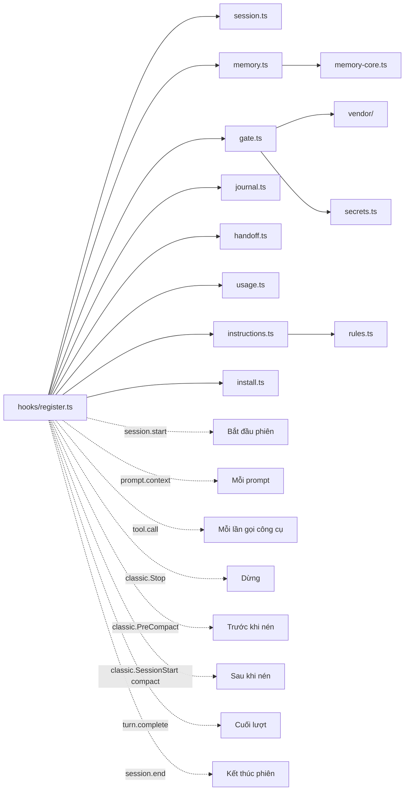

# Mỗi tệp làm gì

Quay lại [README](../../README.vi.md). Cách dùng hằng ngày nằm trong [workflow.md](workflow.md), chi tiết trong [guide.md](../guide.md).

## Cây thư mục của repository

```text
snagon-dev-mods/
├── .claude-plugin/
│   ├── plugin.json            mod manifest (name, version, links, licence, state contract)
│   ├── marketplace.json       makes the repository a marketplace with one plugin
│   └── types/                 editor types written by Claude Code on load, not in git
├── tsconfig.json              extends those types for `tsc -p .`
├── hooks/
│   ├── hooks.json             tells Claude Code to load ./register.ts
│   ├── register.ts            the only file that talks to Claude Code
│   ├── session.ts             Io adapter, config, session facts, .snagon folder
│   ├── memory-core.ts         pure memory logic
│   ├── memory.ts              memory on real files and sqlite3
│   ├── gate.ts                fact-forcing gate, git guard, lint protection
│   ├── secrets.ts             secret patterns, private paths, diff scan
│   ├── journal.ts             journal files, stop reminder, compaction entry
│   ├── handoff.ts             end-of-session handoff
│   ├── usage.ts               cost and context notices, status line
│   ├── instructions.ts        loads always-on instructions and path rules
│   ├── rules.ts               helpers for instruction files
│   ├── install.ts             sqlite3 check and installer
│   ├── address.ts             counts bare-pronoun replies for the address reminder
│   └── vendor/                shell parsing from everything-claude-code (MIT)
├── types/index.d.ts           session state contract
├── instructions/
│   ├── always/common/         eleven always-on instruction files
│   └── paths/<language>/      path rules for 21 stacks
├── skills/                    64 skills, including snagon-setup
├── agents/                    66 agents
├── commands/                  43 commands
├── tests/                     93 tests and two developer checks
├── docs/                      guide.md, files.md, workflow.md, vi/
├── README.md, README.vi.md    overview in English and Vietnamese
├── CREDITS.md                 credits
├── LICENSE                    MIT
└── LICENSES/                  licence of everything-claude-code
```

## Manifest và marketplace

| Tệp | Làm gì | Chạy hoặc được đọc khi nào |
|------|--------------|-------------------------|
| `.claude-plugin/plugin.json` | Manifest: tên `snagon-dev-mods`, phiên bản 0.4.1, mô tả, liên kết, giấy phép, đường dẫn hợp đồng trạng thái | Khi Claude Code nạp mod |
| `.claude-plugin/marketplace.json` | Biến repository thành một marketplace có một plugin, nguồn `"./"` | Khi `/plugin marketplace add` và khi cài |
| `.claude-plugin/types/` | Kiểu cho trình soạn thảo do Claude Code ghi; không nằm trong git | Khi mod được nạp |
| `tsconfig.json` | Mở rộng các kiểu đó để `tsc -p .` kiểm tra được mã | Khi lập trình viên kiểm tra kiểu |

## Các tệp của module hook

| Tệp | Làm gì | Chạy hoặc được đọc khi nào |
|------|--------------|-------------------------|
| `hooks/hooks.json` | Bảo Claude Code nạp module hook `./register.ts`. Mod không có hook nào khác và không có máy chủ MCP | Khi nạp mod |
| `hooks/register.ts` | Tệp duy nhất giao tiếp với Claude Code. Đăng ký ba công cụ bộ nhớ và gắn hook vào các sự kiện. Mọi bước đều được bao bọc an toàn, nên lỗi không bao giờ làm hỏng phiên; lỗi được ghi vào nhật ký debug một lần cho mỗi loại | Mọi sự kiện |
| `hooks/session.ts` | Kiểu bộ điều hợp Io (read, write, exists, list, run, now), giá trị cấu hình mặc định, phân tích và gộp `~/.snagon/config.json` với `<project>/.snagon/config.json`, thông tin phiên (thư mục gốc dự án, thư mục home, có được miễn hay không), ngày giờ địa phương thật lấy từ `date`, thư mục `.snagon` cùng `.gitignore` riêng, nối thêm văn bản, mã băm ngắn | Mọi tệp khác đều dùng |
| `hooks/memory-core.ts` | Logic bộ nhớ thuần: kiểm tra và giới hạn mục, bảy loại mục, làm sạch ký tự điều khiển, dựng SQL có đặt dấu nháy, dựng truy vấn FTS5, tìm kiếm quét thường có bỏ dấu, văn bản digest, các dòng quyết định và bài học đọc từ nhật ký | `memory.ts` gọi |
| `hooks/memory.ts` | Bộ nhớ trên tệp thật và sqlite3: đường dẫn dưới `.snagon/memory`, đồng bộ chỉ mục SQLite từ tệp JSONL (tăng dần, dựng lại khi tệp nhỏ đi), lưu, tìm, lấy, digest lúc bắt đầu, nhập từ nhật ký, ba định nghĩa công cụ | Bắt đầu phiên, mỗi prompt, các lần gọi công cụ bộ nhớ, kết thúc phiên |
| `hooks/gate.ts` | Quyết định buộc nêu sự việc (lần sửa hoặc tạo tệp đầu tiên, lệnh Bash đầu tiên, lệnh phá hủy; `.snagon/` được miễn), kiểm tra bỏ qua hook của git, ý định git (commit, commit -a, commit kèm đường dẫn, staging, push, repository khác, git được bọc), quét bí mật và đường dẫn riêng tư trước commit hoặc push, nhắc khi push, bảo vệ cấu hình lint và formatter | Trước và sau mỗi lần gọi công cụ |
| `hooks/secrets.ts` | Mẫu bí mật (khóa riêng, khóa Anthropic, OpenAI, GitHub, AWS, Slack, Google, mật khẩu trong dấu nháy), đường dẫn riêng tư, quét diff nêu tên tệp và loại nhưng không bao giờ nêu giá trị | Trước commit hoặc push, và khi `memory_save` |
| `hooks/journal.ts` | Thư mục và tệp nhật ký, những lần sửa nào xảy ra sau mục nhật ký cuối, văn bản nhắc khi dừng, mục nhật ký khi nén ngữ cảnh, phần đuôi nhật ký sau khi nén (60 dòng cuối), bộ phát hiện cụm từ đi tắt (ví dụ "skip the tests for now") để hiện toast | Dừng, nén ngữ cảnh |
| `hooks/handoff.ts` | Prompt bàn giao, che các dòng trông giống bí mật và khối khóa riêng, kế hoạch (khi nhật ký có thay đổi), script tiến trình tách rời, tìm bản bàn giao mới nhất cho phiên sau | Kết thúc phiên, mỗi prompt |
| `hooks/usage.ts` | Thông báo chi phí ở mức 5, 10 và 50 USD, gợi ý nén ngữ cảnh từ 70% cửa sổ ngữ cảnh rồi cứ mỗi 5 điểm, văn bản thanh trạng thái, nhắc về mô hình của subagent | Sau các lần gọi công cụ, cuối lượt |
| `hooks/instructions.ts` | Liệt kê và nạp các tệp hướng dẫn luôn bật (của mod, `~/.snagon/instructions/`, `<project>/.snagon/CLAUDE.md`) và quy tắc theo đường dẫn; chọn quy tắc khớp với tệp đang được đọc hoặc sửa | Mỗi prompt, sau các lần gọi công cụ |
| `hooks/rules.ts` | Hàm hỗ trợ thuần: bỏ chú thích HTML và front matter trước khi nạp, đọc các glob `paths:`, đổi glob thành mẫu | `instructions.ts` gọi |
| `hooks/install.ts` | Kiểm tra sqlite3 3.33+, trình cài đặt chạy nền (Homebrew, hoặc khi là root thì dùng trình quản lý gói của hệ thống; không bao giờ dùng sudo), lệnh thủ công chính xác cho từng trình quản lý gói, thông báo cho người dùng và thông báo cho agent | Bắt đầu phiên |
| `types/index.d.ts` | Hợp đồng trạng thái phiên: quy tắc đường dẫn đã thêm, các lần sửa, trạng thái cổng, thông báo, thông báo cài đặt | Trình kiểm tra kiểu đọc |

## Vendor

Lấy nguyên vẹn từ everything-claude-code (MIT).

| Tệp | Làm gì | Chạy hoặc được đọc khi nào |
|------|--------------|-------------------------|
| `hooks/vendor/destructive.ts` | Phát hiện lệnh phá hủy, tìm lệnh con của git, thông điệp của cổng | `gate.ts` gọi |
| `hooks/vendor/heredoc.ts` | Phân tích heredoc của shell | Bước quét shell gọi |
| `hooks/vendor/no-verify.ts` | Phát hiện `--no-verify` và các cờ bỏ qua khác | `gate.ts` gọi |
| `hooks/vendor/shell-scan.ts` | Quét văn bản lệnh shell | `gate.ts` gọi |
| `hooks/vendor/shell-substitution.ts` | Xử lý phép thế của shell trong lệnh | Bước quét shell gọi |

## Hướng dẫn (instructions)

| Tệp | Làm gì | Chạy hoặc được đọc khi nào |
|------|--------------|-------------------------|
| `instructions/always/common/*.md` | Mười một tệp luôn bật: agents, code-review, coding-style, development-workflow, git-workflow, guidance, hooks, patterns, performance, security, testing | Thêm vào ngữ cảnh ở mỗi prompt |
| `instructions/paths/<language>/*.md` | Quy tắc theo đường dẫn cho 21 stack: angular, arkts, cpp, csharp, dart, fsharp, golang, java, kotlin, nuxt, perl, php, python, react, react-native, ruby, rust, swift, typescript, vue, web. Mỗi tệp có các glob `paths:` | Một lần mỗi phiên, khi một tệp khớp được đọc hoặc sửa |

## Skill, agent, lệnh

| Tệp | Làm gì | Chạy hoặc được đọc khi nào |
|------|--------------|-------------------------|
| `skills/` (64) | Các skill, phần lớn từ everything-claude-code đã bỏ những phần chỉ có ở upstream, cộng với `skills/snagon-setup` | Mô hình chọn một skill khi phù hợp, hoặc bạn gõ `/<skill-name>` |
| `agents/` (66) | Các agent có prompt riêng | Bạn yêu cầu ("use the planner agent") hoặc mô hình tự giao việc; tên đầy đủ `snagon-dev-mods:<agent>` |
| `commands/` (43) | Các lệnh slash | Bạn gõ `/<name>` (`/snagon-dev-mods:<name>` khi tên trùng nhau) |

## Test

| Tệp | Làm gì | Chạy hoặc được đọc khi nào |
|------|--------------|-------------------------|
| `tests/*.test.ts` | 93 test: cổng, ý định git, bí mật, lõi bộ nhớ, nhật ký, bàn giao, chi phí, cấu hình, trình cài đặt, và cả module với một Claude Code giả lập | `claude plugin test .` |
| `tests/sqlite.check.mjs` | Bước kiểm tra cho lập trình viên với sqlite3 thật | Chạy thủ công, cần Node.js |
| `tests/install.check.mjs` | Bước kiểm tra cho lập trình viên với script cài đặt thật | Chạy thủ công, cần Node.js |

## Tài liệu và pháp lý

| Tệp | Làm gì | Chạy hoặc được đọc khi nào |
|------|--------------|-------------------------|
| `README.md`, `README.vi.md` | Tổng quan bằng tiếng Anh và tiếng Việt | Người đọc |
| `docs/guide.md` | Hướng dẫn đầy đủ | Người đọc |
| `docs/files.md` | Tệp này | Người đọc |
| `docs/workflow.md` | Ví dụ minh họa và mẹo | Người đọc |
| `docs/vi/` | Tài liệu tiếng Việt | Người đọc |
| `CREDITS.md` | Ghi công | Người đọc |
| `LICENSE` | Giấy phép MIT | Người đọc |
| `LICENSES/everything-claude-code-MIT.txt` | Giấy phép của dự án upstream | Người đọc |

## `register.ts` kết nối các module như thế nào



`tool.call` được gắn hook một lần cho mỗi công cụ bộ nhớ và một lần như hook chung.

## Thư mục dữ liệu

Git bỏ qua toàn bộ `<project>/.snagon/` nhờ `.gitignore` riêng chứa `*`.

```text
<project>/.snagon/
├── memory/
│   ├── memory.jsonl          one entry per line, append-only
│   ├── memory.db             SQLite FTS5 index, rebuilt from the JSONL
│   └── journal-synced.txt    journal lines already copied to memory
├── journal/YYYY-MM-DD.md     one journal file per day
├── handoff/
│   ├── <date>.md             the latest handoff
│   ├── prompt-<id>.md        input of the handoff worker
│   ├── handoff.log           worker log
│   └── state.json            handoff state
├── config.json               project config
├── CLAUDE.md                 personal instructions from /snagon-setup
├── handoff-prompt.md         optional extra instructions for the handoff writer
├── install.json              sqlite3 install state
├── install.log               installer log
├── cost.jsonl                one row per turn
└── backup/                   files /snagon-setup replaced

~/.snagon/
├── config.json               defaults for every project
├── instructions/*.md         your own rules for every project
└── handoff-prompt.md         extra instructions for the handoff writer
```
