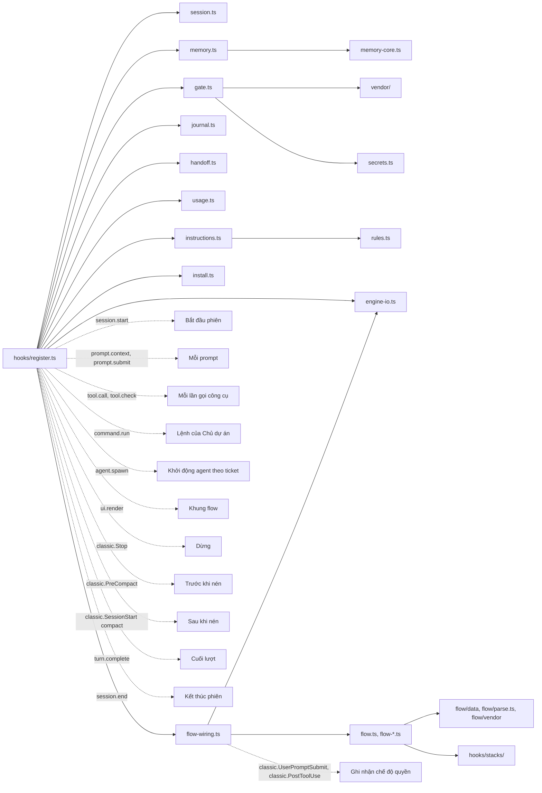

# Mỗi file làm gì

Quay lại [README](../../README.vi.md). Cách dùng hằng ngày nằm trong [workflow.md](workflow.md), chi tiết trong [guide.md](../guide.md) (tiếng Anh) và [flow.md](../flow.md).

## Cây thư mục của repository

```text
snagon-dev-mods/
├── .claude-plugin/
│   ├── plugin.json            manifest của mod (tên, phiên bản, liên kết, giấy phép, hợp đồng trạng thái)
│   ├── marketplace.json       biến repository thành một marketplace có một plugin
│   └── types/                 kiểu cho trình soạn thảo, Claude Code ghi lúc nạp, không nằm trong git
├── tsconfig.json              mở rộng các kiểu đó cho `tsc -p .`
├── hooks/
│   ├── hooks.json             bảo Claude Code nạp ./register.ts
│   ├── register.ts            file duy nhất giao tiếp với Claude Code
│   ├── session.ts             bộ điều hợp Io, cấu hình, thông tin phiên, thư mục .snagon
│   ├── safe-path.ts           PATH đã lọc mà mọi chương trình mod chạy đều nhận
│   ├── engine-io.ts           hàm dùng chung cho register.ts và phần nối dây của flow (thông tin phiên, io, log)
│   ├── memory-core.ts         logic bộ nhớ thuần
│   ├── memory.ts              bộ nhớ trên file thật và sqlite3
│   ├── gate.ts                cổng buộc nêu sự việc, git guard, bảo vệ cấu hình lint
│   ├── git-intent.ts          lệnh git nào mà một lệnh Bash sẽ chạy (tiền tố, cú pháp shell, alias)
│   ├── secrets.ts             mẫu bí mật, đường dẫn riêng tư, quét diff
│   ├── journal.ts             file nhật ký, nhắc khi dừng, mục nhật ký khi nén
│   ├── handoff.ts             bản bàn giao cuối phiên
│   ├── usage.ts               thông báo chi phí và ngữ cảnh, thanh trạng thái
│   ├── instructions.ts        nạp hướng dẫn luôn bật, quy tắc flow và quy tắc theo đường dẫn
│   ├── rules.ts               hàm hỗ trợ cho file hướng dẫn
│   ├── install.ts             kiểm tra và cài sqlite3
│   ├── address.ts             đếm câu trả lời gọi trống không để nhắc cách xưng hô
│   ├── flow.ts, flow-*.ts     bộ máy flow (35 file)
│   ├── stacks/                mã của hai stack, TypeScript và Python, sau một registry (17 file)
│   └── vendor/                phân tích shell lấy từ everything-claude-code (MIT)
├── flow/
│   ├── data/                  dữ liệu flow có kiểu: chuỗi bước, giới hạn vòng, định tuyến, stack, rubric, định nghĩa xong, câu chữ
│   ├── parse.ts               đọc kết quả của test runner
│   ├── junit.ts, toml.ts      bộ đọc nghiêm ngặt cho báo cáo JUnit của pytest và cho file TOML
│   ├── empty.npmrc            cấu hình npm rỗng mà các lần chạy judge dùng thay cho của bạn
│   └── vendor/                phương pháp agent-skills trích trong ticket (MIT), file khóa và phần ghi đè của flow
├── types/index.d.ts           hợp đồng trạng thái phiên
├── instructions/
│   ├── always/common/         mười một file hướng dẫn luôn bật
│   └── paths/<language>/      quy tắc theo đường dẫn cho 21 stack
├── skills/                    64 skill, cùng flow-loop (quy tắc của flow)
├── agents/                    66 agent
├── commands/                  43 lệnh
├── tests/                     884 test trong 50 file, 14 bước kiểm tra cho lập trình viên, tsc.sh, dữ liệu mẫu
├── evals/flow/                các bài chạy thật của flow: script chạy, kịch bản và kết quả
├── docs/                      guide.md, workflow.md, files.md, flow.md, vendor-update.md, vi/
├── README.md, README.vi.md    tổng quan bằng tiếng Anh và tiếng Việt
├── CREDITS.md                 ghi công
├── LICENSE                    MIT
└── LICENSES/                  giấy phép của everything-claude-code, agent-skills và sandbox-runtime
```

## Manifest và marketplace

| File | Làm gì | Chạy hoặc được đọc khi nào |
|------|--------|-----------------------------|
| `.claude-plugin/plugin.json` | Manifest: tên `snagon-dev-mods`, phiên bản 0.5.4, mô tả, liên kết, giấy phép, đường dẫn hợp đồng trạng thái | Khi Claude Code nạp mod |
| `.claude-plugin/marketplace.json` | Biến repository thành một marketplace có một plugin, nguồn `"./"` | Khi `/plugin marketplace add` và khi cài |
| `.claude-plugin/types/` | Kiểu cho trình soạn thảo do Claude Code ghi; không nằm trong git | Khi mod được nạp |
| `tsconfig.json` | Mở rộng các kiểu đó để `tsc -p .` kiểm tra được mã; các kiểu này chỉ được làm mới khi engine nạp mod, nên `tests/tsc.sh` kiểm với bản hiện hành | Khi lập trình viên kiểm tra kiểu |

## Các file của module hook

| File | Làm gì | Chạy hoặc được đọc khi nào |
|------|--------|-----------------------------|
| `hooks/hooks.json` | Bảo Claude Code nạp module hook `./register.ts`. Mod không có hook nào khác và không có máy chủ MCP | Khi nạp mod |
| `hooks/register.ts` | File duy nhất giao tiếp với Claude Code. Đăng ký ba công cụ bộ nhớ, vẽ khung flow, và gắn hook vào các sự kiện. Hai công cụ của flow và mười ba lệnh flow được đăng ký qua `flow-wiring.ts` (`flowStart`, mà `register.ts` gọi). Mọi bước đều được bao bọc an toàn, nên lỗi không bao giờ làm hỏng phiên; lỗi được ghi vào nhật ký debug một lần cho mỗi loại. Riêng guard của flow mà lỗi thì từ chối lệnh gọi | Mọi sự kiện |
| `hooks/session.ts` | Kiểu bộ điều hợp Io (read, write, exists, list, run, now), giá trị cấu hình mặc định, phân tích và gộp `~/.snagon/config.json` với `<project>/.snagon/config.json`, thông tin phiên (thư mục gốc dự án, thư mục home, có được miễn hay không), ngày giờ địa phương thật lấy từ `date`, thư mục `.snagon` cùng `.gitignore` riêng, nối thêm văn bản, mã băm ngắn | Mọi file khác đều dùng |
| `hooks/engine-io.ts` | Hàm `register.ts` và `flow-wiring.ts` dùng chung: thông tin phiên, io của mod với PATH đã lọc, nhật ký mỗi loại một dòng, dạng câu trả lời của công cụ. Mọi chương trình mod chạy đều bị làm rỗng `SHELLOPTS`, `BASHOPTS`, `BASH_ENV`, `ENV` và mọi biến `BASH_FUNC_*%%`, để cài đặt shell của máy chủ không đổi được việc một script băm hay kiểm tra làm | Bắt đầu phiên, mọi chương trình mod chạy |
| `hooks/memory-core.ts` | Logic bộ nhớ thuần: kiểm tra và giới hạn mục, bảy loại mục, làm sạch ký tự điều khiển, dựng SQL có đặt dấu nháy, dựng truy vấn FTS5, tìm kiếm quét thường có bỏ dấu, văn bản digest, các dòng quyết định và bài học đọc từ nhật ký | `memory.ts` gọi |
| `hooks/memory.ts` | Bộ nhớ trên file thật và sqlite3: đường dẫn dưới `.snagon/memory`, đồng bộ chỉ mục SQLite từ file JSONL (tăng dần, dựng lại khi file nhỏ đi), lưu, tìm, lấy, digest lúc bắt đầu, nhập từ nhật ký, ba định nghĩa công cụ | Bắt đầu phiên, mỗi prompt, các lần gọi công cụ bộ nhớ, kết thúc phiên |
| `hooks/gate.ts` | Quyết định buộc nêu sự việc (lần sửa hoặc tạo file đầu tiên, lệnh Bash đầu tiên, lệnh phá hủy; `.snagon/` được miễn), kiểm tra bỏ qua hook của git, ý định git (commit, commit -a, commit kèm đường dẫn, staging, push, repository khác, git được bọc), quét bí mật và đường dẫn riêng tư trước commit hoặc push (một file `.pem` chỉ chứa chứng chỉ thì được đi qua; file có khối khóa, trong thay đổi hay trong HEAD, vẫn bị từ chối, còn `.key`, `.p12` và `.pfx` bị từ chối theo tên), nhắc khi push, bảo vệ cấu hình lint và formatter | Trước và sau mỗi lần gọi công cụ |
| `hooks/git-intent.ts` | Đọc lệnh git mà một lệnh Bash sẽ chạy: biến môi trường đứng trước, xuống dòng, cú pháp shell, tên lệnh trong ngoặc kép hoặc biến, alias trên dòng lệnh và trong cấu hình git (cả chuỗi alias, alias shell), `help.autocorrect`, nguồn và tag được push | `gate.ts` và `register.ts` gọi |
| `hooks/secrets.ts` | Mẫu bí mật (khóa riêng, khóa Anthropic, OpenAI, GitHub, AWS, Slack, Google, mật khẩu trong dấu nháy), đường dẫn riêng tư (`.pem`, `.key`, `.p12`, `.pfx`; một file `.pem` chỉ được miễn theo nội dung của nó, xem `gate.ts`), quét diff nêu tên file và loại nhưng không bao giờ nêu giá trị | Trước commit hoặc push, khi `memory_save`, và ở mọi chỗ flow che chữ (ticket, bản xem, bản phát hành) |
| `hooks/journal.ts` | Thư mục và file nhật ký, những lần sửa nào xảy ra sau mục nhật ký cuối, văn bản nhắc khi dừng, mục nhật ký khi nén ngữ cảnh, phần đuôi nhật ký sau khi nén (60 dòng cuối), bộ phát hiện cụm từ đi tắt (ví dụ "skip the tests for now") để hiện toast | Dừng, nén ngữ cảnh |
| `hooks/handoff.ts` | Prompt bàn giao, che nhật ký trước (thay các giá trị trông giống bí mật, xóa trắng khối khóa riêng), kế hoạch (khi nhật ký có thay đổi), script tiến trình tách rời (một lần chạy `claude -p` không công cụ và không giới hạn chi tiêu), tìm bản bàn giao mới nhất cho phiên sau | Kết thúc phiên, mỗi prompt |
| `hooks/usage.ts` | Thông báo chi phí ở mức 5, 10 và 50 USD, gợi ý nén ngữ cảnh từ 70% cửa sổ ngữ cảnh rồi cứ mỗi 5 điểm, văn bản thanh trạng thái, nhắc về mô hình và mức nỗ lực mỗi lần khởi động subagent | Sau các lần gọi công cụ, cuối lượt |
| `hooks/instructions.ts` | Liệt kê và nạp các file hướng dẫn luôn bật (của mod, quy tắc flow trong `skills/flow-loop/SKILL.md`, `~/.snagon/instructions/`, `<project>/.snagon/CLAUDE.md`) và quy tắc theo đường dẫn; chọn quy tắc khớp với file đang được đọc hoặc sửa | Mỗi prompt, sau các lần gọi công cụ |
| `hooks/rules.ts` | Hàm hỗ trợ thuần: bỏ chú thích HTML và front matter trước khi nạp, đọc các glob `paths:`, đổi glob thành mẫu | `instructions.ts` gọi |
| `hooks/install.ts` | Kiểm tra sqlite3 3.33+, trình cài đặt chạy nền (Homebrew, hoặc khi là root thì dùng trình quản lý gói của hệ thống; không bao giờ dùng sudo), lệnh thủ công chính xác cho từng trình quản lý gói, thông báo cho người dùng và thông báo cho agent | Bắt đầu phiên |
| `hooks/address.ts` | Đếm các câu trả lời gọi trống không thay vì dùng `address` của bạn, để nhắc ở prompt sau | Dừng, prompt sau |
| `types/index.d.ts` | Hợp đồng trạng thái phiên: quy tắc đường dẫn đã thêm, các lần sửa, trạng thái cổng, thông báo, thông báo cài đặt, số lần gọi trống không, và trạng thái flow của phiên này (echo đang chờ duyệt, cửa sổ ghi file cấu hình, nội dung ticket, lời của reviewer, các lần báo xong, số lần nhắc) | Trình kiểm tra kiểu đọc |

## Các file của bộ máy flow

Thứ tự theo một flow: phần mọi bước dùng chung, rồi thiết lập, plan, xây, kiểm tra và phát hành, cuối cùng là các guard.

| File | Làm gì | Chạy hoặc được đọc khi nào |
|------|--------|-----------------------------|
| `hooks/flow.ts` | Con trỏ bước, các lý do bị chặn và lối ra, khối ESCALATE, khối Stop duy nhất có thứ tự, thẻ flow (tối đa 12 dòng) và dòng chi phí | Mỗi prompt, mỗi lần dừng, mỗi `flow_check` |
| `hooks/flow-host.ts` | Cách flow nhìn engine: tìm flow đang chạy của repo, giữ trạng thái flow của phiên, dựng ngữ cảnh cho guard, chặn flow | Mọi bước của flow |
| `hooks/flow-wiring.ts` | Phần của flow trong các hook, chuyển ra khỏi `register.ts` mà không đổi gì: `register.ts` vẫn đăng ký mọi hook và gọi vào đây cho phần của flow | Khi nạp mod, rồi ở mọi sự kiện của flow |
| `hooks/flow-state.ts` | Bản ghi flow `~/.snagon/flow/<id8>.v<N>.json`: mỗi phiên bản một file, ghi kiểu so-rồi-đổi qua hard link; trong đó có, ngoài các thứ khác, stack đã khóa lúc thiết lập và một lần sửa test RED mà Chủ dự án cho phép (`redAllow`); khi flow kết thúc, bản ghi bị xóa, chỉ giữ dấu kết thúc `<id8>.end` | Mỗi lần đọc và ghi bản ghi |
| `hooks/flow-turn.ts` | Flow đang ở đâu với phiên này: thẻ flow, khối Stop, câu trả lời của `flow_status`, bộ đếm nhắc (3 lần, rồi `stalled`) và việc prompt của chính bạn đặt lại nó, hai định nghĩa công cụ | Mỗi prompt, mỗi lần dừng, `flow_status` |
| `hooks/flow-check.ts` | `flow_check`, lệnh gọi duy nhất của main để flow đi tiếp; trước hết so file của plugin, sandbox, nguồn lệnh, runner (cả cây `.venv` hoặc `node_modules` của nó được băm; runner bị đổi thì chặn flow với lý do `tampered`, trừ khi chỉ đổi phụ thuộc, khi đó baseline được dựng lại một lần) và các cây git được giữ cùng các ref khác với bản đã thiết lập | `flow_check` |
| `hooks/flow-cmd.ts` | Mười ba lệnh `/flow-*`: kiểm nguồn gõ, khóa flow cho phiên này, giữ mã phát hành không nằm lại trên dòng lệnh | Mỗi lệnh của Chủ dự án |
| `hooks/flow-owner.ts` | Phân tích lệnh và dòng hướng dẫn cách dùng (`/flow-setup stack=<id>`, `/flow-allow red F-NN <reason>`), các nguồn được tính là Chủ dự án (ô nhập và Remote Control), echo gắn với hash, phép duyệt, mã phát hành dùng một lần | Lệnh của Chủ dự án, khung flow |
| `hooks/flow-pane.ts` | Khung flow, module duy nhất đọc mã phát hành (chỉ lúc vẽ) | Khi khung flow được vẽ |
| `hooks/flow-spend.ts` | Chi phí mỗi lượt của main và nhịp tim ghi nó vào bản ghi; chi phí chỉ được đo và hiện, không bao giờ bị chặn trần | Cuối lượt, mỗi lần chạy judge, mỗi phút |
| `hooks/flow-setup.ts` | S1: những gì `/flow-setup` đề xuất (stack nó tìm thấy, hoặc stack bạn chọn bằng `stack=<id>`, lệnh, khối sandbox, remote và nhánh), mọi lý do chưa bắt đầu được, echo thiết lập | `/flow-setup` |
| `hooks/flow-freeze.ts` | S2 và S2b: đóng băng bản thiết lập đã duyệt, một lần ghi file cấu hình (hoặc bạn tự dán), lệnh thử sandbox | `/flow-approve setup`, lệnh thử |
| `hooks/flow-sandbox.ts` | Khối sandbox đề xuất, các lần từ chối theo từng lớp cài đặt, sandbox đang có hiệu lực, profile `sandbox-exec` của judge (chỉ được tạo hard link bên trong cây dự án và thư mục chạy riêng của nó); còn chứa một profile judge chặt hơn viết cho một lần thử, flow không dùng nó | Thiết lập, mỗi `flow_check` |
| `hooks/flow-baseline.ts` | S3 và S4: chạy mọi lệnh đã duyệt một lần trên dự án như hiện tại, echo baseline, nhận baseline đỏ theo kiểu không thêm lỗi mới | Sau lệnh thử, `/flow-approve baseline` |
| `hooks/flow-git.ts` | Git cho flow, đã siết chặt (không cấu hình toàn cục, hook hay replace ref); chỉ lần push lúc phát hành dùng cấu hình của bạn, sau khi đã kiểm | Mọi lệnh git của flow |
| `hooks/flow-refs.ts` | Các ref dưới `refs/snagon/flow/<id8>/` trỏ vào các cây git của flow, để `git gc` không dọn mất chúng; mọi ref trừ nhánh của flow, các ref theo dõi remote và ref riêng của flow được khóa lúc thiết lập, rồi so ở mỗi `flow_check` và lúc phát hành | Khi bản ghi nêu một cây mới, mỗi `flow_check`, phát hành |
| `hooks/flow-tree.ts` | Băm nội dung cả cây để bảo vệ runner, một cơ chế cho mọi stack. Một liên kết được băm theo chữ của nó, đường dẫn thật của đích và nội dung của đích; hash thất bại với liên kết dẫn ra ngoài các thư mục cho phép (trừ khi đó là interpreter đã ghim, cache của trình quản lý gói hay thứ nằm trong dự án), với tên hay chữ của liên kết có xuống dòng hoặc tab, với thứ không phải file, thư mục hay liên kết, và với mọi lỗi của `find`, `stat` hay của việc băm | Thiết lập, trước mỗi lần chạy judge |
| `hooks/safe-path.ts` | PATH cho mọi chương trình mod chạy: bỏ các mục agent ghi được (trong dự án, thư mục tạm, chỗ sandbox hay cài đặt cho ghi, thư mục cache của trình quản lý gói), để một `git` hay `find` cài sẵn không bao giờ chạy; khung setup hiện kết quả | Lúc bắt đầu phiên, `/flow-setup`, mọi chương trình mod chạy |
| `hooks/flow-plan.ts` | Phân tích và kiểm `docs/flow/plan.md`, băm nó cho lần duyệt, giữ khóa của tính năng qua các lần lập lại plan | P2, P3 |
| `hooks/flow-planning.ts` | P1 ticket của planner, P2 các lượt trả lỗi, P3 lần duyệt chốt plan, file của nó, rubric và định tuyến | `/flow-plan`, `/flow-approve plan` |
| `hooks/flow-build.ts` | B1 và B2: ticket RED và các phép kiểm của nó, khóa test RED, ticket viết mã, giới hạn vòng | `/flow-build`, `flow_check` |
| `hooks/flow-pack.ts` | Gói tính năng: những gì một ticket RED, viết mã hay debug mang theo về một tính năng, đã che bí mật và cắt vừa ticket | Mỗi ticket của tính năng |
| `hooks/flow-method.ts` | Các phương pháp vendor, trích vào ticket dưới dạng chữ | Mỗi ticket |
| `hooks/flow-ticket.ts` | Ticket: nội dung được giữ, hash và nonce trong bản ghi, lần khởi động agent được viết lại sang đúng agent và model, chứng thực câu trả lời | Lúc khởi động agent và lúc agent trả lời |
| `hooks/flow-judge.ts` | Judge: chạy lệnh đã duyệt trong sandbox của judge, đọc báo cáo của runner, must-pass và no-new-failures, luật RED, mã tiêu chí trong tên test, phạm vi, toàn vẹn plugin | Mỗi lần chạy judge |
| `hooks/flow-run.ts` | Một lần chạy judge: thư mục mới, báo cáo của runner, `sandbox-exec`, môi trường rỗng và PATH đã khóa; lệnh đứng đầu nhóm tiến trình riêng của nó | Mỗi lần chạy judge |
| `hooks/flow-reap.ts` | Dọn các lần chạy judge: sau lần chạy, mod kết thúc nhóm tiến trình của lệnh và tìm những tiến trình còn sống sót từ lần chạy. Tiến trình đã sống trước lần chạy và chính các tiến trình con của máy chủ (`caffeinate` của Claude Code) được loại ra; một tiến trình rời khỏi session của nó và xóa môi trường của nó thì không bị phát hiện | Mỗi lần chạy judge |
| `hooks/flow-judging.ts` | B3: mười hai phép kiểm ở thư mục làm việc, ticket debug, kiểm phạm vi sửa và ticket sửa phạm vi | `flow_check` ở B3 |
| `hooks/flow-scan.ts` | Quét hạ chuẩn và rác kỹ thuật trên diff và các file chưa theo dõi | B3, V4 |
| `hooks/flow-review.ts` | Giao thức review: rubric, ticket có rào, bộ đọc finding và câu trả lời (`FIX`, `DISPUTE`, `REVERT`, phán quyết), phạm vi delta, cổng PASS | Ticket review và câu trả lời |
| `hooks/flow-reviewing.ts` | B4 và B5: vòng review, ticket sửa, vòng xem lại, vòng hỏi lại, niêm phong | `flow_check` ở B4 |
| `hooks/flow-verify.ts` | V1 tới V8: mọi lệnh ở thư mục làm việc, các tiêu chí Required, quét rác, `docs/flow/verify.md` | `/flow-verify`, `flow_check` |
| `hooks/flow-ship.ts` | H0 tới H2: kiểm commit, quét trước khi phát hành, echo phát hành kèm mã mới, push | `/flow-ship`, `/flow-approve release` |
| `hooks/flow-decide.ts` | `/flow-decide`, `/flow-retry`, `/flow-waive` và `/flow-allow`, và mỗi lệnh đổi gì | Các lệnh đó |
| `hooks/flow-guard.ts` | Danh sách cho phép mà sandbox gốc không phủ (agent, công cụ, đường dẫn, đẩy bằng git, lệnh publish, chạy nền, chụp màn hình), quyết ở `tool.check`, lỗi thì từ chối | Mọi lần gọi công cụ khi flow đang bật |
| `hooks/flow-live.ts` | Guard bao quanh một lần gọi: phán quyết trước, viết lại lệnh gọi, kiểm lại sau; cửa sổ ghi file cấu hình một lần | Mọi lần gọi công cụ khi flow đang bật |
| `hooks/stacks/index.ts` | Registry của các stack: ghép dữ liệu của mỗi stack (`flow/data/stacks/<id>.ts`) với mã của nó theo id. Phần lõi chỉ chạm tới một stack qua nó; một flow giữ stack đã khóa lúc thiết lập, và một id mà mod này không biết thì chặn flow, không bao giờ đoán | Mọi bước của flow |
| `hooks/stacks/typescript.ts`, `python.ts` | Mã của mỗi stack: các lớp bọc mỏng quanh những module đứng cạnh | Qua registry |
| `hooks/stacks/typescript-commands.ts`, `python-commands.ts` | Những gì thiết lập đề xuất (Python: `pytest`, `ruff`, `mypy` của venv), runner mà một lệnh gọi tên, các cờ làm nó yếu đi, cách judge chạy từng runner | Thiết lập, mỗi lần chạy judge |
| `hooks/stacks/typescript-sources.ts`, `python-sources.ts` | Nguồn lệnh và mã của test runner, khóa lúc thiết lập, để bắt được khi thứ mà lệnh chạy bị đổi | Thiết lập, trước mỗi lần chạy judge |
| `hooks/stacks/python-runner.ts` | Bảo vệ runner Python: `.venv` được băm cả cây, interpreter của nó, và những gì nó chạy lúc khởi động (file `.pth`, `sitecustomize`, plugin `pytest11`); từ chối venv thấy các gói của hệ thống hoặc dẫn ra ngoài dự án | Thiết lập, trước mỗi lần chạy judge |
| `hooks/stacks/typescript-lex.ts`, `python-lex.ts` | Đọc nhẹ ngôn ngữ (chú thích, chuỗi, dạng template và f-string) cho các bước quét và judge | Chúng gọi |
| `hooks/stacks/typescript-scan.ts`, `python-scan.ts` | Luật quét hạ chuẩn và rác kỹ thuật theo từng stack (bỏ qua test, return sớm, tắt cảnh báo, hạ ngưỡng coverage, đồ debug còn sót) | B3, V4 |
| `hooks/stacks/typescript-tests.ts`, `python-tests.ts` | Đọc mã test: khai báo test, import, mã tiêu chí trong tên test, các mẫu buộc phải review bảo mật | Mỗi lần chạy judge |
| `hooks/stacks/typescript-red.ts`, `python-red.ts` | Khóa test RED: test RED bị xóa, đổi hay làm yếu (Python: cả tên RED bị gán lại) thành finding; vá mã được import là finding mock-sau-RED | Mỗi lần chạy judge sau RED |
| `hooks/stacks/python-report.ts` | Kết quả một lần chạy pytest của judge, đọc từ báo cáo JUnit của nó, chỉ được tin khi dòng tóm tắt cuối của pytest khớp | Mỗi lần chạy judge Python |

## Dữ liệu flow và phương pháp vendor

| File | Làm gì | Chạy hoặc được đọc khi nào |
|------|--------|-----------------------------|
| `flow/data/phases.ts` | Chuỗi bước S1 tới H2 cùng những gì mỗi bước ghi và đọc, các lý do bị chặn, giới hạn vòng và phần `/flow-retry` thêm | Các module flow nhập |
| `flow/data/routing.ts` | Agent, model, skill và tài liệu tham khảo của từng vai; tỉ lệ dòng đã đổi nằm trong file của chính stack (70%) từ đó reviewer của stack nhận một review, và agent sửa build cho lỗi typecheck, build và lint; các công cụ một flow cho phép | Các module flow nhập |
| `flow/data/stacks.ts` | Danh sách các stack mà flow biết, theo thứ tự thiết lập thử: TypeScript, rồi Python | Các module flow nhập |
| `flow/data/stacks/typescript.ts`, `flow/data/stacks/python.ts` | Dữ liệu của mỗi stack: cách nhận ra một dự án và tìm lệnh của nó, các dạng kết quả runner, những gì RED chấp nhận, trình quản lý gói và registry, các lệnh publish, các mẫu buộc `Security: yes`, reviewer và agent sửa build của nó | Các module flow nhập |
| `flow/data/common.ts` | Dữ liệu an toàn mọi stack dùng chung: các file thông tin xác thực bị giấu khỏi Bash và judge, và các lệnh publish mà guard từ chối (hợp của mọi stack, nên một flow trên một stack không publish được bằng công cụ của stack khác) | Các module flow nhập |
| `flow/data/python-shadow.ts` | Tên module mà một file của dự án Python không được đặt (tên mà interpreter hay pytest đặt đầu tiên trên `sys.path`) | Thiết lập Python và kiểm nguồn |
| `flow/data/rubrics.ts` | Thang mức độ và các rubric review đã khóa | Ticket review |
| `flow/data/dod.ts` | Định nghĩa xong, mỗi dòng gắn với phép kiểm quyết định nó, hoặc ghi rõ bản này chưa kiểm | Báo cáo kiểm tra |
| `flow/data/templates.ts`, `flow/data/templates-vi.ts` | Mọi câu flow cho bạn xem, bằng tiếng Anh và tiếng Việt, cùng các chỗ điền | Mỗi khi flow nói với bạn |
| `flow/data/types.ts` | Kiểu của dữ liệu flow | Trình kiểm tra kiểu đọc |
| `flow/parse.ts` | Đọc kết quả runner: bỏ mã màu, mỗi lỗi một chữ ký, số test, các dạng lỗi RED chấp nhận | Mỗi lần chạy judge |
| `flow/junit.ts` | Bộ đọc nghiêm ngặt cho báo cáo JUnit XML của pytest; thứ gì ngoài những gì pytest ghi thì không cho kết quả, không bao giờ cho một lần đạt | Mỗi lần chạy judge Python |
| `flow/toml.ts` | Bộ đọc TOML nghiêm ngặt cho `pyproject.toml`, `uv.lock`, `poetry.lock` và cấu hình công cụ; file nó không đọc được thì tính là thay đổi thứ mà các lệnh chạy | Kiểm nguồn Python |
| `flow/empty.npmrc` | Cấu hình npm rỗng mà các lần chạy judge dùng thay cho của bạn | Mỗi lần chạy judge |
| `flow/vendor/agent-skills/` | 14 skill, 3 agent và 7 tài liệu tham khảo từ agent-skills (MIT), chép nguyên văn; ticket trích chúng dưới dạng chữ, Claude Code không bao giờ nạp chúng | Mỗi ticket |
| `flow/vendor/agent-skills.lock.json` | Commit upstream đã ghim, thời điểm lấy về và sha256 của từng file | `tests/vendor.check.mjs`, lúc cập nhật |
| `flow/vendor/overrides.md` | Chỗ nào lời khuyên vendor khác với ticket thì luật của ticket thắng; mỗi ticket đều mang file này | Mỗi ticket |

## Vendor

Lấy từ everything-claude-code 2.2.3 (MIT): chuyển sang ES module và bỏ các phần chỉ chạy trên Node; logic giữ nguyên.

| File | Làm gì | Chạy hoặc được đọc khi nào |
|------|--------|-----------------------------|
| `hooks/vendor/destructive.ts` | Phát hiện lệnh phá hủy, tìm lệnh con của git, thông điệp của cổng | `gate.ts` gọi |
| `hooks/vendor/heredoc.ts` | Phân tích heredoc của shell | Bước quét shell gọi |
| `hooks/vendor/no-verify.ts` | Phát hiện `--no-verify` và các cờ bỏ qua khác | `gate.ts` gọi |
| `hooks/vendor/shell-scan.ts` | Quét văn bản lệnh shell | `gate.ts` gọi |
| `hooks/vendor/shell-substitution.ts` | Xử lý phép thế của shell trong lệnh | Bước quét shell gọi |

## Hướng dẫn (instructions)

| File | Làm gì | Chạy hoặc được đọc khi nào |
|------|--------|-----------------------------|
| `instructions/always/common/*.md` | Mười một file luôn bật: agents, code-review, coding-style, development-workflow, git-workflow, guidance, hooks, patterns, performance, security, testing | Thêm vào ngữ cảnh ở mỗi prompt |
| `instructions/paths/<language>/*.md` | Quy tắc theo đường dẫn cho 21 stack: angular, arkts, cpp, csharp, dart, fsharp, golang, java, kotlin, nuxt, perl, php, python, react, react-native, ruby, rust, swift, typescript, vue, web. Mỗi file có các glob `paths:` | Một lần mỗi phiên (thêm một lần sau khi nén), khi một file khớp được đọc hoặc sửa |

## Skill, agent, lệnh

| File | Làm gì | Chạy hoặc được đọc khi nào |
|------|--------|-----------------------------|
| `skills/` (65) | 64 skill (có `snagon-setup`), phần lớn từ everything-claude-code đã bỏ những phần chỉ có ở upstream, cộng với `skills/snagon-setup`; và `skills/flow-loop`, quy tắc của flow (liệt kê các lệnh của Chủ dự án, kể cả `/flow-allow`), không ai gọi | Mô hình chọn một skill khi phù hợp, hoặc bạn gõ `/<skill-name>`; quy tắc flow nạp cùng phần hướng dẫn |
| `agents/` (66) | Các agent có prompt riêng; flow giao ticket cho planner, tdd-guide, code-reviewer và security-reviewer, cộng với reviewer của từng stack (typescript-reviewer hoặc python-reviewer) và agent sửa build (TypeScript: build-error-resolver; Python: tdd-guide) | Bạn yêu cầu ("use the planner agent") hoặc mô hình tự giao việc; tên đầy đủ `snagon-dev-mods:<agent>` |
| `commands/` (43) | Các lệnh slash. Mười ba lệnh `/flow-*` không nằm ở đây: `flow-wiring.ts` đăng ký chúng, qua `register.ts` | Bạn gõ `/<name>` (`/snagon-dev-mods:<name>` khi tên trùng nhau) |

## Test và eval

| File | Làm gì | Chạy hoặc được đọc khi nào |
|------|--------|-----------------------------|
| `tests/*.test.ts` (50 file, 884 test) | Các module harness (cổng, ý định git, bí mật, lõi bộ nhớ, nhật ký, bàn giao, chi phí, cấu hình, trình cài đặt, cách xưng hô), mọi module flow, cả hai stack (registry, dữ liệu Python, bộ đọc ngôn ngữ, các bước quét, nguồn lệnh, bộ đọc JUnit), `/flow-allow`, việc dọn tiến trình, các ref, việc đọc một bản ghi flow do 0.5.3 viết, và cả module với một Claude Code giả lập | `claude plugin test .` |
| `tests/flow-drive.ts`, `tests/flow-fakes.ts` | Một host giả và một bộ điều khiển đưa một dự án đi qua flow như engine làm | Các test flow nhập |
| `tests/fixtures/` | Kết quả và báo cáo thật của runner (vitest, jest, tsc, eslint, JUnit XML của pytest), các ca TOML đọc lại bằng `tomllib` của Python, và một bản ghi flow do 0.5.3 viết, để kiểm các bộ phân tích và bộ đọc | Các test nhập |
| `tests/sqlite.check.mjs`, `tests/install.check.mjs` | Kiểm tra cho lập trình viên với sqlite3 thật và script cài đặt thật | Chạy thủ công, cần Node.js |
| `tests/flow-data.check.mjs`, `tests/flow-code.check.mjs`, `tests/vendor.check.mjs` | Kiểm dữ liệu flow, kiểm ai đọc mã phát hành và kiểm ranh giới của registry stack (phần lõi chỉ chạm tới một stack qua registry, không gọi model ở chỗ chấm kết quả, không có vòng import qua registry), và kiểm file vendor với file khóa | Chạy thủ công, cần Node.js |
| `tests/flow-git.check.mjs`, `tests/flow-judge.check.mjs` | Kiểm với git thật và `sandbox-exec` (macOS) | Chạy thủ công, cần Node.js |
| `tests/flow-refs.check.mjs` | Kiểm tra cho lập trình viên với git thật: các cây của flow sống sót qua `git gc --prune=now` khi ref của chúng còn, và một cây vẫn bị mất thì được báo là mất | Chạy thủ công, cần Node.js |
| `tests/flow-reap.check.mjs` | Kiểm tra cho lập trình viên với tiến trình thật (các fixture `sleep` vô hại): nhóm tiến trình của lệnh judge được kết thúc và tiến trình sống sót được tìm ra | Chạy thủ công, cần Node.js |
| `tests/flow-tree.check.mjs`, `tests/flow-setup.check.mjs` | Kiểm tra cho lập trình viên việc băm cả cây trên các cây thật (liên kết, FIFO, tên lạ, một venv có file `.pth` và plugin `pytest11`), việc kiểm URL registry và mã băm thư viện của interpreter gốc | Chạy thủ công, cần Node.js |
| `tests/judge-strict.check.mjs` | Kiểm tra cho lập trình viên profile judge chặt hơn dưới `sandbox-exec` thật; profile đó là bản thử và không được bật | Chạy thủ công, cần Node.js |
| `tests/no-backdoor.check.mjs` | Kiểm tra cho lập trình viên rằng mod đã phát hành không có chế độ thử hay cờ nào mà bộ chạy eval dùng được | Chạy thủ công, cần Node.js |
| `tests/safe-path.check.mjs` | Kiểm rằng chương trình cài sẵn ở đầu PATH không bao giờ chạy với PATH đã lọc | Chạy thủ công, cần Node.js |
| `tests/tsc.sh` | Kiểm kiểu mod với file API của engine, tsconfig đặt ngoài mod: `sh tests/tsc.sh <claude-code.d.ts>` | Chạy thủ công, cần `tsc` |
| `evals/flow/run.sh`, `pty-drive.sh`, `scenarios.sh`, `scenarios-main.sh`, `metrics.mjs` | Bài chạy thật: một phiên thật trên dự án thử (TypeScript hoặc Python), một script gõ lệnh thay Chủ dự án, các kịch bản (`scenarios-main.sh`: các bước cần một phiên main có script) và số đo | Chạy thủ công; tốn tiền thật |
| `evals/flow/calls.mjs`, `fake-mcp.mjs`, `plugin-hash.mjs`, `repo-state.sh` | Công cụ phụ của các kịch bản: in các lần gọi công cụ của một phiên (để một kịch bản phân biệt được bị từ chối, đã chạy hay chưa thử); một máy chủ MCP GitHub giả để lại một file đánh dấu nếu công cụ của nó từng chạy; mã băm toàn vẹn plugin mà một flow khóa; trạng thái của repository (HEAD, ref, stash, status) trước và sau một lần thử | Các bài chạy thật gọi |
| `evals/flow/README.md`, `dry-run.md`, `safety.md`, `happy-path.md` | Cách chạy, mỗi bài kiểm gì, và đã tìm ra gì | Người đọc |
| `evals/flow/tu-kiem-tra.md` | Hướng dẫn của Chủ dự án, bằng tiếng Việt, để tự kiểm các guard của flow bằng tay | Người đọc |

## Tài liệu và pháp lý

| File | Làm gì | Chạy hoặc được đọc khi nào |
|------|--------|-----------------------------|
| `README.md`, `README.vi.md` | Tổng quan bằng tiếng Anh và tiếng Việt | Người đọc |
| `docs/guide.md` | Hướng dẫn đầy đủ (tiếng Anh) | Người đọc |
| `docs/files.md` | Bản tiếng Anh của file này | Người đọc |
| `docs/workflow.md` | Ví dụ minh họa và mẹo (tiếng Anh) | Người đọc |
| `docs/flow.md` | Hướng dẫn flow cho Chủ dự án, tiếng Việt | Người đọc; câu báo lỗi plan trỏ tới nó |
| `docs/vendor-update.md` | Cách cập nhật các phương pháp agent-skills đi kèm | Người đọc; `tests/vendor.check.mjs` kiểm nó |
| `docs/vi/` | Bản tiếng Việt của `files.md` và `workflow.md` | Người đọc |
| `.github/workflows/claude.yml`, `claude-code-review.yml` | GitHub Actions của repository đã công bố: Claude Code trả lời một lần nhắc `@claude` trong issue hay pull request, và review từng pull request. Chúng chỉ có trong repository công khai và không được đồng bộ từ phòng thí nghiệm | Trên GitHub, ở các sự kiện issue và pull request |
| `CREDITS.md` | Ghi công | Người đọc |
| `LICENSE` | Giấy phép MIT | Người đọc |
| `LICENSES/everything-claude-code-MIT.txt`, `LICENSES/agent-skills-MIT.txt`, `LICENSES/sandbox-runtime-Apache-2.0.txt` | Giấy phép của các dự án upstream | Người đọc |

## `register.ts` kết nối các module như thế nào



`tool.call` được gắn hook một lần cho mỗi công cụ trong năm công cụ (ba của bộ nhớ, hai của flow) và một lần như hook chung.

## Thư mục dữ liệu

Git bỏ qua toàn bộ `<project>/.snagon/` nhờ `.gitignore` riêng chứa `*`.

```text
<project>/.snagon/
├── memory/
│   ├── memory.jsonl          mỗi dòng một mục, chỉ ghi thêm
│   ├── memory.db             chỉ mục SQLite FTS5, dựng lại từ JSONL
│   └── journal-synced.txt    các dòng nhật ký đã chép vào bộ nhớ
├── journal/YYYY-MM-DD.md     mỗi ngày một file nhật ký
├── handoff/
│   ├── <date>.md             bản bàn giao mới nhất
│   ├── prompt-<id>.md        đầu vào của tiến trình bàn giao
│   ├── handoff.log           log của tiến trình
│   └── state.json            trạng thái bàn giao
├── flow/
│   ├── setup-draft.md        bản thiết lập khung flow đã hiện
│   ├── boundary-S3.md        echo baseline
│   ├── boundary-P2.md        echo plan
│   ├── waivers.md            các miễn trừ của bạn (và các phép duyệt `/flow-allow`) và lý do
│   └── F-NN.json             một tính năng đã niêm phong
├── config.json               cấu hình dự án
├── CLAUDE.md                 hướng dẫn cá nhân từ /snagon-setup
├── handoff-prompt.md         hướng dẫn thêm cho người viết bàn giao (tùy chọn)
├── install.json              trạng thái cài sqlite3
├── install.log               log cài đặt
├── cost.jsonl                mỗi lượt một dòng
└── backup/                   các file /snagon-setup đã thay

<project>/docs/flow/          thuộc dự án của bạn, được commit cùng bản phát hành
├── plan.md                   plan do planner viết và bạn đã duyệt
└── verify.md                 báo cáo kiểm tra

~/.snagon/
├── config.json               mặc định cho mọi dự án
├── instructions/*.md         quy tắc riêng của bạn cho mọi dự án
├── handoff-prompt.md         hướng dẫn thêm cho người viết bàn giao
└── flow/                     bản ghi, file baseline và file RED bị xóa khi flow kết thúc
    ├── <id8>.v<N>.json       bản ghi flow, mỗi phiên bản một file, nằm ngoài mọi dự án
    ├── <id8>.baseline.json   kết quả của từng lệnh đã duyệt trước khi có thay đổi nào
    ├── <id8>.red.json        các test RED lúc được khóa
    └── <id8>.end             đánh dấu flow đã kết thúc, giữ lại mãi
```

Khi một flow chạy, nó còn giữ các ref bên trong `.git` của chính dự án, dưới `refs/snagon/flow/<id8>/`: chúng giữ các cây git của flow để `git gc` không dọn mất, và bị xóa khi flow kết thúc (nếu việc đó thất bại, thông báo kết thúc nói cách liệt kê chúng và cách xóa tay một ref, hoặc nên nhìn vào đâu trước). `git log`, `git branch -a`, `git tag` và `git status` trần (không thêm cờ) không hiện chúng; `git for-each-ref refs/snagon` thì có. Một lệnh `git clone` hay `git push` trần không mang chúng theo; clone hoặc push với `--mirror` thì có.
