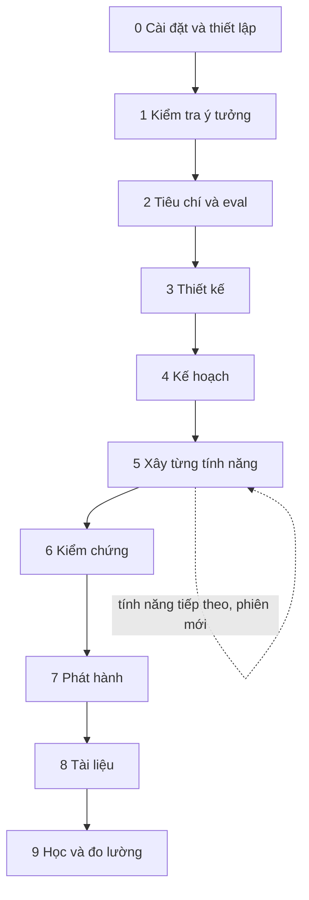
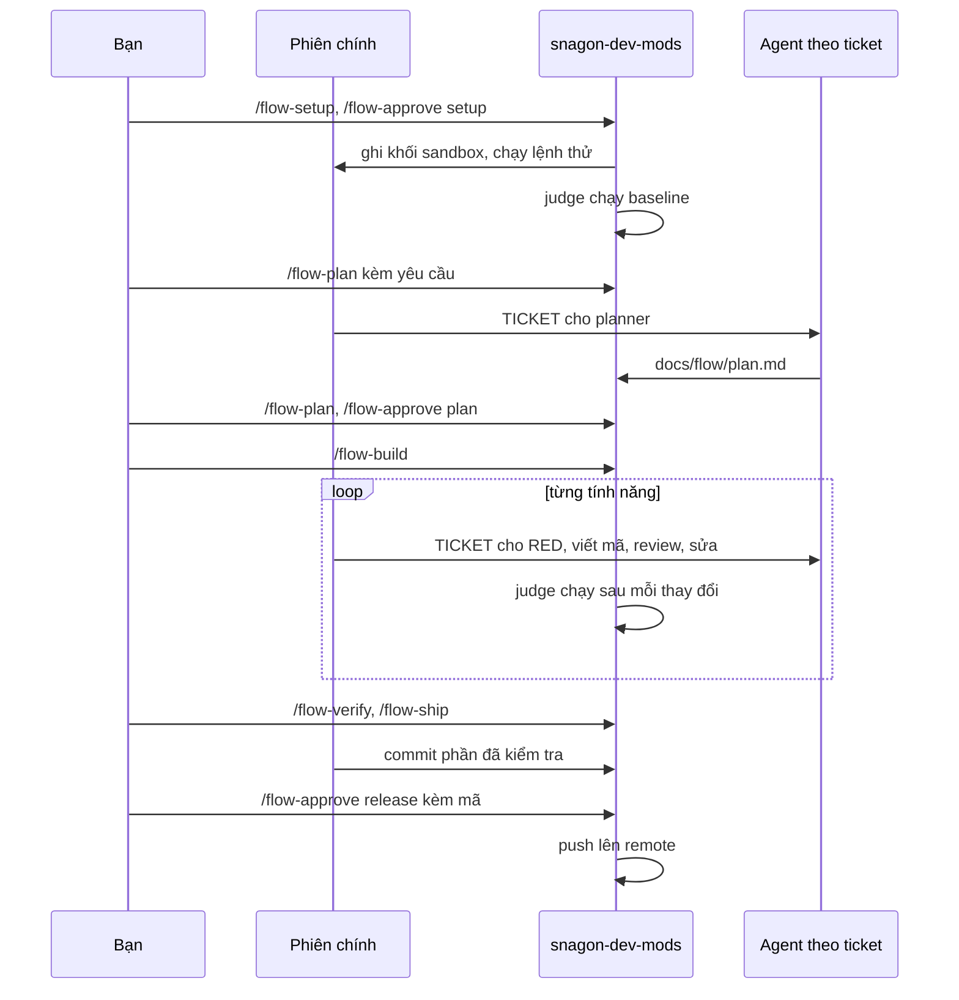

# Quy trình làm việc: ba ví dụ minh họa

Quay lại [README](../../README.vi.md). Tra cứu file: [files.md](files.md). Chi tiết: [guide.md](../guide.md) (tiếng Anh) và [flow.md](../flow.md).

Phần A đưa một dự án từ ý tưởng đến kết quả bằng các skill, agent và lệnh đi kèm; cách này dùng được cho mọi ngôn ngữ. Phần B đi theo một phiên từ đầu đến cuối. Phần C chạy flow trên một dự án TypeScript trên macOS, từ thiết lập tới phát hành, với số liệu thật của một lượt chạy; một dự án Python đi qua đúng các bước đó với lệnh riêng của nó.

Các tên trong ví dụ đều có trong mod. Lệnh được gõ dưới dạng `/<name>` (hiển thị là `/snagon-dev-mods:<name>` khi tên trùng nhau). Skill do mô hình chọn khi phù hợp, hoặc bạn gõ `/<skill-name>`. Agent được dùng khi bạn yêu cầu ("use the planner agent") hoặc khi mô hình tự giao việc; tên đầy đủ là `snagon-dev-mods:<agent>`.

## Phần A: Từ ý tưởng đến kết quả

Dự án là `tiny-ledger`: một CLI theo dõi chi tiêu cá nhân viết bằng Python. Nó đọc các file CSV xuất từ ngân hàng và in tổng theo tháng.



Giữa các phiên, nhật ký, bản bàn giao và memory digest chuyển ngữ cảnh sang phiên sau, nên bạn không phải nhắc lại. Với dự án TypeScript hoặc Python, trên macOS, flow có thể làm thay giai đoạn 4 đến 7; phần C cho thấy cách làm.

### Giai đoạn 0: Cài đặt và thiết lập

| | |
|---|---|
| Mục tiêu | Mod đã được cài và mọi phiên đều biết quy tắc của dự án |
| Bạn gõ | `/plugin install snagon-dev-mods --marketplace phantanphatdgteam-gif/snagon-dev-mods`, rồi `/snagon-setup`, rồi trả lời phần hỏi đáp |
| Harness làm | Xem qua dự án, hỏi tối đa 4 vòng câu hỏi, đưa ra bản nháp, chỉ ghi file sau khi bạn xác nhận, sao lưu mọi file có sẵn |
| Bạn nhận được | `CLAUDE.md` với quy tắc dự án (tiền dùng `Decimal`, không bao giờ đổi số tiền trong `data/`, các lệnh `make test`, `make lint`, `make typecheck`) và `.snagon/CLAUDE.md` với sở thích của bạn |

### Giai đoạn 1: Kiểm tra ý tưởng

| | |
|---|---|
| Mục tiêu | Quyết định xem công cụ có đáng xây không |
| Bạn gõ | "Use product-lens on this idea: a CLI that reads bank CSV exports and prints monthly totals", rồi `/plan-prd` |
| Harness làm | Skill `product-lens` kiểm tra lý do làm và đưa ra bản tóm tắt nên làm hay không. `/plan-prd` viết một PRD gọn, đặt vấn đề lên trước, rồi chuyển tiếp sang `/plan`. Nhật ký và bộ nhớ bắt đầu ghi các quyết định |
| Bạn nhận được | Một bản tóm tắt nên làm hay không và một PRD |

### Giai đoạn 2: Tiêu chí nghiệm thu và eval

| | |
|---|---|
| Mục tiêu | Nói rõ "xong" nghĩa là gì trước khi có bất kỳ dòng mã nào |
| Bạn gõ | "Use intent-driven-development for the monthly report", rồi "Use eval-harness to define the evals" |
| Harness làm | `intent-driven-development` biến thay đổi mơ hồ thành tiêu chí nghiệm thu kiểm chứng được. `eval-harness` định nghĩa các eval về khả năng và hồi quy trước khi viết mã |
| Bạn nhận được | Tiêu chí nghiệm thu và eval. Lưu các quyết định chính bằng `memory_save` (loại `decision`) |

### Giai đoạn 3: Thiết kế

| | |
|---|---|
| Mục tiêu | Chốt cấu trúc và những lựa chọn rủi ro |
| Bạn gõ | "Use the architect agent for the CSV parsing design", rồi "Write ADRs with architecture-decision-records for CSV parsing and money" |
| Harness làm | Agent `architect` đề xuất thiết kế. `architecture-decision-records` viết các ADR trong `docs/adr/` |
| Bạn nhận được | Một bản thiết kế và các ADR cho quyết định về phân tích CSV và về tiền |

### Giai đoạn 4: Kế hoạch

| | |
|---|---|
| Mục tiêu | Một kế hoạch từng bước mà bạn đã duyệt |
| Bạn gõ | `/plan`, rồi xác nhận |
| Harness làm | `/plan` nhắc lại yêu cầu, đánh giá rủi ro, viết kế hoạch từng bước và chờ bạn xác nhận trước khi đụng đến mã. Lệnh tự lập kế hoạch ngay trong phiên; muốn giao cho subagent thì nhờ dùng agent `planner` |
| Bạn nhận được | Một kế hoạch đã xác nhận. Chia công việc thành mỗi phiên một tính năng |

### Giai đoạn 5: Xây từng tính năng

| | |
|---|---|
| Mục tiêu | Một tính năng được xây theo hướng viết test trước |
| Bạn gõ | "Use tdd-workflow to build the monthly report". Khi build hỏng: `/build-fix`. Với câu hỏi bên lề: `/aside ...` |
| Harness làm | `tdd-workflow` dẫn dắt công việc viết test trước (muốn giao cho subagent thì nhờ dùng agent `tdd-guide`). Quy tắc đường dẫn cho Python tự nạp khi đụng đến file `.py`. Cổng yêu cầu nêu sự việc trước lần sửa đầu tiên của mỗi file, lệnh Bash đầu tiên và mỗi lệnh phá hủy. `/build-fix` sửa lỗi build và lỗi kiểu bằng những thay đổi tối thiểu. `/aside` trả lời mà không làm mất nhiệm vụ đang làm |
| Bạn nhận được | Mã chạy được kèm test, và một mục nhật ký cuối phiên |

### Giai đoạn 6: Kiểm chứng

| | |
|---|---|
| Mục tiêu | Biết tính năng đúng trước khi phát hành |
| Bạn gõ | "Run verification-loop", `/test-coverage`, `/code-review`, "Use the python-reviewer and security-reviewer agents", và `/santa-loop` cho đoạn mã xử lý tiền có rủi ro |
| Harness làm | `verification-loop` chạy build, kiểm tra kiểu, lint, test kèm độ phủ, grep bảo mật và rà soát diff, rồi báo PASS hoặc FAIL. `/test-coverage` tìm chỗ thiếu và viết các test còn thiếu. `/code-review` rà soát thay đổi cục bộ từng bước. `/santa-loop` dùng hai người rà soát độc lập, cả hai đều phải duyệt |
| Bạn nhận được | Một báo cáo PASS hoặc FAIL, các test bổ sung và kết quả rà soát |

### Giai đoạn 7: Phát hành

| | |
|---|---|
| Mục tiêu | Thay đổi đã được commit và nằm trong một pull request |
| Bạn gõ | `/prp-commit` (hoặc git thuần), rồi `/pr` |
| Harness làm | Git guard quét những gì commit hoặc push sẽ công bố để tìm bí mật và file riêng tư, và từ chối `--no-verify`. `/prp-commit` tạo commit từ một mô tả thông thường. `/pr` mở pull request trên GitHub |
| Bạn nhận được | Một commit và một pull request. Khi bị từ chối, thông báo nêu tên file và loại bí mật, không bao giờ nêu giá trị |

### Giai đoạn 8: Tài liệu

| | |
|---|---|
| Mục tiêu | Tài liệu khớp với mã |
| Bạn gõ | `/update-docs`, hoặc "Use the doc-updater agent" |
| Harness làm | `/update-docs` đồng bộ tài liệu từ các file nguồn |
| Bạn nhận được | README và tài liệu đã cập nhật |

### Giai đoạn 9: Học và đo lường

| | |
|---|---|
| Mục tiêu | Giữ lại điều bạn đã học và xem nó tốn bao nhiêu |
| Bạn gõ | `memory_save` cho phản hồi và bài học (nhờ Claude lưu), "Use continuous-learning-v2", `/learn`, `/cost-report` |
| Harness làm | `continuous-learning-v2` biến các lần chỉnh sửa, quyết định và bài học thành bộ nhớ dự án. `/learn` biến các mẫu của phiên thành một skill ứng viên. `/cost-report` tóm tắt `.snagon/cost.jsonl` |
| Bạn nhận được | Các mục bộ nhớ, một skill ứng viên và bản tóm tắt chi phí |

### Cách có kết quả tốt nhất với chi phí thấp nhất

Mọi mẹo dưới đây đều là thứ mod hoặc các skill của nó hỗ trợ.

- Chạy `/snagon-setup` trước, để mọi phiên biết quy tắc dự án mà không lặp lại những gì harness đã làm.
- Viết tiêu chí nghiệm thu và eval trước khi viết mã (`intent-driven-development`, `eval-harness`). Xác nhận `/plan` trước khi viết mã.
- Làm một tính năng hoặc một giai đoạn mỗi phiên. Kết thúc bằng một mục nhật ký (nhắc khi dừng sẽ yêu cầu). Bản bàn giao và bộ nhớ sẽ chuyển nó sang phiên sau.
- Tìm trong bộ nhớ (`memory_search`) trước khi quyết định lại. Lưu các chỉnh sửa và quyết định (`memory_save`).
- Nén ngữ cảnh ở ranh giới giữa các giai đoạn, sau khi viết nhật ký (`strategic-compact`; harness gợi ý từ 70% cửa sổ ngữ cảnh). Kiểm tra ngữ cảnh bằng `context-budget` khi phiên trở nên nặng.
- Chọn mô hình có chủ đích: `/model-route`. Chỉ định mô hình rõ ràng cho subagent (harness sẽ nhắc bạn). Xem `cost-aware-claude-pipeline`.
- Viết test trước và kiểm chứng trước khi phát hành (`tdd-workflow`, `verification-loop`). Dùng người rà soát độc lập (`/review-pr`, `/santa-loop`) cho đoạn mã có rủi ro.
- Đọc các thông báo chi phí và `/cost-report`. Bản bàn giao tốn vài cent mỗi lần kết thúc phiên và chỉ chạy khi nhật ký có thay đổi.
- Để cổng làm việc: nêu những sự việc nó yêu cầu, và không bao giờ bỏ qua hook của git.

## Phần B: Một phiên từ đầu đến cuối

Một phiên thực tế trong `tiny-ledger`: thêm tính năng báo cáo theo tháng. Các mốc giờ chỉ mang tính minh họa.


| Thời gian | Điều xảy ra | Bạn thấy gì |
|------|--------------|-------------|
| 09:00 | Bạn khởi động Claude Code trong `tiny-ledger`. Các hook đăng ký công cụ bộ nhớ, kiểm tra sqlite3, và thêm vào ngữ cảnh các hướng dẫn, `.snagon/CLAUDE.md` của bạn, memory digest và bản bàn giao của hôm qua | Không có gì thêm, hoặc một thông báo ngắn nếu thiếu sqlite3 |
| 09:01 | Bạn gõ "Add the monthly report feature". Claude gọi `memory_search` để tìm các quyết định trước đó về báo cáo và tiền | Một lần gọi công cụ `memory_search` với các quyết định trước đó |
| 09:03 | Claude đề xuất một kế hoạch (`/plan`); bạn xác nhận | Một kế hoạch và một câu hỏi xác nhận |
| 09:05 | Lệnh Bash đầu tiên của Claude (chạy test) bị cổng giữ lại một lần; Claude nêu sự việc và thử lại | Một thông báo của cổng, rồi cùng lệnh đó chạy |
| 09:06 | Claude tạo `tests/test_report.py`. Cổng yêu cầu nêu sự việc trước lần tạo đầu tiên; sau đó quy tắc đường dẫn cho Python được nạp một lần | Một thông báo của cổng, rồi file được tạo |
| 09:20 | Test đạt. Claude sửa `src/tiny_ledger/report.py` (lại phải nêu sự việc cho lần sửa đầu tiên của file đó) | Một thông báo của cổng cho file mới, rồi lần sửa |
| 09:35 | Claude chạy `git commit`. Git guard quét các thay đổi đã staged, không thấy bí mật nào, và commit đi qua. Thông báo chi phí có thể hiện sau đó nếu phiên vượt 5 USD | Kết quả commit |
| 09:40 | Claude dừng. Lần dừng bị giữ lại một lần kèm lời nhắc viết nhật ký. Claude viết mục nhật ký (giờ thật, file đã đổi, một dòng quyết định, một dòng bài học, bước tiếp theo) rồi dừng | Một lời nhắc, rồi mục nhật ký, rồi câu trả lời cuối |
| 09:41 | Bạn kết thúc phiên. Tiến trình viết bản bàn giao khởi động ở nền và ghi `.snagon/handoff/<date>.md` khoảng 20 giây sau. Các dòng quyết định và bài học được đưa vào bộ nhớ | Không có gì; dấu nhắc trả về ngay |
| Ngày hôm sau | Phiên mới tự nhận bản bàn giao đó và memory digest | Claude đã biết bạn dừng ở đâu |

## Phần C: Một flow từ thiết lập tới phát hành

Dự án là dự án thử mà các bài eval của flow dùng: một thư viện TypeScript nhỏ có `sum` và `mean`, test bằng vitest, lint bằng eslint, kiểm kiểu bằng tsc, đang ở nhánh `main` và có remote. Lint đã đỏ sẵn trước khi đổi gì (một hàm thừa trong `src/legacy.ts`), nên bước baseline hiện ra. Việc cần làm ghi trong `docs/intent.md`:

```markdown
- F-01: a new module `src/clamp.ts` (new) exporting `clamp(x, lo, hi)` that limits `x` to the range `[lo, hi]`
  and throws a `RangeError` when `lo > hi`; tests in `tests/clamp.test.ts` (new).
- F-02: fix `sum` in `src/sum.ts` so it adds negative numbers too (today it drops them) ...; mark F-02 `Security: yes`.
- F-03: add a new export `median(xs)` to the existing module `src/stats.ts` ...; tests in `tests/stats.test.ts`.
```

Giờ và chi phí trong bảng là của lượt chạy thử 19, một lượt cũ được giữ làm lịch sử (2026-10-18; phiên chính chạy Opus 5.5, planner chạy Opus, các agent khác chạy Sonnet). Lượt đó chạy bản 0.5.2; bản 0.5.3 chỉ đổi cách xử lý khi main không chịu khởi động ticket, và gửi cho main ít lời nhắc ticket hơn. Bản 0.5.4 đổi những gì setup kiểm và những gì judge được làm, không đổi các bước dưới đây; lượt chạy thử của nó (lượt 20 trong `evals/flow/dry-run.md`) phát hành sau 13 phút, tốn 6,61 USD (cả phiên; trong đó 5,49 USD thuộc flow). Bản 0.6.0 thêm một stack thứ hai và đổi nhiều hơn (xem đoạn kế tiếp); lượt 21, lượt đầu tiên chạy mã 0.6.0 trên dự án mẫu này (bước 1 của bản đó, TypeScript), phát hành sau 13 phút, tốn 7,02 USD (cả phiên; trong đó 5,75 USD thuộc flow) trong 16 lượt của phiên chính. Mô hình của phiên chính ở các lượt 20 và 21 không được ghi lại: tiêu đề của bảng trong `dry-run.md` chứa chúng ghi "main on Opus 5.5", nhưng bảng đó đề ngày 2026-10-17, trước các lượt ấy.

Bài đi qua này mang tính TypeScript ở các lệnh và file của nó: script `package.json` (`test`, `lint`, `typecheck`), vitest, eslint, tsc, registry npm mà sandbox phải với tới, và các đường dẫn `src/*.ts`. Một dự án Python (nhận ra bằng `pyproject.toml`, `setup.py`, `setup.cfg`, `requirements*.txt` hoặc `Pipfile`) đi qua đúng các giai đoạn, lệnh và phép duyệt đó; khác nhau ở những gì thiết lập đề xuất, những gì judge chạy và đọc, reviewer, agent sửa build và các miền mạng của sandbox. Thiết lập luôn đề xuất `pytest` của venv (`.venv/bin/pytest`; không có venv thì nó đòi `/flow-setup test="<argv>"`), chỉ đề xuất `ruff check` và `mypy` khi dự án có cấu hình hoặc yêu cầu chúng, và không bao giờ đề xuất build. Một venv thấy các site-packages của hệ thống thì bị từ chối. Judge đọc kết quả của pytest từ báo cáo JUnit của nó. Reviewer là `python-reviewer` và agent sửa build là `tdd-guide`; sandbox với tới PyPI (`pypi.org`, `files.pythonhosted.org`), không phải npm. Nếu khớp nhiều hơn một stack, `/flow-setup stack=<id>` chọn một. Cùng một dự án mẫu ba tính năng có cho cả hai stack (`evals/flow/run.sh fixture <dir> [typescript|python]`). Các lượt chạy thử trên dự án mẫu với phiên chính chạy Haiku đi tới phát hành sau 13 phút, tốn 3,57 USD (TypeScript) và sau 17 phút, tốn 3,44 USD (Python) ngày 2026-10-20, và trên mã của bản phát hành này (2026-10-21) sau 12 phút, tốn 3,09 USD và 3,19 USD (TypeScript; một lượt thứ ba dừng với `couldNotRun` sau `lint`) và sau 13 phút, tốn 2,97 USD (Python); chúng không so được với lượt 19, vốn có phiên chính chạy Opus.



| Giờ | Bạn gõ | Điều xảy ra | Bạn thấy gì |
|------|--------|-------------|-------------|
| 02:51 | `/flow-setup` | Mod tìm ra stack, các script `test`, `lint` và `typecheck`, registry npm mà sandbox cần mở, remote và nhánh | Bản thiết lập trong khung flow, kèm hash8 |
| 02:51 | `/flow-approve setup <hash8>` | Main ghi khối sandbox vào `.claude/settings.local.json` (Claude Code hỏi; bạn cho phép), chạy lệnh thử sandbox, rồi judge chạy baseline | `lint` đỏ, nên flow chờ bạn |
| 02:52 | `/flow-status`, rồi `/flow-approve baseline <hash8>` | `lint` đỏ được nhận theo kiểu "không thêm lỗi mới" | `Đã nhận baseline. Bước tiếp: /flow-plan.` |
| 02:53 | `/flow-plan Build the three features described in docs/intent.md, in that order, exactly as that file says.` | Planner viết `docs/flow/plan.md`: sáu tiêu chí (một Optional), ba tính năng, `Security: yes` ở F-02 | `Planner bắt đầu; flow_status đưa ticket cho agent chính.` |
| 02:54 | `/flow-plan`, rồi `/flow-approve plan <hash8>` | Plan hiện trong khung flow; lệnh duyệt chốt plan và các file của nó | `Đã duyệt kế hoạch: 3 tính năng. Bước tiếp: /flow-build.` |
| 02:55 | `/flow-build` | F-01 (`clamp`): test RED, mã, judge, và review đạt ngay. F-02 (`sum`, có security-reviewer) và F-03 (`median`): mỗi cái cần một lần sửa và một lần xem lại trước khi niêm phong | 13 phút không phải gõ gì |
| 03:08 | `/flow-verify` | Chạy lại mọi lệnh cùng mọi tiêu chí Required, quét rác, viết `docs/flow/verify.md` | Flow chờ `/flow-ship` |
| 03:09 | `/flow-ship` | Main commit phần đã kiểm tra | `Xong thì chạy lại /flow-ship.` |
| 03:10 | `/flow-ship`, rồi `/flow-approve release <hash8> <mã>` | Bản phát hành hiện trên một màn hình kèm mã dùng một lần; lệnh duyệt kiểm lại tất cả và mod tự push | `Đã phát hành … Flow đã xong.` |

Ở lượt chạy thử 19, cả flow mất 19 phút và 9,18 USD trong 26 lượt của phiên chính: thiết lập 0,21, plan 0,89, F-01 1,26, F-02 2,81, F-03 2,70, kiểm tra 0,31, phát hành khoảng 1 (lấy từ nhật ký chi phí riêng của lượt đó; repository chỉ giữ các tổng, trong `evals/flow/dry-run.md`). Không lần nào bị chặn, không có miễn trừ nào. Script đóng vai Chủ dự án gõ 14 lệnh; hai lệnh là gõ lặp trong lúc chờ, nên bảng chỉ ghi mười hai lệnh bạn cần. Flow có tất cả mười ba lệnh của Chủ dự án; lượt này không cần `/flow-decide`, `/flow-retry`, `/flow-waive`, `/flow-allow`, `/flow-reject` hay `/flow-off`.

Sau flow, dự án có: mã và test mới, `docs/flow/plan.md` và `docs/flow/verify.md`, tất cả nằm trong commit phát hành trên remote. Khối sandbox vẫn ở `.claude/settings.local.json`; commit phát hành không chứa file đó. Bản ghi flow trong `~/.snagon/flow/` bị xóa khi flow kết thúc; dấu kết thúc và các bản xem trong `.snagon/flow/` ở lại làm lịch sử.

### Làm sao để một flow rẻ và gọn

- Viết yêu cầu vào file và giữ tính năng nhỏ. Mỗi lần sửa kèm một lượt xem lại tốn khoảng 1 đến 1,5 USD, nên yêu cầu càng rõ thì càng rẻ.
- Nói rõ cái gì là mới. "Giữ test cũ xanh" đã là điều kiện xong của mọi tính năng, không cần thành tiêu chí.
- Đưa trình định dạng vào lệnh lint đã duyệt (ví dụ `prettier --check`), để hook pre-commit không còn gì để viết lại lúc phát hành và bạn không phải kiểm lại.
- Xem dòng chi phí trên thẻ flow. Từ 2026-10-20 flow chỉ đo và hiện chi phí (của phiên và của flow); nó không có trần chi phí. Thứ dừng một flow cứ thất bại là số vòng theo từng phạm vi: một tính năng 3 vòng sửa, 3 vòng review và 4 vòng debug, plan 3 vòng sửa, bước kiểm tra 2 vòng sửa và 3 vòng debug, và `/flow-retry` thêm một bộ vòng nữa, một lần (với một tính năng: 1 vòng sửa, 1 vòng review và 2 vòng debug). Các thông báo chi phí ở 5, 10 và 50 USD đến từ harness trong mọi phiên, có flow hay không; chúng không dừng gì.
- Khi một ticket debug không đưa được tính năng về xanh vì test RED của nó sai, `/flow-allow red F-NN <reason>` cho một ticket debug của tính năng đó sửa file test RED (chỉ trong lúc F-NN đang được xây, sau khi các test RED của nó đã được ghi). Bạn duyệt bằng `/flow-approve allow <hash8>`, lệnh này cũng gỡ chặn các vòng debug của tính năng đó mà không cần `/flow-retry`; thay đổi vẫn quay lại thành finding `red-test-changed` để bạn đọc và miễn trừ.
- Khi flow bị chặn, đọc lý do trước khi chọn lối ra: miễn trừ là quyết định của bạn, được ghi vào báo cáo kiểm tra cùng lý do bạn nêu.
