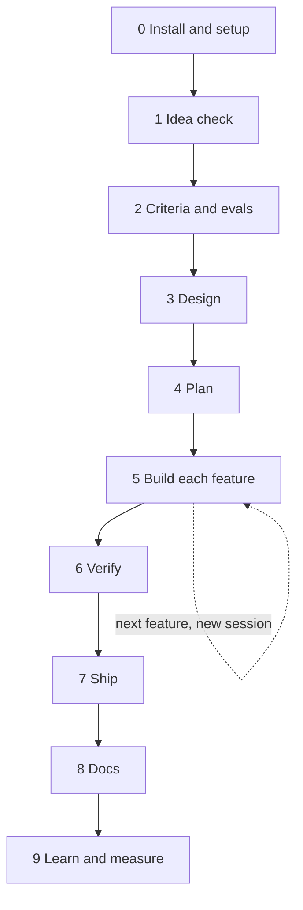
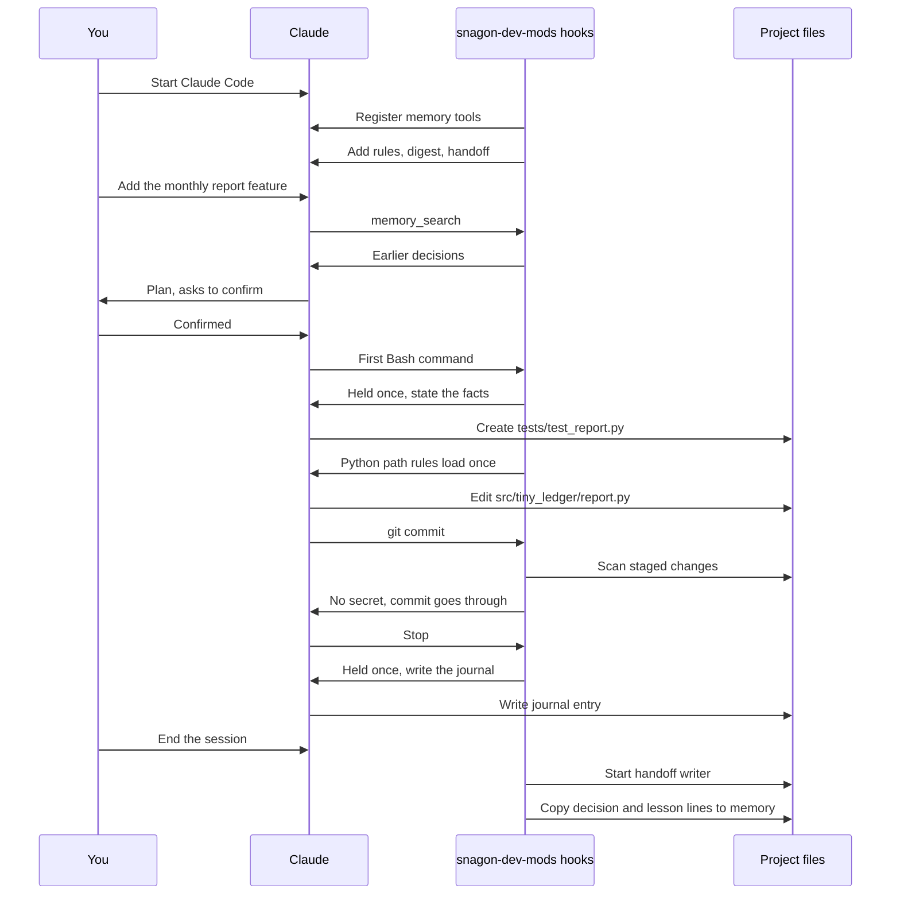

# Workflow: two worked examples

Back to the [README](../README.md). File reference: [files.md](files.md). Details: [guide.md](guide.md).

Names in the examples exist in the mod. Commands are typed as `/<name>` (shown as `/snagon-dev-mods:<name>` when names clash). Skills are picked by the model when relevant, or you type `/<skill-name>`. Agents are used when you ask ("use the planner agent") or when the model delegates; the full name is `snagon-dev-mods:<agent>`.

## Part A: From idea to result

The project is `tiny-ledger`: a personal expense tracker CLI in Python. It reads bank CSV exports and prints monthly totals.

Between sessions the journal, the handoff and the memory digest carry the context to the next session, so you do not repeat yourself.

### Phase 0: Install and setup

| | |
|---|---|
| Goal | The mod is installed and every session knows the project rules |
| You type | `/plugin install snagon-dev-mods --marketplace phantanphatdgteam-gif/snagon-dev-mods`, then `/snagon-setup`, then answer the interview |
| The harness does | Looks at the project, asks up to 4 rounds of questions, shows a draft, writes files only after you confirm, backs up any existing file |
| You get | `CLAUDE.md` with project rules (money is `Decimal`, never change amounts in `data/`, commands `make test`, `make lint`, `make typecheck`) and `.snagon/CLAUDE.md` with your preferences |

### Phase 1: Idea check

| | |
|---|---|
| Goal | Decide whether the tool is worth building |
| You type | "Use product-lens on this idea: a CLI that reads bank CSV exports and prints monthly totals", then `/plan-prd` |
| The harness does | The `product-lens` skill checks the why and gives a go or no-go brief. `/plan-prd` writes a lean, problem-first PRD and hands off to `/plan`. The journal and memory start recording decisions |
| You get | A go or no-go brief and a PRD |

### Phase 2: Acceptance criteria and evals

| | |
|---|---|
| Goal | Say what "done" means before any code exists |
| You type | "Use intent-driven-development for the monthly report", then "Use eval-harness to define the evals" |
| The harness does | `intent-driven-development` turns the vague change into verifiable acceptance criteria. `eval-harness` defines capability and regression evals before coding |
| You get | Acceptance criteria and evals. Save the key decisions with `memory_save` (kind `decision`) |

### Phase 3: Design

| | |
|---|---|
| Goal | Fix the structure and the risky choices |
| You type | "Use the architect agent for the CSV parsing design", then "Write ADRs with architecture-decision-records for CSV parsing and money" |
| The harness does | The `architect` agent proposes the design. `architecture-decision-records` writes ADRs in `docs/adr/` |
| You get | A design and ADRs for the CSV parsing and money decisions |

### Phase 4: Plan

| | |
|---|---|
| Goal | A step-by-step plan you have approved |
| You type | `/plan`, then confirm |
| The harness does | `/plan` (the `planner` agent) restates requirements, assesses risks, writes a step-by-step plan and waits for your confirmation before touching code |
| You get | A confirmed plan. Split the work into one feature per session |

### Phase 5: Build each feature

| | |
|---|---|
| Goal | One feature built test first |
| You type | "Use tdd-workflow to build the monthly report". When the build breaks: `/build-fix`. For a side question: `/aside ...` |
| The harness does | `tdd-workflow` (the `tdd-guide` agent) drives test-first work. Python path rules load by themselves when `.py` files are touched. The gate asks for facts before the first edit of each file, the first Bash command and each destructive command. `/build-fix` fixes build and type errors with minimal changes. `/aside` answers without losing the task |
| You get | Working code with tests, and a journal entry at the end of the session |

### Phase 6: Verify

| | |
|---|---|
| Goal | Know the feature is correct before shipping |
| You type | "Run verification-loop", `/test-coverage`, `/code-review`, "Use the python-reviewer and security-reviewer agents", and `/santa-loop` for the risky money code |
| The harness does | `verification-loop` runs build, types, lint, tests with coverage, a security grep and a diff review, and reports PASS or FAIL. `/test-coverage` finds gaps and writes missing tests. `/code-review` reviews local changes step by step. `/santa-loop` uses two independent reviewers who must both approve |
| You get | A PASS or FAIL report, extra tests and review findings |

### Phase 7: Ship

| | |
|---|---|
| Goal | The change is committed and in a pull request |
| You type | `/prp-commit` (or plain git), then `/pr` |
| The harness does | The git guard scans what the commit or push would publish for secrets and private files, and refuses `--no-verify`. `/prp-commit` makes a commit from a plain description. `/pr` opens the GitHub pull request |
| You get | A commit and a pull request. A refusal names the file and the kind of secret, never the value |

### Phase 8: Docs

| | |
|---|---|
| Goal | Docs that match the code |
| You type | `/update-docs`, or "Use the doc-updater agent" |
| The harness does | `/update-docs` syncs docs from source files |
| You get | Updated README and docs |

### Phase 9: Learn and measure

| | |
|---|---|
| Goal | Keep what you learned and see what it cost |
| You type | `memory_save` for feedback and lessons (ask Claude to save them), "Use continuous-learning-v2", `/learn`, `/cost-report` |
| The harness does | `continuous-learning-v2` turns corrections, decisions and lessons into project memory. `/learn` turns session patterns into a candidate skill. `/cost-report` summarizes `.snagon/cost.jsonl` |
| You get | Memory entries, a candidate skill and a cost summary |

### How to get the best result for the least cost

Every tip below is something the mod or its skills support.

- Run `/snagon-setup` first, so every session knows the project rules without repeating the harness.
- Write acceptance criteria and evals before code (`intent-driven-development`, `eval-harness`). Confirm the `/plan` before code.
- Do one feature or phase per session. Finish with a journal entry (the stop reminder asks for it). The handoff and memory carry it over.
- Search memory (`memory_search`) before re-deciding. Save corrections and decisions (`memory_save`).
- Compact at phase boundaries, after writing the journal (`strategic-compact`; the harness suggests it from 70% of the context window). Audit the context with `context-budget` when sessions get heavy.
- Choose models deliberately: `/model-route`. Give subagents an explicit model (the harness reminds you). See `cost-aware-claude-pipeline`.
- Test first and verify before shipping (`tdd-workflow`, `verification-loop`). Use independent reviewers (`/review-pr`, `/santa-loop`) for risky code.
- Read the cost notices and `/cost-report`. The handoff costs a few cents per session end and runs only when the journal changed.
- Let the gate work: state the facts it asks for, and never bypass git hooks.

## Part B: One session from start to end

A realistic session in `tiny-ledger`: adding the monthly report feature. Times are illustrative.

| Time | What happens | What you see |
|------|--------------|--------------|
| 09:00 | You start Claude Code in `tiny-ledger`. The hooks register the memory tools, check sqlite3, and add the instructions, your `.snagon/CLAUDE.md`, the memory digest and yesterday's handoff to the context | Nothing extra, or a short notice if sqlite3 is missing |
| 09:01 | You type "Add the monthly report feature". Claude calls `memory_search` for earlier decisions about reports and money | A `memory_search` tool call with earlier decisions |
| 09:03 | Claude proposes a plan (`/plan`); you confirm | A plan and a question to confirm |
| 09:05 | Claude's first Bash command (running the tests) is held once by the gate; Claude states the facts and retries | A gate message, then the same command runs |
| 09:06 | Claude creates `tests/test_report.py`. The gate asks for facts before the first creation; after it, the Python path rules load once | A gate message, then the file is created |
| 09:20 | Tests pass. Claude edits `src/tiny_ledger/report.py` (first-edit facts again for that file) | A gate message for the new file, then the edit |
| 09:35 | Claude runs `git commit`. The git guard scans the staged changes, finds no secret, and the commit goes through. A cost notice may appear later if the session passes 5 USD | The commit result |
| 09:40 | Claude stops. The stop is held once with the journal reminder. Claude writes the journal entry (real time, files changed, a decision line, a lesson line, next step) and stops | A reminder, then the journal entry, then the final reply |
| 09:41 | You end the session. The handoff writer starts in the background and writes `.snagon/handoff/<date>.md` about 20 seconds later. The decision and lesson lines go into memory | Nothing; the prompt returns at once |
| Next day | The new session gets that handoff and the memory digest by itself | Claude already knows where you stopped |
