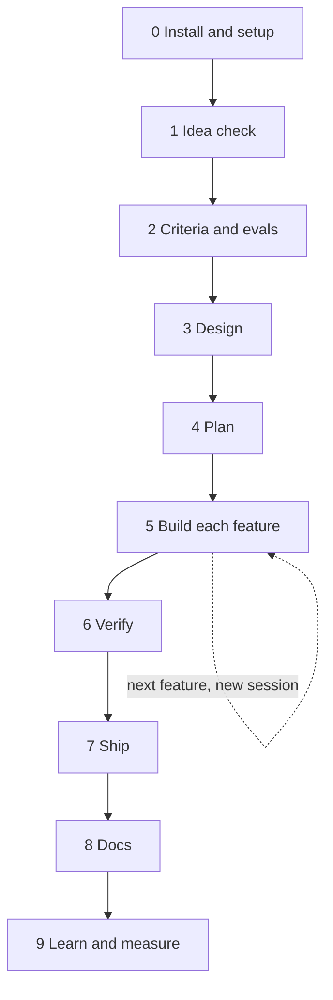
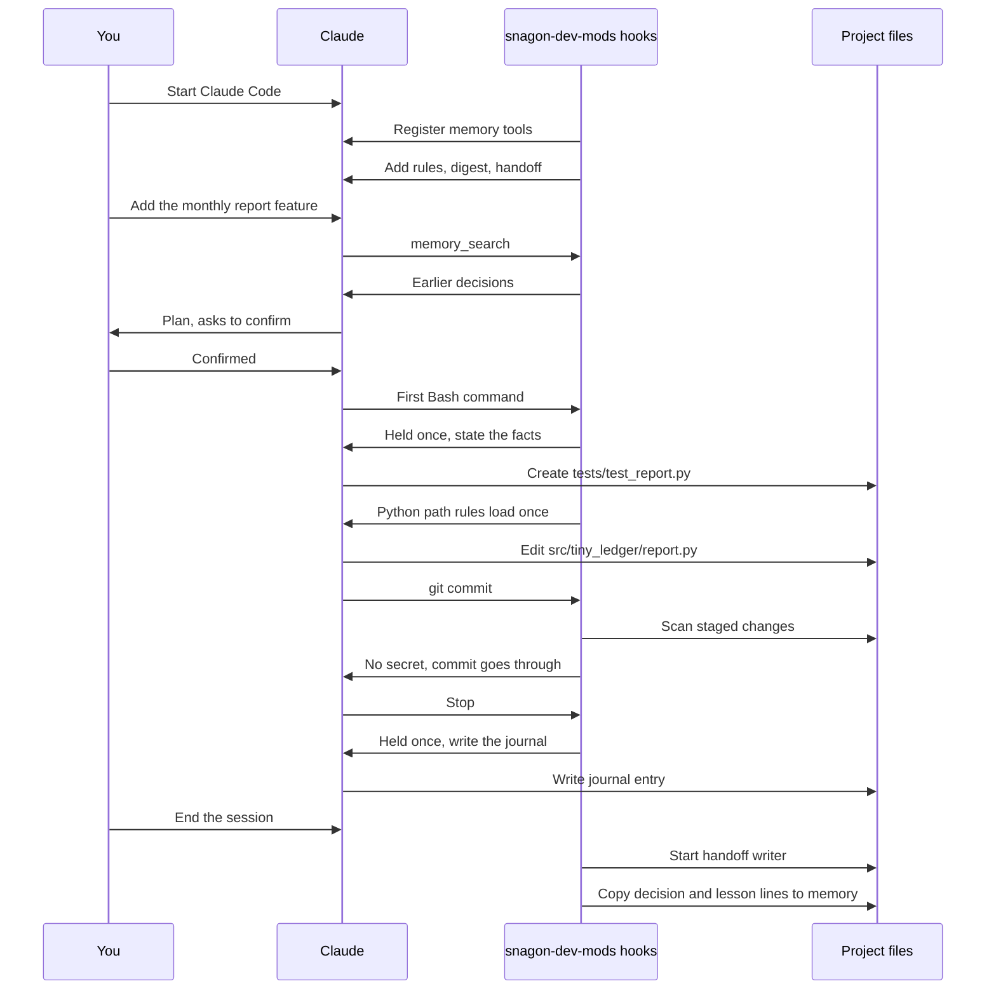
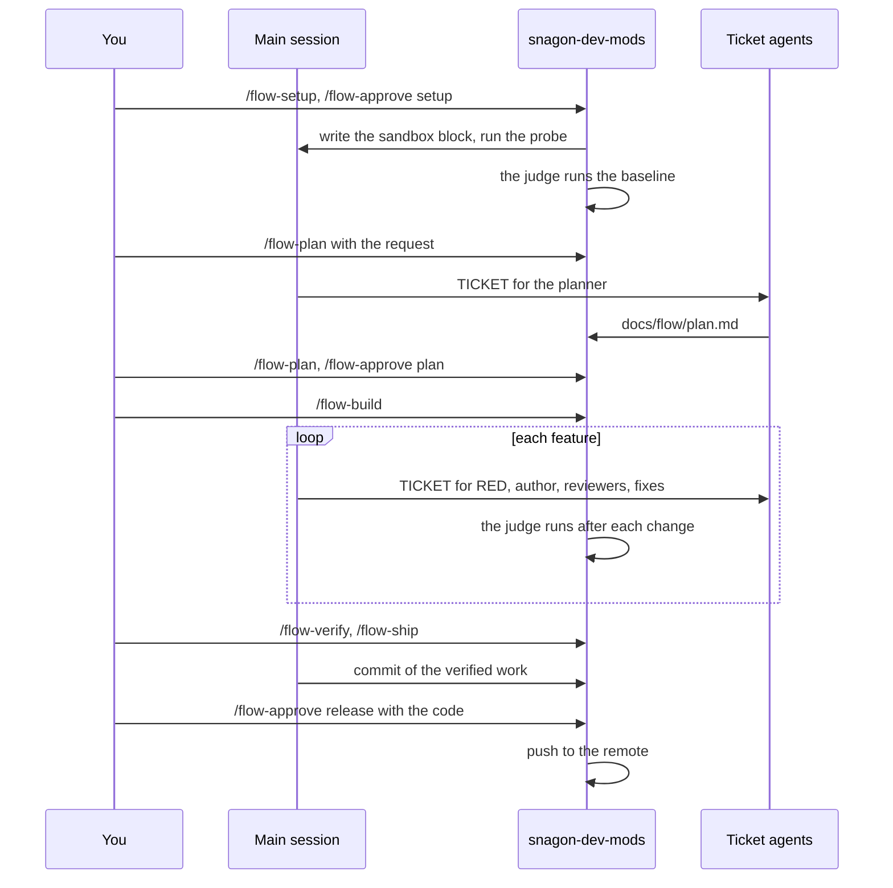

# Workflow: three worked examples

Back to the [README](../README.md). File reference: [files.md](files.md). Details: [guide.md](guide.md).

Part A takes a project from idea to result with the bundled skills, agents and commands; it works for any language. Part B follows one session from start to end. Part C runs the flow on a TypeScript project on macOS, from setup to release, with the real numbers of one run; a Python project goes through the same steps with its own commands.

Names in the examples exist in the mod. Commands are typed as `/<name>` (shown as `/snagon-dev-mods:<name>` when names clash). Skills are picked by the model when relevant, or you type `/<skill-name>`. Agents are used when you ask ("use the planner agent") or when the model delegates; the full name is `snagon-dev-mods:<agent>`.

## Part A: From idea to result

The project is `tiny-ledger`: a personal expense tracker CLI in Python. It reads bank CSV exports and prints monthly totals.



Between sessions the journal, the handoff and the memory digest carry the context to the next session, so you do not repeat yourself. On a TypeScript or Python project, on macOS, the flow can take phases 4 to 7 off your hands; Part C shows how.

### Phase 0: Install and setup

| | |
|---|---|
| Goal | The mod is installed and every session knows the project rules |
| You type | `/plugin install snagon-dev-mods --marketplace phantanphatdgteam-gif/snagon-dev-mods`, then `/snagon-setup`, then answer the interview |
| The harness does | Looks at the project, asks up to 4 rounds of questions, shows a draft, writes files only after you confirm, backs up any existing file |
| You get | `CLAUDE.md` with project rules (money is `Decimal`, never change amounts in `data/`, commands `make test`, `make lint`, `make typecheck`) and `.snagon/CLAUDE.md` with your preferences |

### Phase 1: Idea check

| | |
|---|---|
| Goal | Decide whether the tool is worth building |
| You type | "Use product-lens on this idea: a CLI that reads bank CSV exports and prints monthly totals", then `/plan-prd` |
| The harness does | The `product-lens` skill checks the why and gives a go or no-go brief. `/plan-prd` writes a lean, problem-first PRD and hands off to `/plan`. The journal and memory start recording decisions |
| You get | A go or no-go brief and a PRD |

### Phase 2: Acceptance criteria and evals

| | |
|---|---|
| Goal | Say what "done" means before any code exists |
| You type | "Use intent-driven-development for the monthly report", then "Use eval-harness to define the evals" |
| The harness does | `intent-driven-development` turns the vague change into verifiable acceptance criteria. `eval-harness` defines capability and regression evals before coding |
| You get | Acceptance criteria and evals. Save the key decisions with `memory_save` (kind `decision`) |

### Phase 3: Design

| | |
|---|---|
| Goal | Fix the structure and the risky choices |
| You type | "Use the architect agent for the CSV parsing design", then "Write ADRs with architecture-decision-records for CSV parsing and money" |
| The harness does | The `architect` agent proposes the design. `architecture-decision-records` writes ADRs in `docs/adr/` |
| You get | A design and ADRs for the CSV parsing and money decisions |

### Phase 4: Plan

| | |
|---|---|
| Goal | A step-by-step plan you have approved |
| You type | `/plan`, then confirm |
| The harness does | `/plan` restates requirements, assesses risks, writes a step-by-step plan and waits for your confirmation before touching code. It plans in the session; ask for the `planner` agent if you want a subagent to plan |
| You get | A confirmed plan. Split the work into one feature per session |

### Phase 5: Build each feature

| | |
|---|---|
| Goal | One feature built test first |
| You type | "Use tdd-workflow to build the monthly report". When the build breaks: `/build-fix`. For a side question: `/aside ...` |
| The harness does | `tdd-workflow` drives test-first work (ask for the `tdd-guide` agent to hand it to a subagent). Python path rules load by themselves when `.py` files are touched. The gate asks for facts before the first edit of each file, the first Bash command and each destructive command. `/build-fix` fixes build and type errors with minimal changes. `/aside` answers without losing the task |
| You get | Working code with tests, and a journal entry at the end of the session |

### Phase 6: Verify

| | |
|---|---|
| Goal | Know the feature is correct before shipping |
| You type | "Run verification-loop", `/test-coverage`, `/code-review`, "Use the python-reviewer and security-reviewer agents", and `/santa-loop` for the risky money code |
| The harness does | `verification-loop` runs build, types, lint, tests with coverage, a security grep and a diff review, and reports PASS or FAIL. `/test-coverage` finds gaps and writes missing tests. `/code-review` reviews local changes step by step. `/santa-loop` uses two independent reviewers who must both approve |
| You get | A PASS or FAIL report, extra tests and review findings |

### Phase 7: Ship

| | |
|---|---|
| Goal | The change is committed and in a pull request |
| You type | `/prp-commit` (or plain git), then `/pr` |
| The harness does | The git guard scans what the commit or push would publish for secrets and private files, and refuses `--no-verify`. `/prp-commit` makes a commit from a plain description. `/pr` opens the GitHub pull request |
| You get | A commit and a pull request. A refusal names the file and the kind of secret, never the value |

### Phase 8: Docs

| | |
|---|---|
| Goal | Docs that match the code |
| You type | `/update-docs`, or "Use the doc-updater agent" |
| The harness does | `/update-docs` syncs docs from source files |
| You get | Updated README and docs |

### Phase 9: Learn and measure

| | |
|---|---|
| Goal | Keep what you learned and see what it cost |
| You type | `memory_save` for feedback and lessons (ask Claude to save them), "Use continuous-learning-v2", `/learn`, `/cost-report` |
| The harness does | `continuous-learning-v2` turns corrections, decisions and lessons into project memory. `/learn` turns session patterns into a candidate skill. `/cost-report` summarizes `.snagon/cost.jsonl` |
| You get | Memory entries, a candidate skill and a cost summary |

### How to get the best result for the least cost

Every tip below is something the mod or its skills support.

- Run `/snagon-setup` first, so every session knows the project rules without repeating the harness.
- Write acceptance criteria and evals before code (`intent-driven-development`, `eval-harness`). Confirm the `/plan` before code.
- Do one feature or phase per session. Finish with a journal entry (the stop reminder asks for it). The handoff and memory carry it over.
- Search memory (`memory_search`) before re-deciding. Save corrections and decisions (`memory_save`).
- Compact at phase boundaries, after writing the journal (`strategic-compact`; the harness suggests it from 70% of the context window). Audit the context with `context-budget` when sessions get heavy.
- Choose models deliberately: `/model-route`. Give subagents an explicit model (the harness reminds you). See `cost-aware-claude-pipeline`.
- Test first and verify before shipping (`tdd-workflow`, `verification-loop`). Use independent reviewers (`/review-pr`, `/santa-loop`) for risky code.
- Read the cost notices and `/cost-report`. The handoff costs a few cents per session end and runs only when the journal changed.
- Let the gate work: state the facts it asks for, and never bypass git hooks.

## Part B: One session from start to end

A realistic session in `tiny-ledger`: adding the monthly report feature. Times are illustrative.



| Time | What happens | What you see |
|------|--------------|--------------|
| 09:00 | You start Claude Code in `tiny-ledger`. The hooks register the memory tools, check sqlite3, and add the instructions, your `.snagon/CLAUDE.md`, the memory digest and yesterday's handoff to the context | Nothing extra, or a short notice if sqlite3 is missing |
| 09:01 | You type "Add the monthly report feature". Claude calls `memory_search` for earlier decisions about reports and money | A `memory_search` tool call with earlier decisions |
| 09:03 | Claude proposes a plan (`/plan`); you confirm | A plan and a question to confirm |
| 09:05 | Claude's first Bash command (running the tests) is held once by the gate; Claude states the facts and retries | A gate message, then the same command runs |
| 09:06 | Claude creates `tests/test_report.py`. The gate asks for facts before the first creation; after it, the Python path rules load once | A gate message, then the file is created |
| 09:20 | Tests pass. Claude edits `src/tiny_ledger/report.py` (first-edit facts again for that file) | A gate message for the new file, then the edit |
| 09:35 | Claude runs `git commit`. The git guard scans the staged changes, finds no secret, and the commit goes through. A cost notice may appear later if the session passes 5 USD | The commit result |
| 09:40 | Claude stops. The stop is held once with the journal reminder. Claude writes the journal entry (real time, files changed, a decision line, a lesson line, next step) and stops | A reminder, then the journal entry, then the final reply |
| 09:41 | You end the session. The handoff writer starts in the background and writes `.snagon/handoff/<date>.md` about 20 seconds later. The decision and lesson lines go into memory | Nothing; the prompt returns at once |
| Next day | The new session gets that handoff and the memory digest by itself | Claude already knows where you stopped |

## Part C: One flow from setup to release

The project is the one the flow evals use: a small TypeScript library with `sum` and `mean`, tested with vitest, linted with eslint, typed with tsc, on branch `main` with a remote. Its lint is already red before any change (an unused helper in `src/legacy.ts`), so the baseline step shows up. What to build is written in `docs/intent.md`:

```markdown
- F-01: a new module `src/clamp.ts` (new) exporting `clamp(x, lo, hi)` that limits `x` to the range `[lo, hi]`
  and throws a `RangeError` when `lo > hi`; tests in `tests/clamp.test.ts` (new).
- F-02: fix `sum` in `src/sum.ts` so it adds negative numbers too (today it drops them) ...; mark F-02 `Security: yes`.
- F-03: add a new export `median(xs)` to the existing module `src/stats.ts` ...; tests in `tests/stats.test.ts`.
```

The times and costs in the table are dry run 19, an older run kept as history (2026-10-18; main on Opus 5.5, the planner on Opus, the other agents on Sonnet). It ran 0.5.2; 0.5.3 changed only what happens when main will not start a ticket, and it sends main fewer ticket prompts. 0.5.4 changed what setup checks and what the judge may do, not these steps; its dry run (run 20 in `evals/flow/dry-run.md`) released in 13 minutes for $6.61 (session; $5.49 of it in the flow). Release 0.6.0 adds a second stack and changes more (see the next paragraph); run 21, the first run of 0.6.0 code on this fixture (step 1 of that release, TypeScript), released in 13 minutes for $7.02 (session; $5.75 in the flow) in 16 main turns. The main model of runs 20 and 21 is not recorded: the heading of the `dry-run.md` table that holds them says "main on Opus 5.5", but it is dated 2026-10-17, before those runs.

This walk-through is TypeScript-specific in its commands and files: `package.json` scripts (`test`, `lint`, `typecheck`), vitest, eslint, tsc, the npm registry that the sandbox must reach, and `src/*.ts` paths. A Python project (found by `pyproject.toml`, `setup.py`, `setup.cfg`, `requirements*.txt` or `Pipfile`) goes through the same phases, commands and approvals; what setup proposes, what the judge runs and reads, the reviewer, the build fixer and the sandbox's network domains differ. Setup always proposes the venv's `pytest` (`.venv/bin/pytest`; without one it asks for `/flow-setup test="<argv>"`), proposes `ruff check` and `mypy` only when the project configures or requires them, and never proposes a build. A venv that sees the system site-packages is refused. The judge reads pytest's results from its JUnit report. The reviewer is `python-reviewer` and the build fixer is `tdd-guide`; the sandbox reaches PyPI (`pypi.org`, `files.pythonhosted.org`), not npm. If more than one stack matches, `/flow-setup stack=<id>` picks one. The same three-feature fixture exists for both stacks (`evals/flow/run.sh fixture <dir> [typescript|python]`). Fixture dry runs with the main on Haiku ran to the release in 13 minutes for $3.57 (TypeScript) and in 17 minutes for $3.44 (Python) on 2026-10-20, and on the code of this release (2026-10-21) in 12 minutes for $3.09 and $3.19 (TypeScript; a third run stopped with `couldNotRun` after `lint`) and in 13 minutes for $2.97 (Python); they are not comparable with run 19, whose main ran on Opus.



| Time | You type | What happens | What you see |
|------|----------|--------------|--------------|
| 02:51 | `/flow-setup` | The mod finds the stack, the `test`, `lint` and `typecheck` scripts, the npm registry the sandbox must reach, the remote and the branch | The setup in the pane, with its hash8 |
| 02:51 | `/flow-approve setup <hash8>` | Main writes the sandbox block into `.claude/settings.local.json` (Claude Code asks; you allow it), runs the probe, and the judge runs the baseline | `lint` is red, so the flow waits for you |
| 02:52 | `/flow-status`, then `/flow-approve baseline <hash8>` | The red `lint` is accepted as "no new failures" | `Baseline accepted. Next: /flow-plan.` |
| 02:53 | `/flow-plan Build the three features described in docs/intent.md, in that order, exactly as that file says.` | The planner writes `docs/flow/plan.md`: six criteria (one Optional), three features, `Security: yes` on F-02 | `The planner starts now; flow_status gives main its ticket.` |
| 02:54 | `/flow-plan`, then `/flow-approve plan <hash8>` | The plan shows in the pane; the approval freezes the plan and its files | `Plan approved: 3 features. Next: /flow-build.` |
| 02:55 | `/flow-build` | F-01 (`clamp`): RED tests, code, judge, and a review that passed at once. F-02 (`sum`, with the security reviewer) and F-03 (`median`): each needed one fix and one second look before its seal | Nothing to type for 13 minutes |
| 03:08 | `/flow-verify` | Every command again with every Required criterion, the junk scan, and `docs/flow/verify.md` | The flow waits for `/flow-ship` |
| 03:09 | `/flow-ship` | Main commits the verified work | `Run /flow-ship again when it is done.` |
| 03:10 | `/flow-ship`, then `/flow-approve release <hash8> <code>` | The release shows on one screen with its one-time code; the approval checks it all again and the mod pushes | `Released … The flow is done.` |

In dry run 19 the whole flow took 19 minutes and 9.18 USD in 26 main turns: setup 0.21, plan 0.89, F-01 1.26, F-02 2.81, F-03 2.70, verify 0.31, and about 1 for the release (from that run's own cost log; the repository keeps only the totals, in `evals/flow/dry-run.md`). Nothing blocked and nothing was waived. The script that played the owner typed 14 commands; two were repeats sent while it waited, so the table shows the twelve you need. The flow has thirteen owner commands in all; this run needed no `/flow-decide`, `/flow-retry`, `/flow-waive`, `/flow-allow`, `/flow-reject` or `/flow-off`.

What the project has afterwards: the new code and tests, and `docs/flow/plan.md` and `docs/flow/verify.md`, all in the release commit on the remote. The sandbox block stays in `.claude/settings.local.json`; the release commit leaves that file out. The flow record in `~/.snagon/flow/` is deleted at the end; its end marker and the views in `.snagon/flow/` stay as history.

### How to get a cheap, clean flow

- Write the request in a file and keep features small. Each fix with its second look costs about 1 to 1.5 USD, so a precise request is the cheapest one.
- Say what is new. "Keep the existing tests green" is already part of done for every feature; it does not need a criterion.
- Put your formatter in the approved lint command (for example `prettier --check`), so a pre-commit hook has nothing to rewrite at release time and you are not asked to verify again.
- Read the card's cost line. Since 2026-10-20 the flow only measures and shows spend (session and flow); it has no cost cap. What stops a flow that keeps failing is the rounds per scope: a feature gets 3 edit, 3 review and 4 debug rounds, the plan 3 edit rounds, the verify step 2 edit and 3 debug rounds, and `/flow-retry` adds one more set of rounds, once (for a feature: 1 edit, 1 review and 2 debug rounds). The cost notices at 5, 10 and 50 USD come from the harness in every session, flow or not; they stop nothing.
- When a debug ticket cannot get a feature green because its RED test is wrong, `/flow-allow red F-NN <reason>` lets one debug ticket of that feature edit the RED test file (only while F-NN is being built, after its RED tests are recorded). You approve it with `/flow-approve allow <hash8>`, which also releases a block on that feature's debug rounds without `/flow-retry`; the change still comes back as a `red-test-changed` finding for you to read and waive.
- When the flow blocks, read the cause before you pick an exit: a waiver is your decision, recorded in the verify report with your reason.
